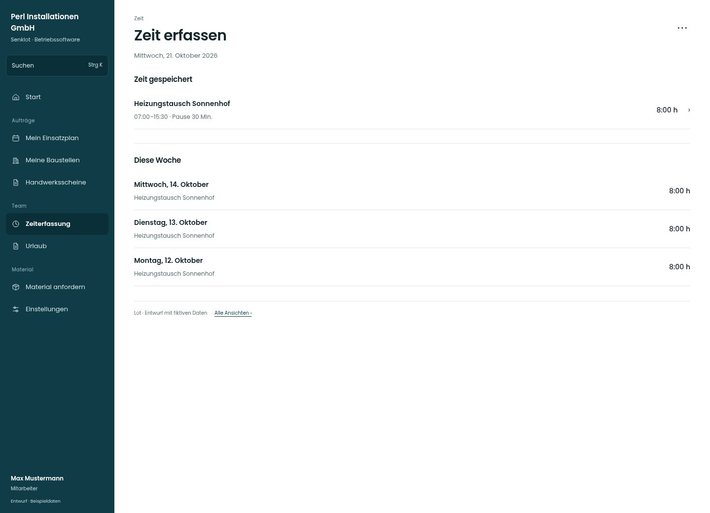

# Zeit erfassen

[Zur Übersicht](../README.md) · [Bereich: Zeit](../bereiche/zeit.md)

**Zeit · Mitarbeiter · /time · gespeichert**

Gestaltungsentwurf mit fiktiven Beispieldaten. Aktionen und Datenänderungen sind lokal simuliert, ohne Backend.

[Desktop](../bilder/104-zeit-gespeichert-desktop.jpg) · [Tablet](../bilder/104-zeit-gespeichert-tablet.jpg) · [Mobil](../bilder/104-zeit-gespeichert-mobil.jpg)

## Aufbau

Erfolg und konkreter gebuchter Eintrag genügen; wartende Offlineübertragung darf diesen Zustand nicht vortäuschen.

## Vorhandene Funktionen für die spätere Umsetzung erhalten

- Nur tatsächlichen Servererfolg als gespeichert anzeigen
- Offline separat als wartet kennzeichnen

## Aktionen

- Weitere Zeit erfassen

## Quellen

Quellstand: `3e49090`.
- [src/features/time/TimeView.tsx](https://github.com/juliandeutsch22/Prototype-App-Installateure/blob/3e49090d4054ebbd3ecbce6ab583bb944c2c0770/src/features/time/TimeView.tsx)

Die Screens zeigen die vorgesehenen Bedienwege. Reale Speicherung, vollständige Rollenprüfung, Berechnungen, Exporte, Benachrichtigungen und Integrationen müssen bei einer Umsetzung gegen die App geprüft werden.
