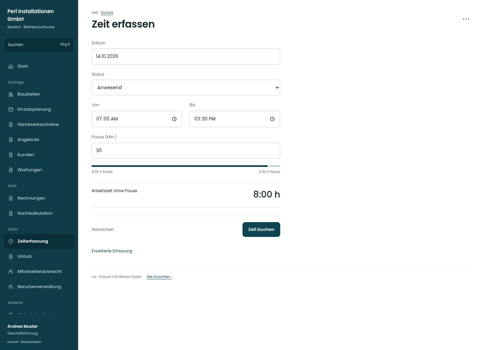

# Zeit erfassen

[Zur Übersicht](../README.md) · [Bereich: Zeit](../bereiche/zeit.md)

**Zeit · Geschäftsführung · /time · Leitung**

Gestaltungsentwurf mit fiktiven Beispieldaten. Aktionen und Datenänderungen sind lokal simuliert, ohne Backend.

[Desktop](../bilder/202-zeit-leitung-desktop.jpg) · [Tablet](../bilder/202-zeit-leitung-tablet.jpg) · [Mobil](../bilder/202-zeit-leitung-mobil.jpg)

## Aufbau

Kurze Erfassung bleibt Standard, vollständige Erfassung direkt zuschaltbar; Administration bekommt kein künstliches Zeitkonto.

## Vorhandene Funktionen für die spätere Umsetzung erhalten

- Einfache Erfassung als Standard
- Leitung kann volle Erfassung zuschalten
- Administration ohne künstliches Zeitkonto

## Felder im Beispiel

- Datum
- Status
- Von
- Bis
- Pause (Min.)

## Aktionen

- Zeit buchen
- Erweiterte Erfassung
- Meine Einträge

## Quellen

Quellstand: `3e49090`.
- [src/features/time/TimeView.tsx](https://github.com/juliandeutsch22/Prototype-App-Installateure/blob/3e49090d4054ebbd3ecbce6ab583bb944c2c0770/src/features/time/TimeView.tsx)
- [src/features/time/TimeForm.tsx](https://github.com/juliandeutsch22/Prototype-App-Installateure/blob/3e49090d4054ebbd3ecbce6ab583bb944c2c0770/src/features/time/TimeForm.tsx)

Die Screens zeigen die vorgesehenen Bedienwege. Reale Speicherung, vollständige Rollenprüfung, Berechnungen, Exporte, Benachrichtigungen und Integrationen müssen bei einer Umsetzung gegen die App geprüft werden.
