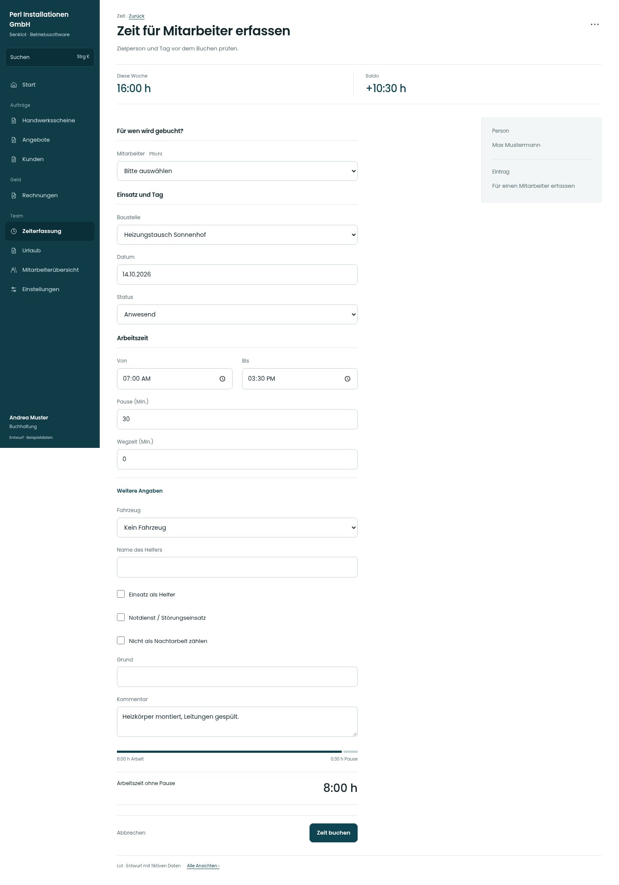

# Zeit für Mitarbeiter erfassen

[Zur Übersicht](../README.md) · [Bereich: Zeit](../bereiche/zeit.md)

**Zeit · Buchhaltung · /time**

Gestaltungsentwurf mit fiktiven Beispieldaten. Aktionen und Datenänderungen sind lokal simuliert, ohne Backend.

[Desktop](../bilder/217-zeit-person-desktop.jpg) · [Tablet](../bilder/217-zeit-person-tablet.jpg) · [Mobil](../bilder/217-zeit-person-mobil.jpg)

## Aufbau

Bedingten Arbeitszustand bzw. getrennte Aufgabe explizit zeigen, ohne vorhandene Ansicht umzudeuten.

## Vorhandene Funktionen für die spätere Umsetzung erhalten

- Zielperson ausdrücklich wählen
- Aus Personendetail: Person und Tag vorbelegen
- Fremdbuchung nach tatsächlichen Korrekturrechten
- Arbeitszeitgrenzen, Lehrlingsschutz und Doppelbuchung serverseitig erhalten

## Felder im Beispiel

- Mitarbeiter (Pflichtfeld)
- Baustelle
- Datum
- Status
- Von
- Bis
- Pause (Min.)
- Wegzeit (Min.)
- Fahrzeug
- Name des Helfers
- Einsatz als Helfer
- Notdienst / Störungseinsatz
- Nicht als Nachtarbeit zählen
- Grund
- Kommentar

## Aktionen

- Zeit buchen
- Meine Einträge
- Auf Baustellen aufteilen

## Quellen

Quellstand: `3e49090`.
- [src/features/accounting/AccountingView.tsx](https://github.com/juliandeutsch22/Prototype-App-Installateure/blob/3e49090d4054ebbd3ecbce6ab583bb944c2c0770/src/features/accounting/AccountingView.tsx)
- [src/features/time/TimeForm.tsx](https://github.com/juliandeutsch22/Prototype-App-Installateure/blob/3e49090d4054ebbd3ecbce6ab583bb944c2c0770/src/features/time/TimeForm.tsx)

Die Screens zeigen die vorgesehenen Bedienwege. Reale Speicherung, vollständige Rollenprüfung, Berechnungen, Exporte, Benachrichtigungen und Integrationen müssen bei einer Umsetzung gegen die App geprüft werden.
