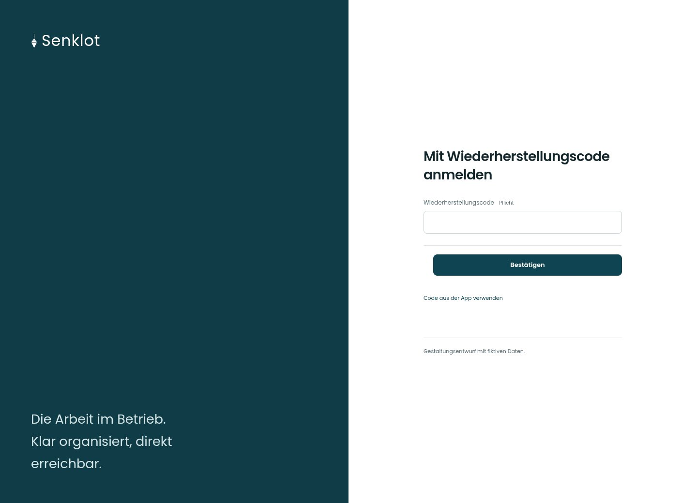

# Mit Wiederherstellungscode anmelden

[Zur Übersicht](../README.md) · [Bereich: Zugang](../bereiche/zugang.md)

**Zugang · Geschäftsführung · Anmeldeprüfung · Wiederherstellung**

Gestaltungsentwurf mit fiktiven Beispieldaten. Aktionen und Datenänderungen sind lokal simuliert, ohne Backend.

[Desktop](../bilder/006-zwei-faktor-code-desktop.jpg) · [Tablet](../bilder/006-zwei-faktor-code-tablet.jpg) · [Mobil](../bilder/006-zwei-faktor-code-mobil.jpg)

## Aufbau

Ein Wiederherstellungscode ist eine alternative Anmeldung; keine parallele zweite Formularspalte einführen.

## Vorhandene Funktionen für die spätere Umsetzung erhalten

- Siehe Quellcode und Seitenübersicht.

## Felder im Beispiel

- Wiederherstellungscode (Pflichtfeld)

## Aktionen

- Bestätigen
- Code aus der App verwenden

## Quellen

Quellstand: `3e49090`.
- [src/features/auth/ZweiFaktorSeite.tsx](https://github.com/juliandeutsch22/Prototype-App-Installateure/blob/3e49090d4054ebbd3ecbce6ab583bb944c2c0770/src/features/auth/ZweiFaktorSeite.tsx)

Die Screens zeigen die vorgesehenen Bedienwege. Reale Speicherung, vollständige Rollenprüfung, Berechnungen, Exporte, Benachrichtigungen und Integrationen müssen bei einer Umsetzung gegen die App geprüft werden.
