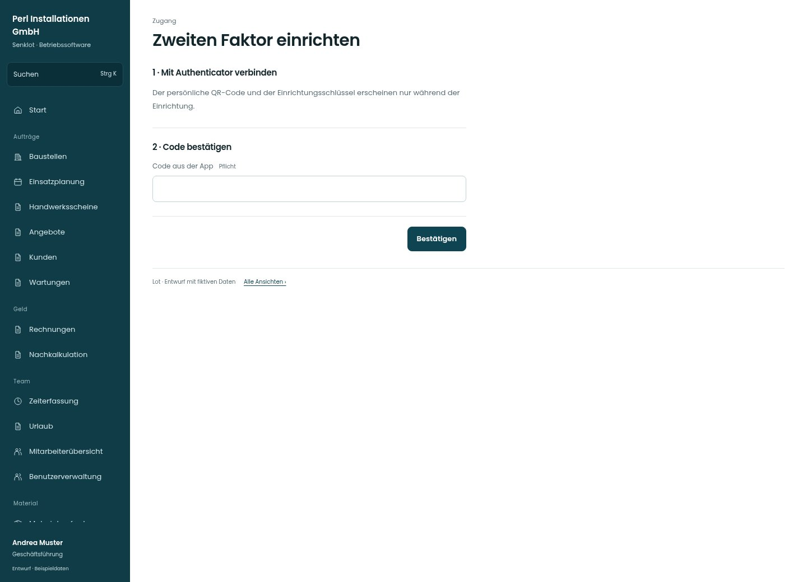

# Zweiten Faktor einrichten

[Zur Übersicht](../README.md) · [Bereich: Zugang](../bereiche/zugang.md)

**Zugang · Geschäftsführung · /settings/meldungen · Einrichtung**

Gestaltungsentwurf mit fiktiven Beispieldaten. Aktionen und Datenänderungen sind lokal simuliert, ohne Backend.

[Desktop](../bilder/007-zwei-faktor-einrichten-desktop.jpg) · [Tablet](../bilder/007-zwei-faktor-einrichten-tablet.jpg) · [Mobil](../bilder/007-zwei-faktor-einrichten-mobil.jpg)

## Aufbau

Verbindung mit Authenticator und anschließende Codebestätigung als zwei klar aufeinanderfolgende Abschnitte darstellen; keine verwendbaren Geheimnisse vortäuschen.

## Vorhandene Funktionen für die spätere Umsetzung erhalten

- QR/Schlüssel nur für die angemeldete Person
- Bestätigung vor Aktivierung

## Felder im Beispiel

- Code aus der App (Pflichtfeld)

## Aktionen

- Bestätigen

## Quellen

Quellstand: `3e49090`.
- [src/features/auth/ZweiFaktorEinrichten.tsx](https://github.com/juliandeutsch22/Prototype-App-Installateure/blob/3e49090d4054ebbd3ecbce6ab583bb944c2c0770/src/features/auth/ZweiFaktorEinrichten.tsx)
- [src/features/settings/ZweiFaktorKarte.tsx](https://github.com/juliandeutsch22/Prototype-App-Installateure/blob/3e49090d4054ebbd3ecbce6ab583bb944c2c0770/src/features/settings/ZweiFaktorKarte.tsx)

Die Screens zeigen die vorgesehenen Bedienwege. Reale Speicherung, vollständige Rollenprüfung, Berechnungen, Exporte, Benachrichtigungen und Integrationen müssen bei einer Umsetzung gegen die App geprüft werden.
