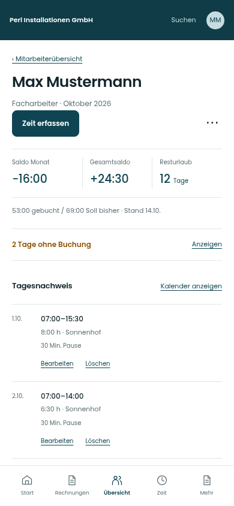

# Mitarbeiterdetail mobil · Tage ohne Buchung einklappbar

Die Einzeltage im Personendetail sind auf dem Smartphone zunächst eingeklappt. **„2 Tage ohne Buchung“ bleibt sichtbar**; die ganze Zeile öffnet oder schließt den Abschnitt. Desktop und Tablet zeigen die Tage wie bisher offen.

[Geschlossen – sichtbarer Anfang](geschlossen-ausschnitt.png) · [Geöffnet – sichtbarer Anfang](offen-ausschnitt.png)

| Zustand | Vollständiger mobiler Screen |
| --- | --- |
| Eingeklappt | [Ansehen](bilder/geschlossen.jpg) |
| Aufgeklappt | [Ansehen](bilder/offen.jpg) |

## Verhalten

- Mobil bis 759 px zunächst geschlossen; Tippen auf die Zeile oder Enter/Leertaste öffnet und schließt den Abschnitt.
- Die Anzahl bleibt sichtbar. In der geöffneten Liste ist „Zeit erfassen“ weiterhin am konkreten Datum erreichbar.
- Die Auswahl eines fehlenden Tages im Raster öffnet den Abschnitt automatisch und führt zum Tag.
- Die Öffnung bleibt beim Wechsel zwischen Kalender, Tagesnachweis und Erfassung innerhalb der Vorschau erhalten.
- Der mobile Kopf wiederholt den Kontext nicht mehr in einer zusätzlichen „Auswertung“-Zeile. Stand und Zeitraum bleiben lesbar. Kontostand, offene Tage und Tagesnachweis sind durch gleichmäßige Abschnittslinien getrennt.

## Prüfung und Einordnung

[Prüfungen](pruefung.json): mobile Zustände bei 320, 390 und 430 px, Tastaturbedienung, Zustandserhalt, Person-/Datumsvorbelegung, direkter Rasteraufruf, JavaScriptfehler, Seitenüberlauf und automatische Axe-Prüfungen. Desktop-/Tablet-Personendetail sowie die mobile Hauptübersicht wurden visuell gegen den vorherigen Entwurf verglichen. Die Bildgegenproben verwenden die Standardtoleranz für Kantenglättung.

Die Dateien sind ein ergänzter Gestaltungsentwurf mit fiktiven Daten, ohne produktives Backend. Die Hauptanwendung bleibt unverändert auf `3e49090`; weder Merge noch App-Deployment wurden vorgenommen. Der [übrige akzeptierte Gesamtentwurf](https://github.com/juliandeutsch22/Prototype-App-Installateure/blob/8a36a015ada022670910ea353525ac95cad8cd03/lot-gesamtentwurf-2026-10-21/README.md) bleibt erhalten.

[ZIP mit klickbarer Vorschau herunterladen](../lot-mitarbeiter-mobil-2026-10-21.zip?raw=true). Nach dem Entpacken `galerie.html` öffnen. Die Ganzseiten-Screens zeigen das Menü am Bildende; die Ausschnitte zeigen die am Fensterrand fixierte Navigation.
