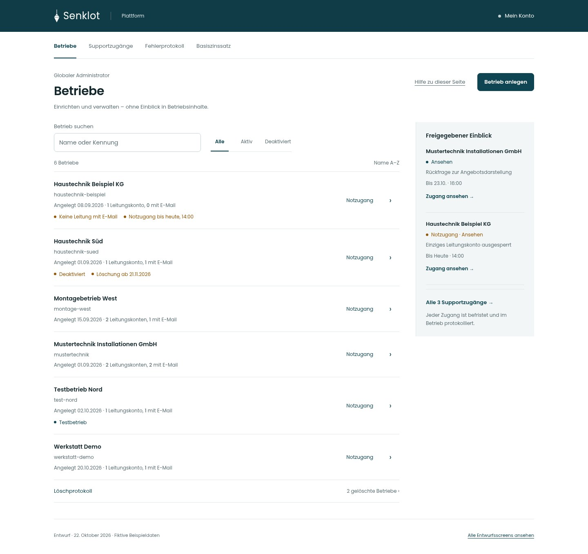

# Lot · Globaler Admin · Entwurf 22.10.2026

**25 Ansichten und Zustände für Desktop, Tablet und Mobil.** Die Entwürfe greifen die freigegebene Lot-Linie der App auf: Poppins, Petrol, klare Zeilen und ein ruhiger Kontextbereich. Große Kennzahlenleisten und zusätzliche Kacheln entfallen.

Alle Daten sind fiktiv. Die gezeigten Fehler und fehlenden Zinssätze sind keine Befunde zur Live-App. **Dies sind Entwürfe zur Abstimmung; die App wurde dafür nicht verändert.**

## Schnell ansehen

- [Betriebsübersicht · Desktop](screens/betriebe-desktop.jpg) · [Mobil](screens/betriebe-mobil.jpg)
- [Betrieb verwalten · Desktop](screens/betrieb-deaktiviert-desktop.jpg) · [Mobiles Blatt vollständig](screens/betrieb-deaktiviert-mobil-vollstaendig.jpg)
- [Supportzugänge · Desktop](screens/support-desktop.jpg) · [Mobil](screens/support-mobil.jpg)
- [Fehlerprotokoll · Desktop](screens/fehler-desktop.jpg) · [Mobil](screens/fehler-mobil.jpg)
- [Betrieb anlegen · Desktop](screens/neu-email-desktop.jpg) · [Mobil](screens/neu-email-mobil.jpg)

## Aufbau

Vier lokale Bereiche ordnen die Plattform: **Betriebe, Supportzugänge, Fehlerprotokoll und Basiszinssatz**. Das eigene Konto bleibt im Markenband erreichbar. Die Betriebsübersicht zeigt freigegebene Zugänge im Kontext. Verwaltung, Übergabe und Löschung bleiben zusammen im Seitenfenster.

Mobil steht die Bereichswahl offen in zwei Zeilen. Es gibt kein neues Hamburgermenü. Das vorhandene mobile Menü der Betriebs-App bleibt unverändert. Der Kontext folgt unter dem Arbeitsbereich; die Betriebsidentität bleibt im Vorgang sichtbar.

[Gestaltungsentscheidungen und vollständiger Funktionsabgleich](Funktionsabgleich.md) · [Prüfumfang](Pruefung.md)

## Alle Screens

Desktop 1440 px · Tablet 834 px · Mobil 390 px. Die sieben Verwaltungsblätter gibt es zusätzlich mit dem vollständigen mobilen Inhalt über mehrere Bildschirmhöhen. Im echten Seitenfenster scrollt dieser Inhalt.

| Nr. | Ansicht / Zustand | Desktop | Tablet | Mobil |
| --- | --- | --- | --- | --- |
| 01 | Betriebsübersicht | [Ansehen](screens/betriebe-desktop.jpg) | [Ansehen](screens/betriebe-tablet.jpg) | [Ansehen](screens/betriebe-mobil.jpg) |
| 02 | Aktiven Betrieb verwalten | [Ansehen](screens/betrieb-aktiv-desktop.jpg) | [Ansehen](screens/betrieb-aktiv-tablet.jpg) | [Ansehen](screens/betrieb-aktiv-mobil.jpg) · [Vollständiger Inhalt](screens/betrieb-aktiv-mobil-vollstaendig.jpg) |
| 03 | Deaktivierter Betrieb | [Ansehen](screens/betrieb-deaktiviert-desktop.jpg) | [Ansehen](screens/betrieb-deaktiviert-tablet.jpg) | [Ansehen](screens/betrieb-deaktiviert-mobil.jpg) · [Vollständiger Inhalt](screens/betrieb-deaktiviert-mobil-vollstaendig.jpg) |
| 04 | Übergabe bereit | [Ansehen](screens/betrieb-uebergabe-desktop.jpg) | [Ansehen](screens/betrieb-uebergabe-tablet.jpg) | [Ansehen](screens/betrieb-uebergabe-mobil.jpg) · [Vollständiger Inhalt](screens/betrieb-uebergabe-mobil-vollstaendig.jpg) |
| 05 | Geplante Löschung | [Ansehen](screens/betrieb-frist-desktop.jpg) | [Ansehen](screens/betrieb-frist-tablet.jpg) | [Ansehen](screens/betrieb-frist-mobil.jpg) · [Vollständiger Inhalt](screens/betrieb-frist-mobil-vollstaendig.jpg) |
| 06 | Löschfrist abgelaufen | [Ansehen](screens/betrieb-loeschen-desktop.jpg) | [Ansehen](screens/betrieb-loeschen-tablet.jpg) | [Ansehen](screens/betrieb-loeschen-mobil.jpg) · [Vollständiger Inhalt](screens/betrieb-loeschen-mobil-vollstaendig.jpg) |
| 07 | Testbetrieb verwalten | [Ansehen](screens/betrieb-test-desktop.jpg) | [Ansehen](screens/betrieb-test-tablet.jpg) | [Ansehen](screens/betrieb-test-mobil.jpg) · [Vollständiger Inhalt](screens/betrieb-test-mobil-vollstaendig.jpg) |
| 08 | Betrieb ohne echte Daten | [Ansehen](screens/betrieb-leer-desktop.jpg) | [Ansehen](screens/betrieb-leer-tablet.jpg) | [Ansehen](screens/betrieb-leer-mobil.jpg) · [Vollständiger Inhalt](screens/betrieb-leer-mobil-vollstaendig.jpg) |
| 09 | Löschprotokoll | [Ansehen](screens/geloescht-desktop.jpg) | [Ansehen](screens/geloescht-tablet.jpg) | [Ansehen](screens/geloescht-mobil.jpg) |
| 10 | Betrieb anlegen · E-Mail | [Ansehen](screens/neu-email-desktop.jpg) | [Ansehen](screens/neu-email-tablet.jpg) | [Ansehen](screens/neu-email-mobil.jpg) |
| 11 | Betrieb anlegen · Benutzername | [Ansehen](screens/neu-benutzer-desktop.jpg) | [Ansehen](screens/neu-benutzer-tablet.jpg) | [Ansehen](screens/neu-benutzer-mobil.jpg) |
| 12 | Einmalige Übergabe · Link | [Ansehen](screens/angelegt-email-desktop.jpg) | [Ansehen](screens/angelegt-email-tablet.jpg) | [Ansehen](screens/angelegt-email-mobil.jpg) |
| 13 | Einmalige Übergabe · Startpasswort | [Ansehen](screens/angelegt-benutzer-desktop.jpg) | [Ansehen](screens/angelegt-benutzer-tablet.jpg) | [Ansehen](screens/angelegt-benutzer-mobil.jpg) |
| 14 | Supportzugänge | [Ansehen](screens/support-desktop.jpg) | [Ansehen](screens/support-tablet.jpg) | [Ansehen](screens/support-mobil.jpg) |
| 15 | Notzugang öffnen | [Ansehen](screens/notzugang-desktop.jpg) | [Ansehen](screens/notzugang-tablet.jpg) | [Ansehen](screens/notzugang-mobil.jpg) |
| 16 | Passwort wiederherstellen | [Ansehen](screens/notpasswort-desktop.jpg) | [Ansehen](screens/notpasswort-tablet.jpg) | [Ansehen](screens/notpasswort-mobil.jpg) |
| 17 | Zweiten Faktor zurücksetzen | [Ansehen](screens/notfaktor-desktop.jpg) | [Ansehen](screens/notfaktor-tablet.jpg) | [Ansehen](screens/notfaktor-mobil.jpg) |
| 18 | Wiederherstellung · Startpasswort | [Ansehen](screens/notpasswort-erledigt-desktop.jpg) | [Ansehen](screens/notpasswort-erledigt-tablet.jpg) | [Ansehen](screens/notpasswort-erledigt-mobil.jpg) |
| 19 | Wiederherstellung · Faktor entfernt | [Ansehen](screens/notfaktor-erledigt-desktop.jpg) | [Ansehen](screens/notfaktor-erledigt-tablet.jpg) | [Ansehen](screens/notfaktor-erledigt-mobil.jpg) |
| 20 | Fehlerprotokoll | [Ansehen](screens/fehler-desktop.jpg) | [Ansehen](screens/fehler-tablet.jpg) | [Ansehen](screens/fehler-mobil.jpg) |
| 21 | Technische Einzelheiten | [Ansehen](screens/fehler-details-desktop.jpg) | [Ansehen](screens/fehler-details-tablet.jpg) | [Ansehen](screens/fehler-details-mobil.jpg) |
| 22 | Zentraler Basiszinssatz | [Ansehen](screens/basiszins-desktop.jpg) | [Ansehen](screens/basiszins-tablet.jpg) | [Ansehen](screens/basiszins-mobil.jpg) |
| 23 | Basiszinssatz ersetzen | [Ansehen](screens/basiszins-ersetzen-desktop.jpg) | [Ansehen](screens/basiszins-ersetzen-tablet.jpg) | [Ansehen](screens/basiszins-ersetzen-mobil.jpg) |
| 24 | Eigenes Plattformkonto | [Ansehen](screens/konto-desktop.jpg) | [Ansehen](screens/konto-tablet.jpg) | [Ansehen](screens/konto-mobil.jpg) |
| 25 | Wiederherstellungscodes | [Ansehen](screens/konto-codes-desktop.jpg) | [Ansehen](screens/konto-codes-tablet.jpg) | [Ansehen](screens/konto-codes-mobil.jpg) |

## Prototyp herunterladen

[**Komplettes Entwurfspaket herunterladen**](entwurfspaket.zip?raw=true) – Screens, anklickbarer HTML-Entwurf, lokale Schriftdateien und Dokumentation. Für die Screens genügt GitHub. Für den Prototyp ZIP entpacken, im entpackten Ordner `python3 -m http.server 8000` starten und `http://localhost:8000/galerie.html` öffnen.

Der HTML-Prototyp simuliert die Auswahl von Bereichen, Suche, Filter, Seitenfenster und einzelne Formularzustände. Aktionen ändern keine App-Daten. Rücksetzlinks, Passwörter und Codes sind ausdrücklich ungültige Platzhalter.

Grundlage: App-Quellstand `7b223888c7e2c92e30a940868a8b08d81162d87c`. Diese Sammlung liegt ausschließlich auf dem separaten Bilder-Branch.
