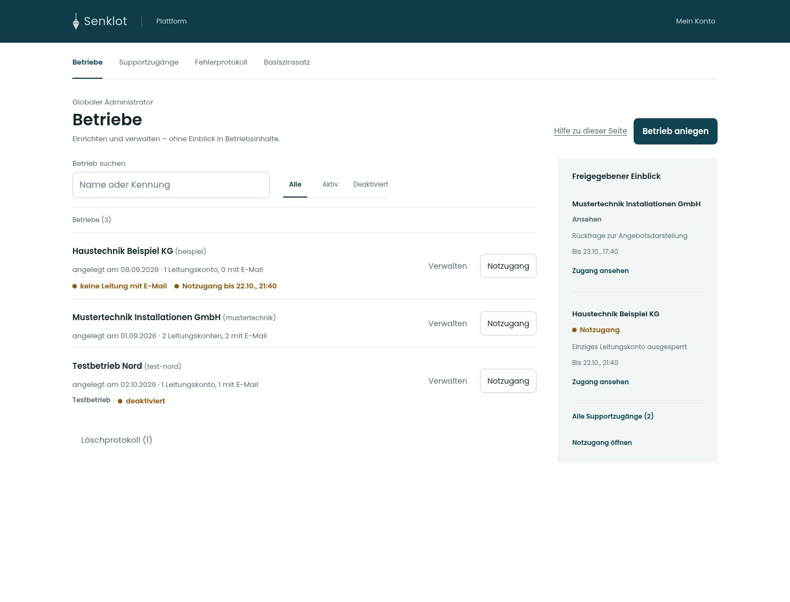

# Lot · Globale Plattformverwaltung · Umsetzung

54 Screens aus den echten React-Ansichten mit fiktiven Vorschau-Daten. Quellstand: `77c016225cb05a9efb38ab45af282c1d3da42672`, [Pull Request 343](https://github.com/juliandeutsch22/Prototype-App-Installateure/pull/343). Die Bilder sind keine Aussage darüber, welcher Stand bereits live ist.

## Ansichten

| Ansicht | Mobil · 390 px | Tablet · 834 px | Desktop · 1440 px |
| --- | --- | --- | --- |
| Betriebsübersicht | [Ansehen](screens/betriebe-390.jpg) | [Ansehen](screens/betriebe-834.jpg) | [Ansehen](screens/betriebe-1440.jpg) |
| Betrieb anlegen · E-Mail | [Ansehen](screens/neu-email-390.jpg) | [Ansehen](screens/neu-email-834.jpg) | [Ansehen](screens/neu-email-1440.jpg) |
| Betrieb anlegen · Benutzername | [Ansehen](screens/neu-benutzer-390.jpg) | [Ansehen](screens/neu-benutzer-834.jpg) | [Ansehen](screens/neu-benutzer-1440.jpg) |
| Einmalige Zugangsübergabe | [Ansehen](screens/angelegt-390.jpg) | [Ansehen](screens/angelegt-834.jpg) | [Ansehen](screens/angelegt-1440.jpg) |
| Löschprotokoll | [Ansehen](screens/geloescht-390.jpg) | [Ansehen](screens/geloescht-834.jpg) | [Ansehen](screens/geloescht-1440.jpg) |
| Supportzugänge | [Ansehen](screens/support-390.jpg) | [Ansehen](screens/support-834.jpg) | [Ansehen](screens/support-1440.jpg) |
| Notzugang öffnen | [Ansehen](screens/notzugang-390.jpg) | [Ansehen](screens/notzugang-834.jpg) | [Ansehen](screens/notzugang-1440.jpg) |
| Passwort wiederherstellen | [Ansehen](screens/notpasswort-390.jpg) | [Ansehen](screens/notpasswort-834.jpg) | [Ansehen](screens/notpasswort-1440.jpg) |
| Zweiten Faktor zurücksetzen | [Ansehen](screens/notfaktor-390.jpg) | [Ansehen](screens/notfaktor-834.jpg) | [Ansehen](screens/notfaktor-1440.jpg) |
| Fehlerprotokoll | [Ansehen](screens/fehler-390.jpg) | [Ansehen](screens/fehler-834.jpg) | [Ansehen](screens/fehler-1440.jpg) |
| Technische Details | [Ansehen](screens/fehler-details-390.jpg) | [Ansehen](screens/fehler-details-834.jpg) | [Ansehen](screens/fehler-details-1440.jpg) |
| Zentraler Basiszinssatz | [Ansehen](screens/basiszins-390.jpg) | [Ansehen](screens/basiszins-834.jpg) | [Ansehen](screens/basiszins-1440.jpg) |
| Eigenes Plattformkonto | [Ansehen](screens/konto-390.jpg) | [Ansehen](screens/konto-834.jpg) | [Ansehen](screens/konto-1440.jpg) |
| Aktiven Betrieb verwalten | [Ansehen](screens/verwaltung-aktiv-390.jpg) | [Ansehen](screens/verwaltung-aktiv-834.jpg) | [Ansehen](screens/verwaltung-aktiv-1440.jpg) |
| Deaktivierter Betrieb | [Ansehen](screens/verwaltung-deaktiviert-390.jpg) | [Ansehen](screens/verwaltung-deaktiviert-834.jpg) | [Ansehen](screens/verwaltung-deaktiviert-1440.jpg) |
| Löschung mit laufender Frist | [Ansehen](screens/verwaltung-frist-390.jpg) | [Ansehen](screens/verwaltung-frist-834.jpg) | [Ansehen](screens/verwaltung-frist-1440.jpg) |
| Löschfrist abgelaufen | [Ansehen](screens/verwaltung-loeschen-390.jpg) | [Ansehen](screens/verwaltung-loeschen-834.jpg) | [Ansehen](screens/verwaltung-loeschen-1440.jpg) |

## Dunkle Darstellung

[Betriebe](screens/betriebe-390-dunkel.jpg) · [Supportzugänge](screens/support-390-dunkel.jpg) · [Mein Konto](screens/konto-390-dunkel.jpg)

Die Formulare und einmaligen Ausgaben bleiben beim Bereichswechsel erhalten. Die vorhandenen Datenfunktionen, Freigaben, Zwei-Faktor-Pflicht, Wiederherstellungsprüfung, Übergaben und Löschgrenzen bleiben erhalten. Am Telefon bleibt die Bereichswahl offen; die Betriebs-App behält ihre bisherige mobile Navigation.

Alle Angaben, Fehler, Zinssätze und Wiederherstellungszustände in diesen Bildern sind fiktiv. Die eigentlichen Funktionsprüfungen liefen gegen den lokalen Teststapel. Keine produktiven Zugangsdaten oder Betriebsdaten sind enthalten.

## Nachweise

- 5.379 Modul-/Komponentenprüfungen, 94 bestandene Browserfälle und zwei vorgesehene Skips, sieben Linkprüfungen.
- Beide neuen Plattformabläufe in Chromium, Tablet und WebKit: Anlage bis Übergabe / Frist / Reaktivierung sowie Notzugang / bestätigter Rückruf / neues Passwort / endgültige Testlöschung.
- [54 Darstellungs-/axe-Prüfungen](pruefungen/darstellung.json) ohne gemeldeten Verstoß oder seitliches Überlaufen.
- [Unveränderte API-Aufrufe und Argumente](pruefungen/api-abgleich.json).

[**Alle Screens herunterladen**](screens.zip?raw=true)
