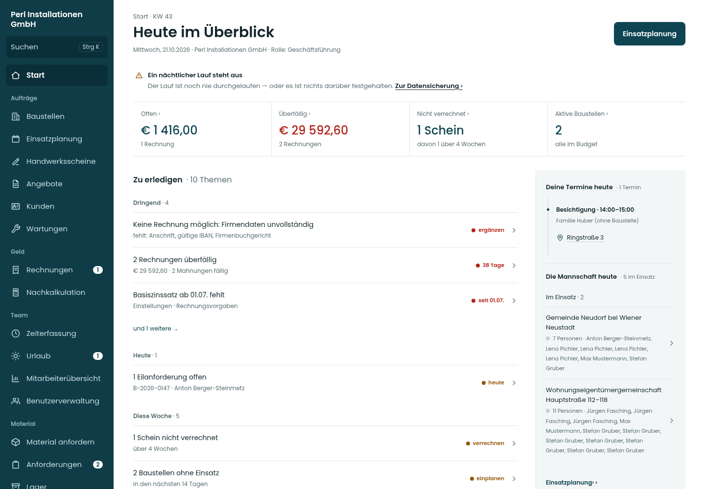
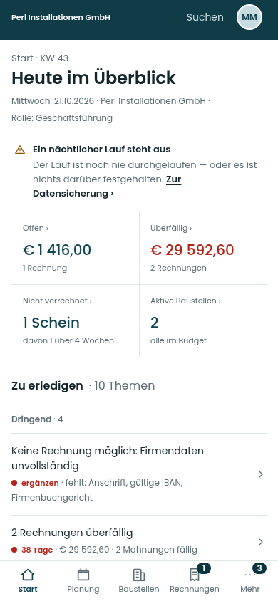
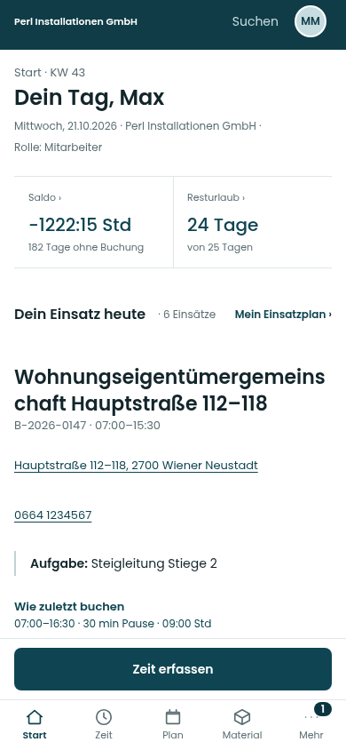

# Lot · Startseite umgesetzt

Stand 21.10.2026 · [PR #341](https://github.com/juliandeutsch22/Prototype-App-Installateure/pull/341) · Quellstand d17d72b.

Screens der echten App-Komponenten mit fiktiven Vorschau-Daten. Die angezeigten Lauf-/Datenwarnungen und die langen, mehrfachen Beispieldaten stammen aus den Stubs und sind kein Befund über den Live-Betrieb. Die fachlichen Browserwege prüfen separat gegen die lokale Datenbank.

Das bestehende mobile Menü einschließlich seiner Rollenbelegung, „Mehr“, Suche und Profilzugang bleibt unverändert. Die direkte Zeitbuchung des Monteurs sitzt in der bestehenden Aktionsleiste darüber.

## Bildschirmbereiche

### Geschäftsführung · Desktop

### Geschäftsführung · Mobil

### Monteur · Mobil

## Alle vollständigen Ansichten

Die langen Vollbilder enthalten den gesamten scrollbaren Inhalt. Fixe Menü-/Aktionsleisten erscheinen darin an ihrer Position im ersten Bildschirmbereich; die Ausschnitte oben zeigen die tatsächliche Bildschirmdarstellung.

| Rolle | Handy 390 | Tablet 834 | Desktop 1440 |
|---|---|---|---|
| Geschäftsführung | [Hell](bilder/geschaeftsfuehrung-390.png) · [Dunkel](bilder/dunkel-geschaeftsfuehrung-390.png) | [Hell](bilder/geschaeftsfuehrung-834.png) · [Dunkel](bilder/dunkel-geschaeftsfuehrung-834.png) | [Hell](bilder/geschaeftsfuehrung-1440.png) · [Dunkel](bilder/dunkel-geschaeftsfuehrung-1440.png) |
| Mitarbeiter | [Hell](bilder/monteur-390.png) · [Dunkel](bilder/dunkel-monteur-390.png) | [Hell](bilder/monteur-834.png) · [Dunkel](bilder/dunkel-monteur-834.png) | [Hell](bilder/monteur-1440.png) · [Dunkel](bilder/dunkel-monteur-1440.png) |
| Verwaltung | [Hell](bilder/verwaltung-390.png) · [Dunkel](bilder/dunkel-verwaltung-390.png) | [Hell](bilder/verwaltung-834.png) · [Dunkel](bilder/dunkel-verwaltung-834.png) | [Hell](bilder/verwaltung-1440.png) · [Dunkel](bilder/dunkel-verwaltung-1440.png) |
| Buchhaltung | [Hell](bilder/buchhaltung-390.png) · [Dunkel](bilder/dunkel-buchhaltung-390.png) | [Hell](bilder/buchhaltung-834.png) · [Dunkel](bilder/dunkel-buchhaltung-834.png) | [Hell](bilder/buchhaltung-1440.png) · [Dunkel](bilder/dunkel-buchhaltung-1440.png) |
| Projektleiter | [Hell](bilder/projektleitung-390.png) · [Dunkel](bilder/dunkel-projektleitung-390.png) | [Hell](bilder/projektleitung-834.png) · [Dunkel](bilder/dunkel-projektleitung-834.png) | [Hell](bilder/projektleitung-1440.png) · [Dunkel](bilder/dunkel-projektleitung-1440.png) |
| Administrator | [Hell](bilder/administrator-390.png) · [Dunkel](bilder/dunkel-administrator-390.png) | [Hell](bilder/administrator-834.png) · [Dunkel](bilder/dunkel-administrator-834.png) | [Hell](bilder/administrator-1440.png) · [Dunkel](bilder/dunkel-administrator-1440.png) |

36 Darstellungen geprüft: kein horizontaler Seitenüberlauf, keine abgeschnittenen Kennzahlwerte, keine JavaScript-Seitenfehler und keine automatisierten axe-Befunde (WCAG 2/2.1/2.2 A/AA). Details in `darstellungspruefung.json`.
