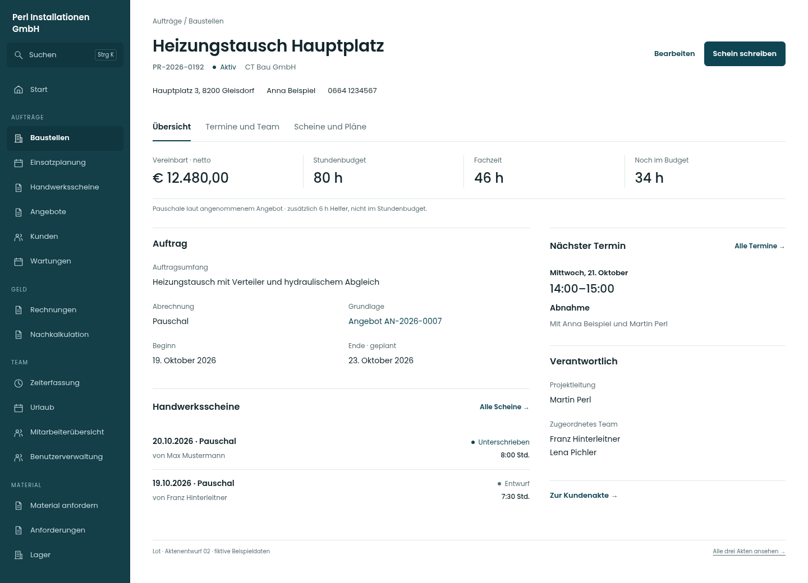
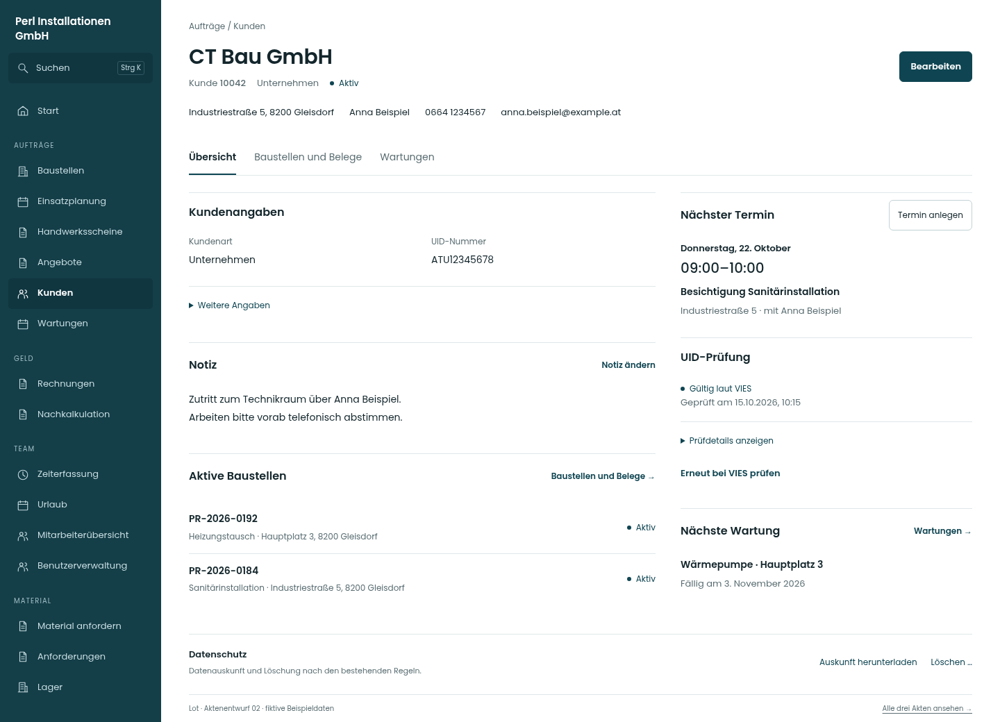
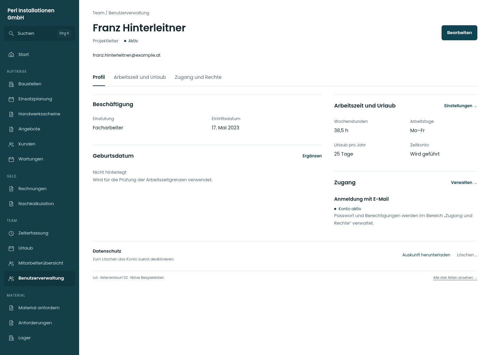

# Lot · drei Aktenentwürfe 02

Stand 20.10.2026. **Gestaltungsentwürfe mit fiktiven Daten. Die App ist unverändert.** Grundlage sind die echten Akten und Lot-Grundwerte des App-Commits `d5c691dd4bfd01425f5f2f7c08138ab093f5aed4`.

## Die sechs Hauptansichten

| Akte | Desktop | Handy | Ganze Handyseite |
|---|---|---|---|
| Baustelle | [Bild öffnen](https://raw.githubusercontent.com/juliandeutsch22/Prototype-App-Installateure/refs/heads/bilder/landingpage-2026-10-14/lot-v2-akten-entwurf-02/bilder/baustelle-desktop.png) | [Bild öffnen](https://raw.githubusercontent.com/juliandeutsch22/Prototype-App-Installateure/refs/heads/bilder/landingpage-2026-10-14/lot-v2-akten-entwurf-02/bilder/baustelle-mobil.png) | [Ganzes Bild](https://raw.githubusercontent.com/juliandeutsch22/Prototype-App-Installateure/refs/heads/bilder/landingpage-2026-10-14/lot-v2-akten-entwurf-02/bilder/baustelle-mobil-gesamt.png) |
| Kunde | [Bild öffnen](https://raw.githubusercontent.com/juliandeutsch22/Prototype-App-Installateure/refs/heads/bilder/landingpage-2026-10-14/lot-v2-akten-entwurf-02/bilder/kunde-desktop.png) | [Bild öffnen](https://raw.githubusercontent.com/juliandeutsch22/Prototype-App-Installateure/refs/heads/bilder/landingpage-2026-10-14/lot-v2-akten-entwurf-02/bilder/kunde-mobil.png) | [Ganzes Bild](https://raw.githubusercontent.com/juliandeutsch22/Prototype-App-Installateure/refs/heads/bilder/landingpage-2026-10-14/lot-v2-akten-entwurf-02/bilder/kunde-mobil-gesamt.png) |
| Benutzer | [Bild öffnen](https://raw.githubusercontent.com/juliandeutsch22/Prototype-App-Installateure/refs/heads/bilder/landingpage-2026-10-14/lot-v2-akten-entwurf-02/bilder/benutzer-desktop.png) | [Bild öffnen](https://raw.githubusercontent.com/juliandeutsch22/Prototype-App-Installateure/refs/heads/bilder/landingpage-2026-10-14/lot-v2-akten-entwurf-02/bilder/benutzer-mobil.png) | [Ganzes Bild](https://raw.githubusercontent.com/juliandeutsch22/Prototype-App-Installateure/refs/heads/bilder/landingpage-2026-10-14/lot-v2-akten-entwurf-02/bilder/benutzer-mobil-gesamt.png) |

[**Alle Screens und die klickbare Vorschau herunterladen**](../Lot-Akten-Entwurf-02-2026-10-20.zip?raw=true). Das ZIP vollständig entpacken und **index.html** öffnen. Die Reiter, Bereichsverweise und beispielhaften Bearbeitungsfenster lassen sich ausprobieren. GitHub zeigt HTML-Dateien als Quelltext an; für die Vorschau ist deshalb das entpackte Paket vorgesehen.

Alle Poppins-Schriften, Bilder und Skripte liegen im Paket. Kein CDN, kein Login und keine Datenbank erforderlich. Kontaktlinks öffnen bewusst Karte, Telefon oder Mailprogramm; alle Namen und Angaben sind fiktiv.

## Baustellenakte

Klarer Aktenkopf, Kontaktmöglichkeiten, Stundenbudget und Auftrag. Helferstunden bleiben vom Budget getrennt. Ein vereinbarter Betrag wird am Beispiel einer Pauschalbaustelle mit angenommenem Angebot gezeigt. Bei Regie oder fehlendem Angebot entfällt diese feste Summe; fehlendes Budget und Überschreitungen brauchen ihre bestehenden Zustände.

- **Übersicht:** Auftrag, Fachzeit/Budget, jüngste Scheine, nächster Termin und Zuständigkeit.
- **Termine und Team:** bestehende Termine, vergangene Termine, Projektleitung und zugeordnetes Team.
- **Scheine und Pläne:** vorhandene Scheine, Angebotsverweis, Pläne und Dokumente einschließlich „Nur fürs Büro“.

Der Block „Nächster Termin“ nutzt das vorhandene Termin-Konzept. Er behauptet keinen Arbeitseinsatz. Eine neue Materialhistorie oder ein zusammengeführter Vorgangsverlauf sind nicht Bestandteil dieses Entwurfs.

## Kundenakte

Kontaktangaben stehen im Kopf. UID, Kundenart und Notiz sind direkt lesbar. Projektnummer und Adresse der Baustellen stehen getrennt und werden nicht als ein langer Titel abgeschnitten.

- **Übersicht:** Kundenangaben, Notiz, aktive Baustellen, nächster Termin, VIES-Status und nächste Wartung.
- **Baustellen und Belege:** Baustellen, bestehende Zuordnungsmöglichkeiten, Rechnungen und Angebote.
- **Wartungen:** bestehende Wartungsvereinbarungen mit Fälligkeit und Terminbezug.
- Datenschutz bleibt am Ende der Übersicht eindeutig erreichbar.

Die nächste Wartung ist eine Zusammenfassung der bereits vorhandenen Wartungen; fehlende, ruhende oder überfällige Vereinbarungen erhalten bei Umsetzung die vorhandene fachliche Bewertung. VIES-Details und erneute Prüfung bleiben zugänglich.

## Benutzerakte

Lesen und gezieltes Bearbeiten sind getrennt. Name und Rolle stehen im Kopf; im Inhalt folgen Beschäftigung und Kontoeinstellungen. Das lange, ständig offene Formular entfällt in diesem Vorschlag als Einstieg.

- **Profil:** Einstufung, Eintritt, Geburtsdatum und kompakte Hinweise auf Arbeitszeit und Zugang.
- **Arbeitszeit und Urlaub:** Wochenstunden, Arbeitstage, Tagessoll, Eintritt und Saldo-Start, Startwerte und Urlaubsanspruch.
- **Zugang und Rechte:** Anmeldeart, Passwort-/Startpasswortfunktion, Kontoumstellung, Aktivieren/Deaktivieren sowie die zur Rolle gehörenden Berechtigungen.
- Datenschutz und die Sperre gegen Löschen eines aktiven Kontos bleiben sichtbar.

Aktuelle Ist-Salden und Buchungen werden nicht als neue Zahlen in der Benutzerakte erfunden. Dafür bleibt die Mitarbeiterübersicht zuständig. Das Beispiel zeigt ein fremdes Projektleiterkonto mit E-Mail-Anmeldung aus Sicht einer berechtigten Leitungsrolle.

## Gemeinsame Linie und Handy

Poppins 400/600 für Text/Titel und 500 für Zahlen, bestehende Lot-Farben, 30/24-px-Seitentitel, eine weiße Fläche mit Linien, eindeutige Aktionen. Drei sichtbare Aktenbereiche ohne zusätzliche senkrechte Aktennavigation. Große Listen erhalten mehr Breite; am Handy stehen die Inhalte untereinander. Die Hauptaktion sitzt über der mobilen Navigation. Bearbeiten wird als Seitenfenster beziehungsweise mobiles Blatt skizziert.

## Geprüft und noch offen

27 Bereich-/Breitenkombinationen bei 390/834/1.440 px wurden in Chromium fotografiert und auf Seitenüberlauf, JavaScript-Seitenfehler und WCAG-A/AA-Regeln mit axe geprüft. Zusätzlich wurden Pfeiltastenwechsel der Reiter, Escape und Fokusrückgabe der Bearbeitungsfenster kontrolliert. Die genauen Ergebnisse stehen in [pruefung.json](pruefung.json). Das Paket enthält 36 Bilder: 27 Bereichsansichten, drei vollständige Handyseiten und sechs Bearbeitungsansichten.

Die Prüfung lief über einen lokalen HTTP-Server. Direktes file://-Öffnen ist durch die Cloud-Browserrichtlinie gesperrt und wurde hier nicht verifiziert; die Vorschau benötigt technisch keinen Webdienst und verwendet kein Fetch.

**Die Fenster sind Layoutskizzen mit repräsentativen Feldern, keine vollständige Formularimplementierung.** Einzelne Beleg-, Konto-, VIES- und Datenschutzaktionen zeigen einen erklärenden Vorschauhinweis. Es werden keine Daten gespeichert. Rollen-/Modulvarianten, Formulardetails, Validierung und sämtliche bisherigen Sonderfälle müssen bei einer späteren App-Umsetzung übernommen und gegen die bestehenden Verhaltenstests geprüft werden. Hier sind keine Speicher- oder Produktivabläufe abgenommen.

Rollen- und Modulrechte werden im Entwurf nicht neu festgelegt. Die Darstellung zeigt eine berechtigte Leitungsrolle mit den relevanten Modulen. Die Zuordnung der bestehenden Funktionen steht in [Funktionszuordnung.json](Funktionszuordnung.json).
