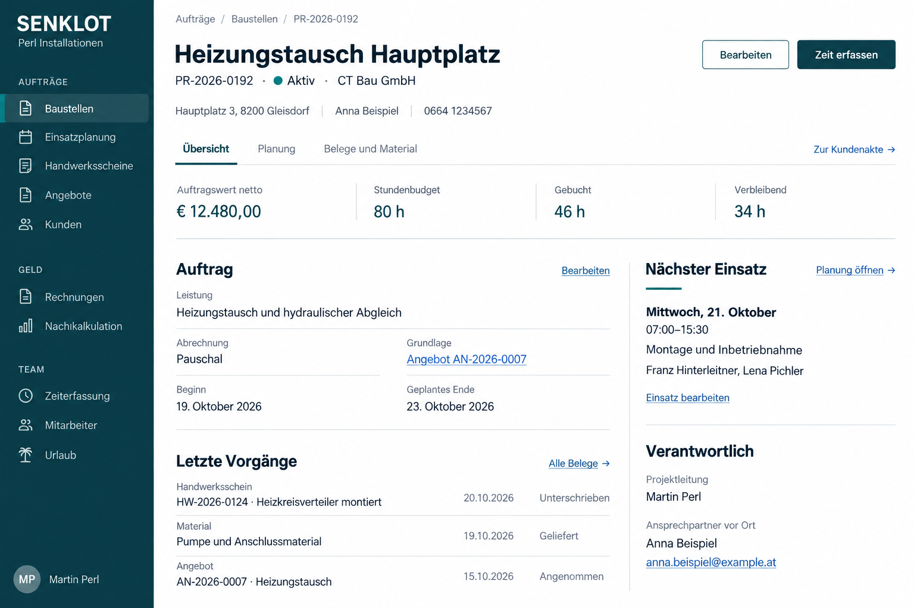

# Vorschlag für die Baustellenakte · 20.10.2026

Gestaltungsentwurf mit fiktiven Daten, noch keine Änderung der Live-App. Das Bild zeigt einen klaren Aktenkopf, eine kompakte Kennzahlenzeile und geordnete Bereiche für Auftrag, Vorgänge, nächsten Einsatz und Zuständigkeit.

[Bild direkt öffnen oder herunterladen](https://raw.githubusercontent.com/juliandeutsch22/Prototype-App-Installateure/refs/heads/bilder/landingpage-2026-10-14/lot-v2-akten-entwurf-2026-10-20/baustellenakte.png)

