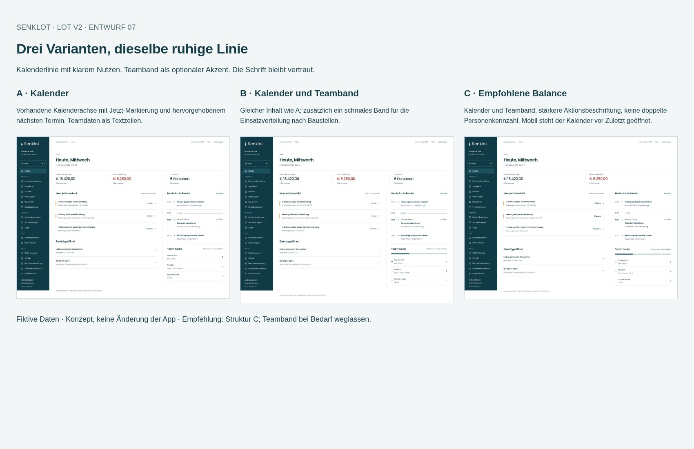
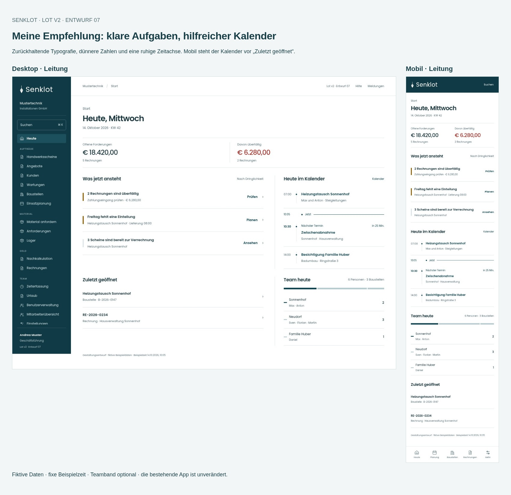
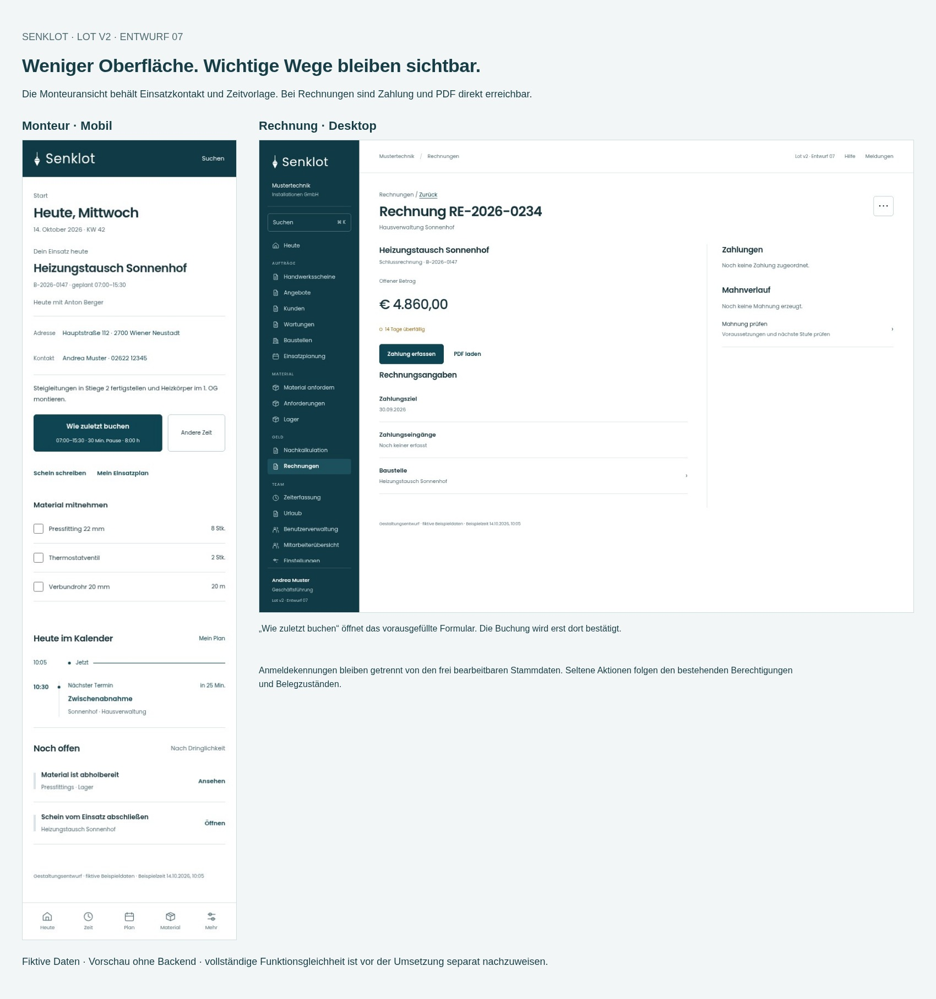

# Lot v2 · Vorschläge 07

Sechs neue Vergleichsansichten, jeweils als Desktop-, Tablet- und Mobilbild. Fiktive Beispieldaten. Keine Änderung der produktiven App.

[Komplettes Paket herunterladen](../Lot-v2-Empfehlungen-2026-10-15.zip?raw=true) · [Empfehlungen und offene Prüfungen](Empfehlungen.md) · [Funktionsschutz](Funktionsschutz.json) · [Prüfergebnisse](pruefung.json)

ZIP entpacken, dann **galerie.html** öffnen. Dort lässt sich zwischen Desktop, Tablet und Mobil wechseln. Die interaktive Vorschau ist ein eigenständiges Mockup ohne Backend. Weitere verlinkte Ansichten stammen aus Entwurf 06.

## Vergleich A / B / C

A ergänzt die Kalenderlinie. B zusätzlich das Teamband. C verbessert auch Hierarchie und mobile Reihenfolge. **Empfehlung: Struktur C; das Teamband bleibt optional.**

## Empfohlene Startseite

[Desktop in Originalgröße](bilder/start-c-desktop.jpg) · [Tablet](bilder/start-c-tablet.jpg) · [Mobil](bilder/start-c-mobil.jpg)

## Arbeitswege erhalten

[Monteur mobil](bilder/monteur-mobil.jpg) · [Rechnung](bilder/rechnung-desktop.jpg) · [Benutzerdaten](bilder/konto-desktop.jpg)

## Funktionserhalt

Die neue Linie ist noch nicht in der App umgesetzt. Eine vollständige Funktionsgleichheit ist anhand der Screens nicht nachgewiesen. Die gezielte Gegenprüfung hat Lücken im vorherigen Mockup gefunden; die neuen Beispiele korrigieren Einsatzkontakt, Zeitvorlage, Kontoumstellung und bedingte Rechnungsaktionen.

977 historische Funktionszuordnungen sind als Arbeitsgrundlage enthalten. Deren frühere Prüfvermerke gelten nicht als neue Abnahme. Vor der Umsetzung bleiben die vollständige Zuordnung aller Aktionen/Felder/Rollen und Prüfungen der realen Arbeitsabläufe offen.
