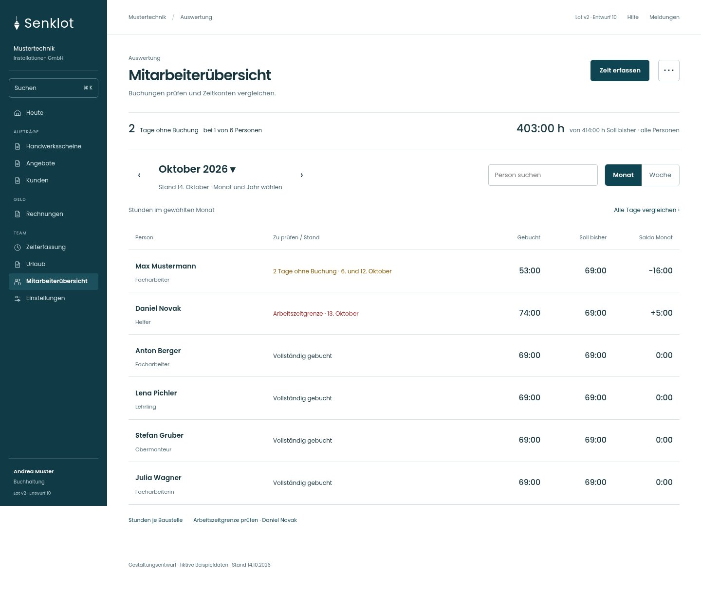
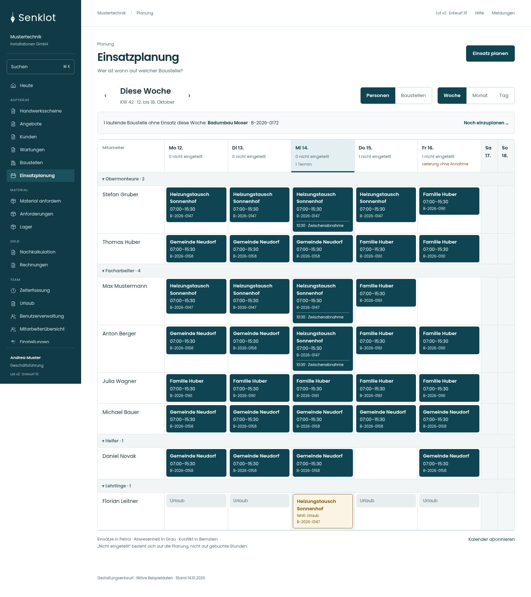

# Lot v2 · Gesamtkonzept 10

217 Ansichten in einer gemeinsamen Linie: 206 bisherige Konzeptansichten wurden einzeln geprüft, elf zusätzliche Aufgaben- oder Zustandsvarianten ergänzt. Jede Ansicht liegt für Desktop, Tablet und Handy vor: **651 nummerierte Screenshots**.

Dies ist ein UI/UX-Entwurf mit fiktiven Beispieldaten. Die Live-Anwendung wurde dafür nicht verändert. Eine vollständige Funktionsgleichheit muss bei der späteren Umsetzung in der echten Anwendung geprüft werden.

## Screens direkt ansehen

- [Mitarbeiterübersicht](bilder/119-mitarbeiter-monat-desktop.jpg) · [Handy](bilder/119-mitarbeiter-monat-mobil.jpg)
- [Tagesnachweis einer Person](bilder/121-mitarbeiter-person-desktop.jpg) · [Handy](bilder/121-mitarbeiter-person-mobil.jpg)
- [Wochenplan](bilder/040-planung-woche-desktop.jpg) · [Handy](bilder/040-planung-woche-mobil.jpg)
- [Startseite](bilder/011-heute-desktop.jpg) · [Start für Mitarbeiter](bilder/012-heute-monteur-mobil.jpg)
- [Übersicht weiterer Bereiche](bilder/Uebersicht-Buero.jpg) · [Arbeit und Einstellungen](bilder/Uebersicht-Betrieb.jpg) · [Mobile Ansichten](bilder/Uebersicht-Mobil.jpg)
- [Alle 217 Ansichten mit Einzelprüfung und Bildlinks](UX-Pruefung.md)

## Vollständige Galerie öffnen

[Gesamtes Paket als ZIP herunterladen](../Lot-v2-Gesamtkonzept-10-2026-10-15.zip?raw=true), vollständig entpacken und **galerie.html** im Browser öffnen. Sie enthält Suche, Bereichs- und Rollenfilter sowie den Wechsel zwischen den drei Bildschirmgrößen. Alle Bilder und Schriften liegen im Paket; es benötigt keinen Zugang zu einem Codex-Workspace.

**index.html** öffnet den Bedienprototyp. Die HTML-Vorschau wird von GitHub nicht als Website ausgeführt; direkt auf GitHub funktionieren die Bildlinks und die Markdown-Dokumentation. Optional lokal mit `python -m http.server 8000` im entpackten Ordner starten und `http://localhost:8000/galerie.html` öffnen. Keine Installation von Node-Abhängigkeiten erforderlich.

## Was sich verbessert hat

- **Mitarbeiterübersicht:** breite, vergleichbare Personenliste; konkrete Auffälligkeiten; Gebucht, Soll bisher und Monatssaldo; Tagesliste erst nach Auswahl; Kalender als Alternative. Erfassung für eine andere Person erhält ausdrücklich Mitarbeiter und Datum.
- **Wochenplan:** bewährte dunkle Petrol-Einsätze; klare Tages- und Personenorientierung; fixierte Köpfe, einklappbare Gruppen und Personen-/Baustellensicht. Mobil eine Tagesliste mit allen sieben Wochentagen als Reiter.
- **Start:** Aufgaben, aktueller Einsatz, Termine und rollenabhängige Kennzahlen. Grafische Elemente erklären Inhalte; keine zusätzlichen Dekokarten oder erfundenen Kapazitätsanzeigen.
- **Andere Seiten:** dieselbe Schrift-, Zahlen-, Abstands- und Aktionshierarchie. Listen, Akten, Formulare, Planer und Bestätigungen haben jeweils ein zur Aufgabe passendes Muster. Gut funktionierende Seiten wurden beibehalten.

## Nachweise und Grenzen

- [Gestaltungsentscheidungen und gemeinsame Regeln](Konzept.md)
- [Alle Einzelentscheidungen](UX-Pruefung.md) · [maschinenlesbare Prüfliste](Seitenpruefung.json)
- [Funktionserhalt und noch offene Abnahme](Funktionsschutz.md)
- [Prüfergebnis des Entwurfs](Pruefung.md)
- [Quellinventar](quelleninventar.json) und [Rollenmatrix aus der Ausgangsanalyse](rollenmatrix.json)

Quellbasis: [d4b8542](https://github.com/juliandeutsch22/Prototype-App-Installateure/tree/d4b8542821d86c7057761af16de1331d1de87e09). Enthalten sind Screens von Seiten, Formularen, Dialogen und ausgewählten Rollen-/Fachzuständen. Die Zahl 217 ist keine Behauptung, sämtliche möglichen Daten-, Fehler- und Berechtigungskombinationen visuell geprüft zu haben.
