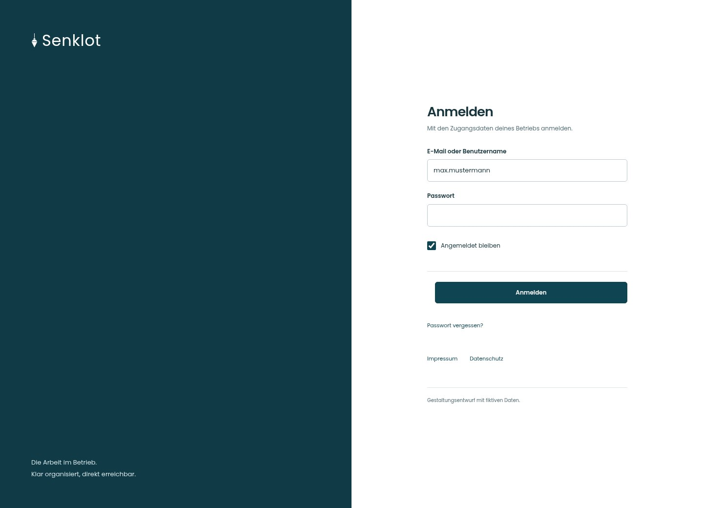
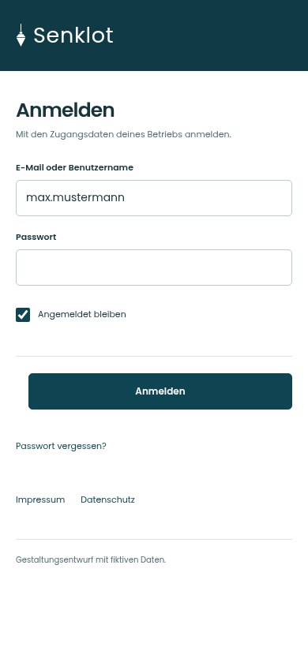
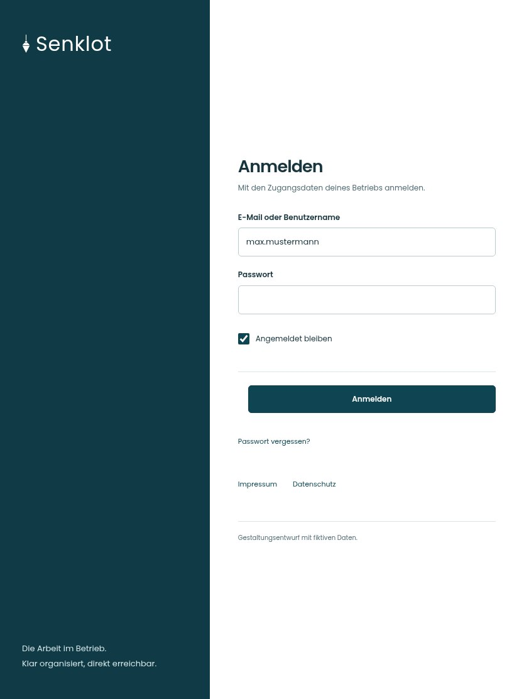

# 001 · Anmelden

[Zur Gesamtübersicht](../README.md) · [Vollständiges Konzept](../Konzept.md)

**Bereich:** Zugang · **Bestandsort:** `/login`

Handy · 390 px

Tablet · 834 px

## Entscheidung

Marke trägt das Kopfband; das Formular braucht keine zusätzliche Illustration.

**Gezeigte Rolle:** Mitarbeiter. Sichtbarkeit und Aktionen bleiben an bestehende Rollen, Zusatzrechte, Module und Datensatzstatus gebunden.

**Hauptaktion:** Anmelden.

**Weitere Aktionen:** Passwort vergessen?.

**Handy/Tablet:** Zeilen statt zusätzlicher Karten; Hauptaktion bleibt gut erreichbar.

## Muss erhalten bleiben

- Benutzername und E-Mail
- Neutrale Fehlermeldung
- Angemeldet bleiben
- Rücksetzweg

## Felder

- E-Mail oder Benutzername
- Passwort
- Angemeldet bleiben

## Quelle

- [src/features/auth/LoginPage.tsx](https://github.com/juliandeutsch22/Prototype-App-Installateure/blob/d4b8542821d86c7057761af16de1331d1de87e09/src/features/auth/LoginPage.tsx)

Gestaltungsvorschau mit fiktiven Beispieldaten. Keine Änderung oder Auslieferung der App.
