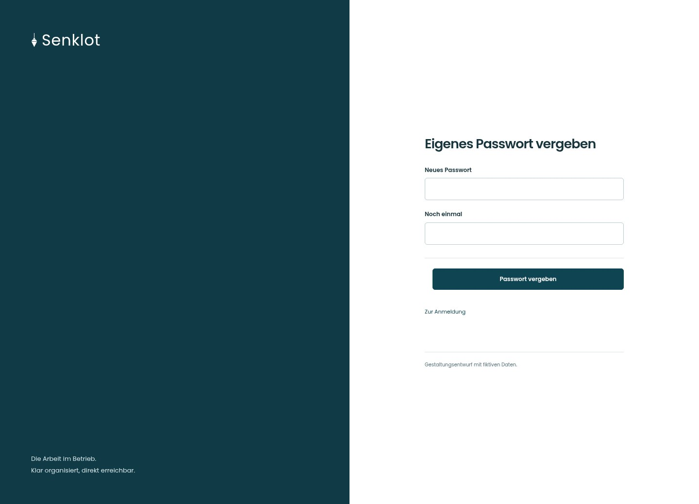
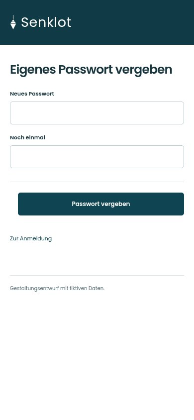
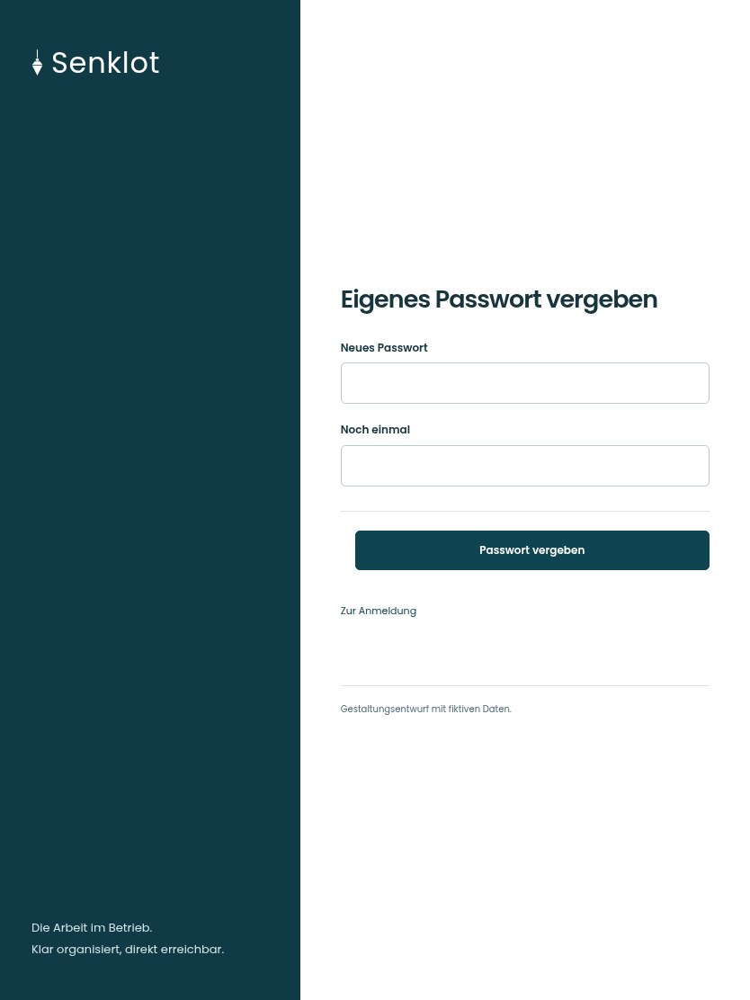

# 003 · Eigenes Passwort vergeben

[Zur Gesamtübersicht](../README.md) · [Vollständiges Konzept](../Konzept.md)

**Bereich:** Zugang · **Bestandsort:** `Nach Rücksetzlink / Startpasswort`

Handy · 390 px

Tablet · 834 px

## Entscheidung

Nur arbeitsrelevante Angaben; Details über die Zeile öffnen.

**Gezeigte Rolle:** Geschäftsführung. Sichtbarkeit und Aktionen bleiben an bestehende Rollen, Zusatzrechte, Module und Datensatzstatus gebunden.

**Hauptaktion:** Passwort vergeben.

**Weitere Aktionen:** Zur Anmeldung.

**Handy/Tablet:** Zeilen statt zusätzlicher Karten; Hauptaktion bleibt gut erreichbar.

## Muss erhalten bleiben

- Passwortbestätigung
- Bei normaler Änderung aktuelles Passwort
- Kein Überspringen beim Startpasswort

## Felder

- Neues Passwort
- Noch einmal

## Quelle

- [src/features/auth/PasswortAendern.tsx](https://github.com/juliandeutsch22/Prototype-App-Installateure/blob/d4b8542821d86c7057761af16de1331d1de87e09/src/features/auth/PasswortAendern.tsx)

Gestaltungsvorschau mit fiktiven Beispieldaten. Keine Änderung oder Auslieferung der App.
