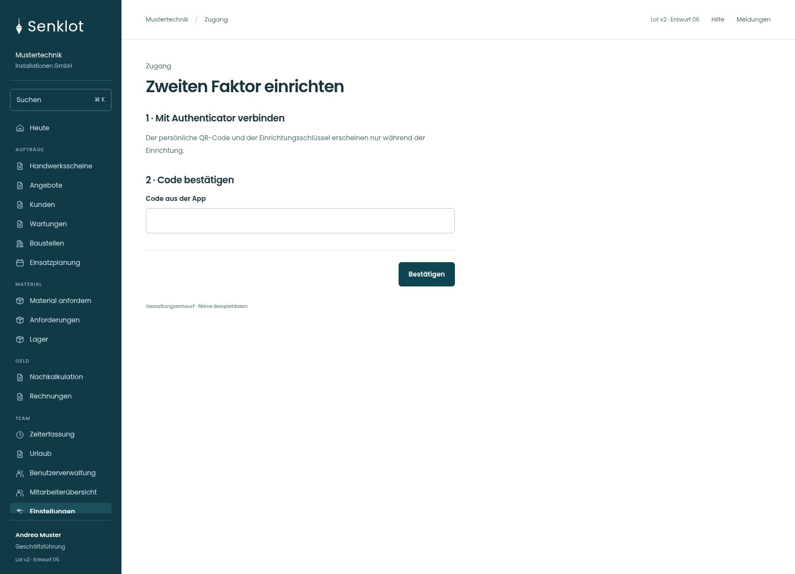
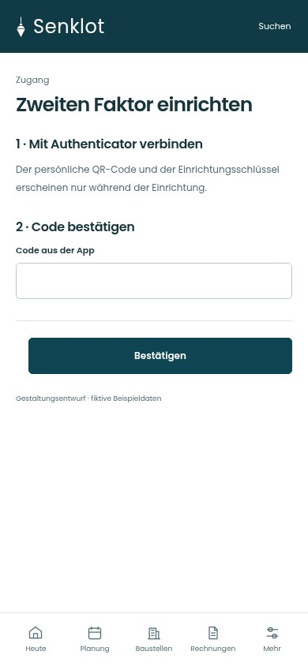
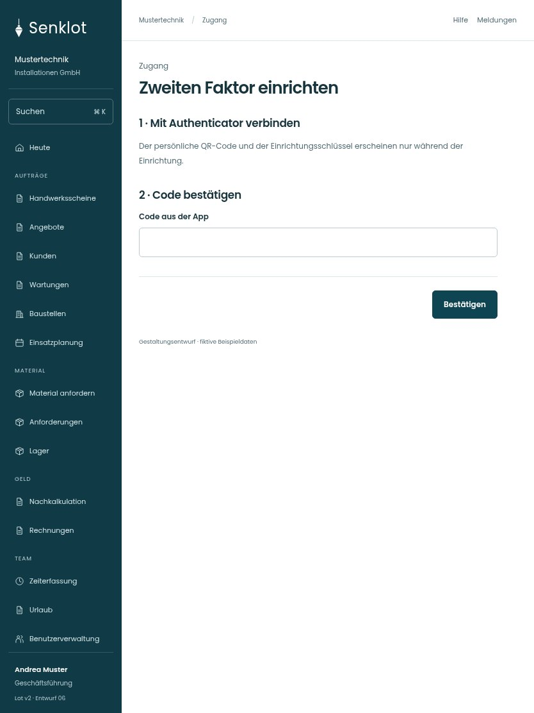

# 007 · Zweiten Faktor einrichten

[Zur Gesamtübersicht](../README.md) · [Vollständiges Konzept](../Konzept.md)

**Bereich:** Zugang · **Bestandsort:** `/settings/meldungen · Einrichtung`

Handy · 390 px

Tablet · 834 px

## Entscheidung

Der QR-Bereich ist eine Funktionsfläche, kein Schmuck. Im Konzept bleibt er neutral, ohne echtes Geheimnis.

**Gezeigte Rolle:** Geschäftsführung. Sichtbarkeit und Aktionen bleiben an bestehende Rollen, Zusatzrechte, Module und Datensatzstatus gebunden.

**Hauptaktion:** Bestätigen.

**Handy/Tablet:** Zeilen statt zusätzlicher Karten; Hauptaktion bleibt gut erreichbar.

## Muss erhalten bleiben

- QR/Schlüssel nur für die angemeldete Person
- Bestätigung vor Aktivierung

## Felder

- Code aus der App

## Quelle

- [src/features/auth/ZweiFaktorEinrichten.tsx](https://github.com/juliandeutsch22/Prototype-App-Installateure/blob/d4b8542821d86c7057761af16de1331d1de87e09/src/features/auth/ZweiFaktorEinrichten.tsx)
- [src/features/settings/ZweiFaktorKarte.tsx](https://github.com/juliandeutsch22/Prototype-App-Installateure/blob/d4b8542821d86c7057761af16de1331d1de87e09/src/features/settings/ZweiFaktorKarte.tsx)

Gestaltungsvorschau mit fiktiven Beispieldaten. Keine Änderung oder Auslieferung der App.
