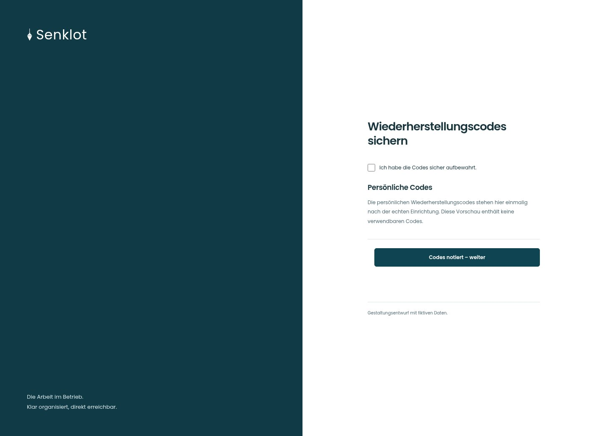
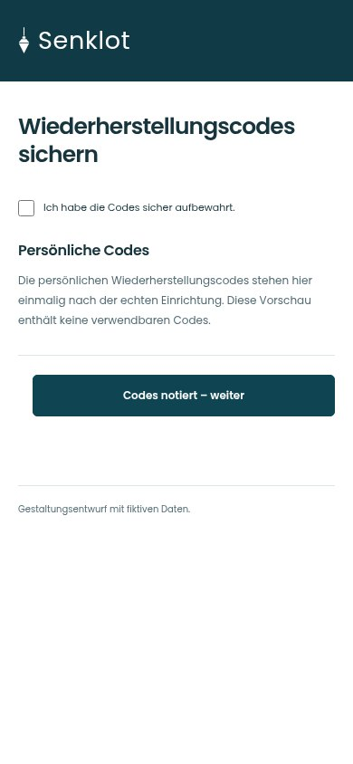
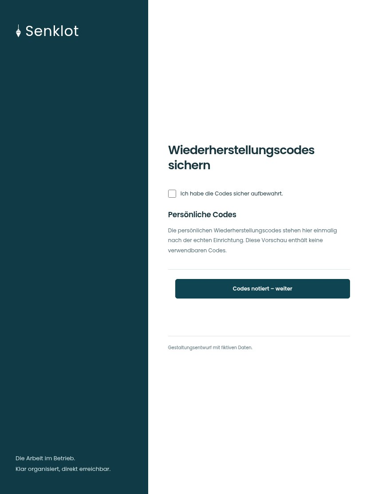

# 008 · Wiederherstellungscodes sichern

[Zur Gesamtübersicht](../README.md) · [Vollständiges Konzept](../Konzept.md)

**Bereich:** Zugang · **Bestandsort:** `Nach Zwei-Faktor-Einrichtung`

Handy · 390 px

Tablet · 834 px

## Entscheidung

Nur arbeitsrelevante Angaben; Details über die Zeile öffnen.

**Gezeigte Rolle:** Geschäftsführung. Sichtbarkeit und Aktionen bleiben an bestehende Rollen, Zusatzrechte, Module und Datensatzstatus gebunden.

**Hauptaktion:** Codes notiert – weiter.

**Handy/Tablet:** Zeilen statt zusätzlicher Karten; Hauptaktion bleibt gut erreichbar.

## Muss erhalten bleiben

- Codes bleiben bis zur ausdrücklichen Bestätigung sichtbar
- Keine echten Codes im Entwurf

## Felder

- Ich habe die Codes sicher aufbewahrt.

## Quelle

- [src/features/auth/ZweiFaktorEinrichten.tsx](https://github.com/juliandeutsch22/Prototype-App-Installateure/blob/d4b8542821d86c7057761af16de1331d1de87e09/src/features/auth/ZweiFaktorEinrichten.tsx)

Gestaltungsvorschau mit fiktiven Beispieldaten. Keine Änderung oder Auslieferung der App.
