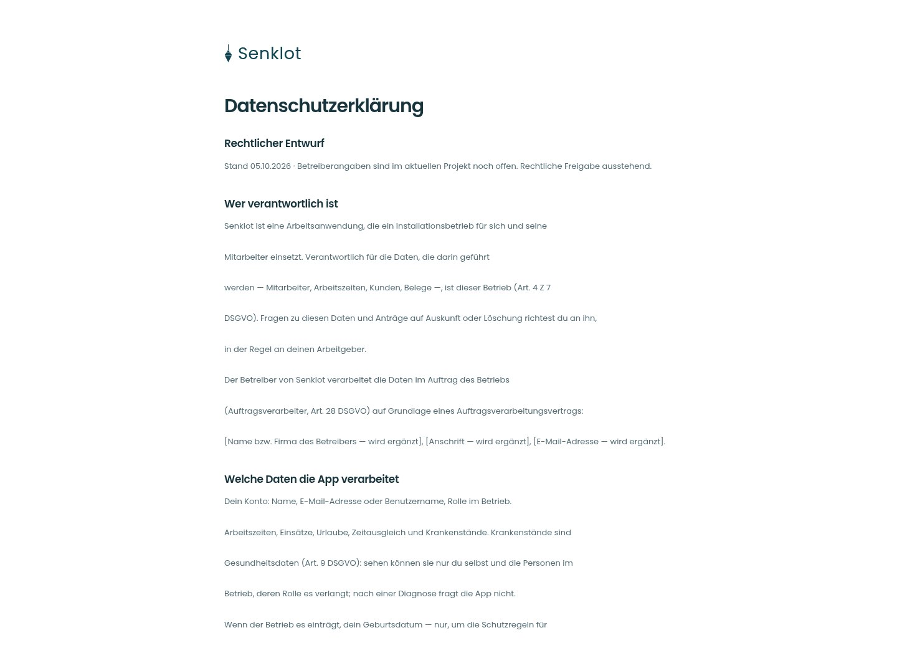
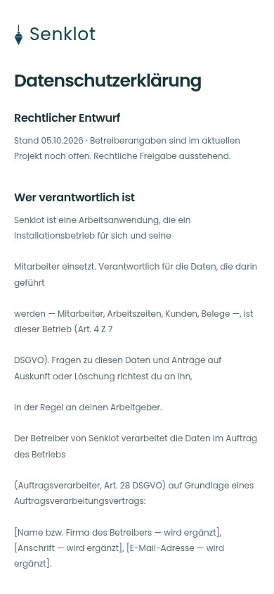
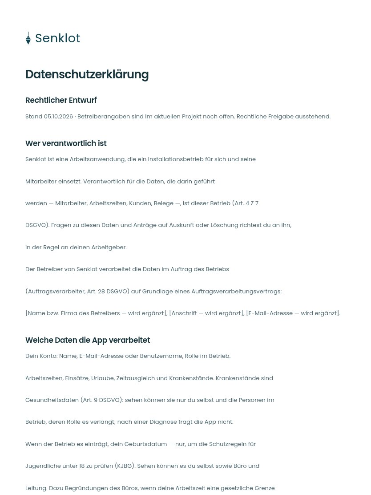

# 010 · Datenschutzerklärung

[Zur Gesamtübersicht](../README.md) · [Vollständiges Konzept](../Konzept.md)

**Bereich:** Zugang · **Bestandsort:** `/datenschutz`

Handy · 390 px

[Ganze Seite ansehen](../bilder/010-datenschutz-handy-gesamt.jpg)

Tablet · 834 px

[Ganze Seite ansehen](../bilder/010-datenschutz-tablet-gesamt.jpg)

[Desktop in voller Seitenlänge](../bilder/010-datenschutz-desktop-gesamt.jpg)

## Entscheidung

Lesespalte mit ruhiger Hierarchie. Keine erfundenen Betreiberangaben und keine gekürzten Rechtstexte.

**Gezeigte Rolle:** Geschäftsführung. Sichtbarkeit und Aktionen bleiben an bestehende Rollen, Zusatzrechte, Module und Datensatzstatus gebunden.

**Hauptaktion:** Keine zusätzliche Hauptaktion.

**Handy/Tablet:** Zeilen statt zusätzlicher Karten; Hauptaktion bleibt gut erreichbar.

## Muss erhalten bleiben

- Öffentlich ohne Anmeldung erreichbar
- Vollständiger Rechtstext aus dem Bestand
- GEPRUEFT=false bleibt sichtbar; neue Gestaltung ersetzt keine rechtliche Freigabe
- Wortlaut aus den bestehenden Abschnitten übernommen

## Quelle

- [src/features/recht/DatenschutzView.tsx](https://github.com/juliandeutsch22/Prototype-App-Installateure/blob/d4b8542821d86c7057761af16de1331d1de87e09/src/features/recht/DatenschutzView.tsx)

Gestaltungsvorschau mit fiktiven Beispieldaten. Keine Änderung oder Auslieferung der App.
