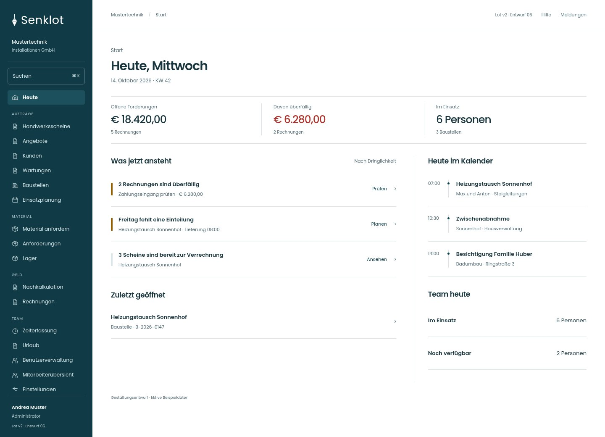
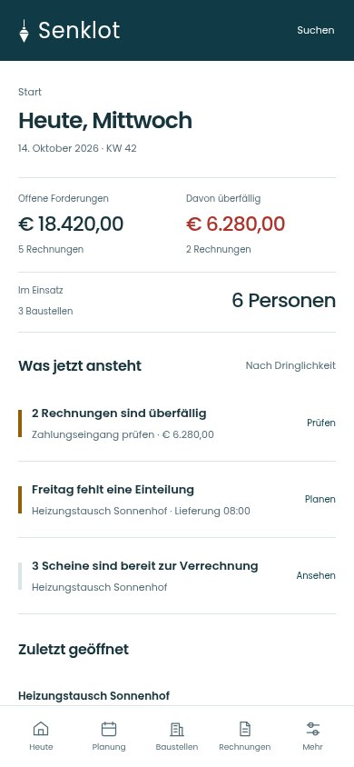
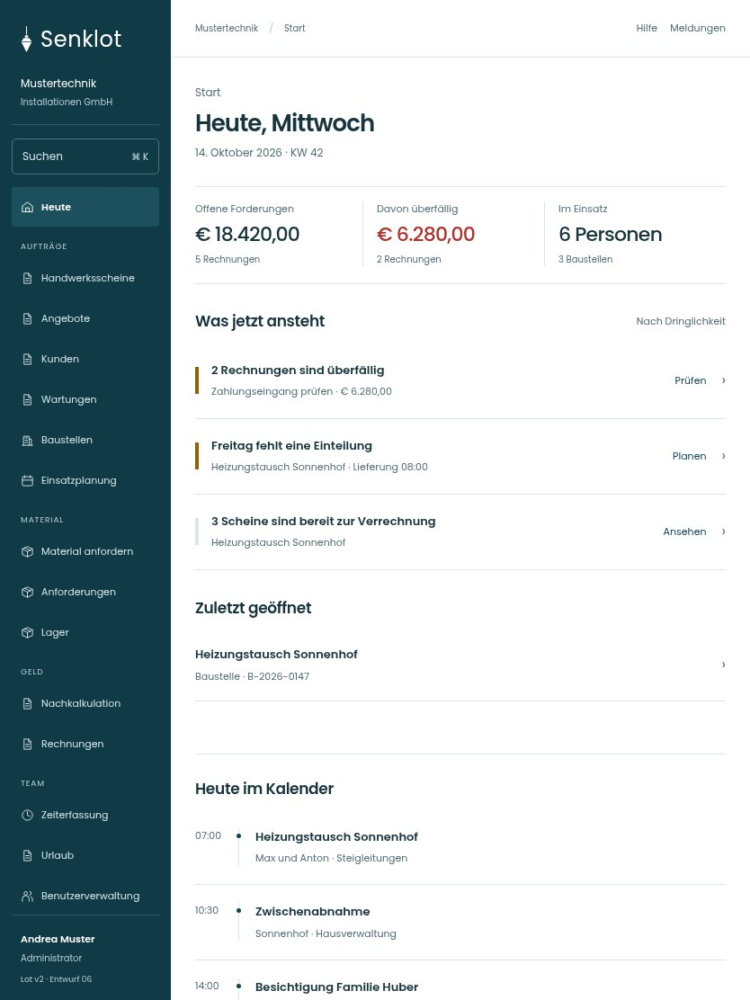

# 016 · Heute, Mittwoch

[Zur Gesamtübersicht](../README.md) · [Vollständiges Konzept](../Konzept.md)

**Bereich:** Start · **Bestandsort:** `/`

Handy · 390 px

[Ganze Seite ansehen](../bilder/016-heute-admin-handy-gesamt.jpg)

Tablet · 834 px

[Ganze Seite ansehen](../bilder/016-heute-admin-tablet-gesamt.jpg)

## Entscheidung

Nur eigene Aufgaben bzw. Aufgaben mit Zuständigkeit. Keine Erfolgsbanner oder Fortschrittsketten.

**Gezeigte Rolle:** Administrator. Sichtbarkeit und Aktionen bleiben an bestehende Rollen, Zusatzrechte, Module und Datensatzstatus gebunden.

**Hauptaktion:** Keine zusätzliche Hauptaktion.

**Handy/Tablet:** Zeilen statt zusätzlicher Karten; Hauptaktion bleibt gut erreichbar.

## Muss erhalten bleiben

- Rollenabhängiger Handlungsbedarf
- Bestehende Ausfall- und Wartungshinweise
- Keine Margen oder fremden Zeitkonten für Projektleitung

## Quelle

- [src/features/dashboard/DashboardView.tsx](https://github.com/juliandeutsch22/Prototype-App-Installateure/blob/d4b8542821d86c7057761af16de1331d1de87e09/src/features/dashboard/DashboardView.tsx)
- [src/features/dashboard/start/HeuteEigene.tsx](https://github.com/juliandeutsch22/Prototype-App-Installateure/blob/d4b8542821d86c7057761af16de1331d1de87e09/src/features/dashboard/start/HeuteEigene.tsx)
- [src/features/dashboard/start/HeuteLeitung.tsx](https://github.com/juliandeutsch22/Prototype-App-Installateure/blob/d4b8542821d86c7057761af16de1331d1de87e09/src/features/dashboard/start/HeuteLeitung.tsx)
- [src/features/dashboard/start/Handlungsbedarf.tsx](https://github.com/juliandeutsch22/Prototype-App-Installateure/blob/d4b8542821d86c7057761af16de1331d1de87e09/src/features/dashboard/start/Handlungsbedarf.tsx)

Gestaltungsvorschau mit fiktiven Beispieldaten. Keine Änderung oder Auslieferung der App.
