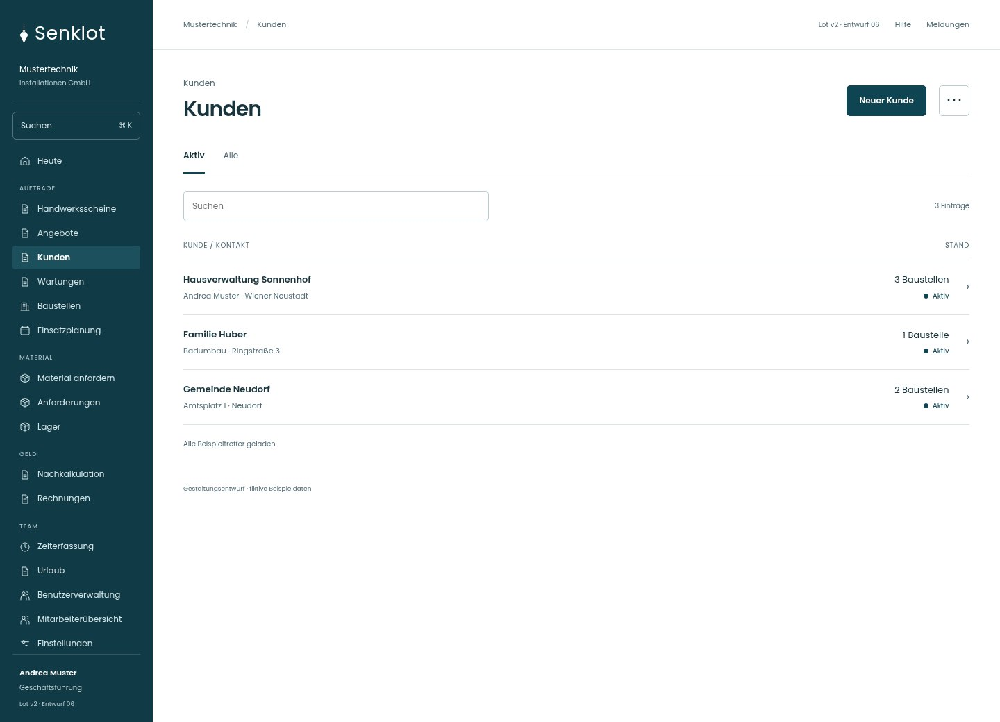
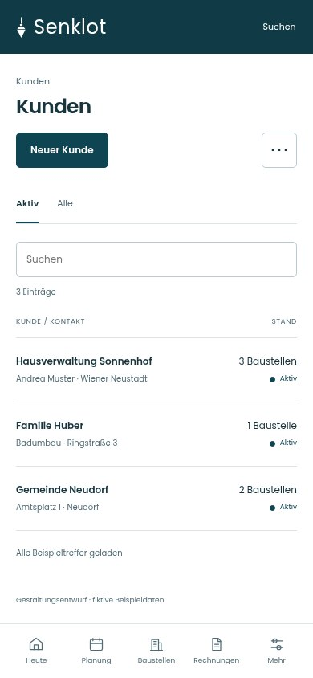
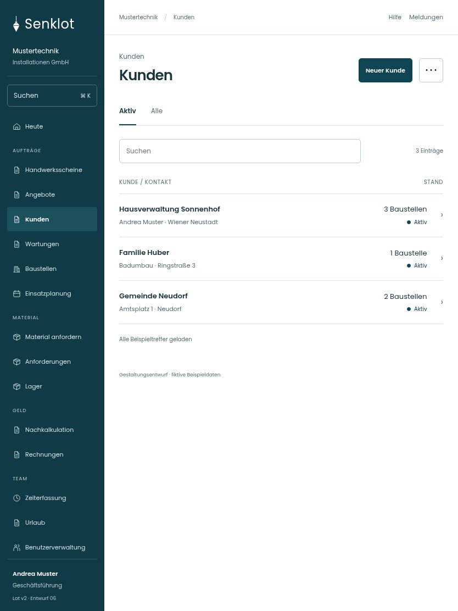

# 017 · Kunden

[Zur Gesamtübersicht](../README.md) · [Vollständiges Konzept](../Konzept.md)

**Bereich:** Kunden · **Bestandsort:** `/customers`

Handy · 390 px

Tablet · 834 px

## Entscheidung

Nur arbeitsrelevante Angaben; Details über die Zeile öffnen.

**Gezeigte Rolle:** Geschäftsführung. Sichtbarkeit und Aktionen bleiben an bestehende Rollen, Zusatzrechte, Module und Datensatzstatus gebunden.

**Hauptaktion:** Neuer Kunde.

**Weitere Aktionen:** Kunden importieren, Baustellen zuordnen.

**Handy/Tablet:** Zeilen statt zusätzlicher Karten; Hauptaktion bleibt gut erreichbar.

## Muss erhalten bleiben

- Kundenpflegerecht je Benutzer
- Dublettenprüfung
- Import
- Übernahme bestehender Baustellen
- Verwaltung/Buchhaltung nur mit kundenPflegen; sonst lesend ohne Pflegeaktionen

## Quelle

- [src/features/customers/CustomersView.tsx](https://github.com/juliandeutsch22/Prototype-App-Installateure/blob/d4b8542821d86c7057761af16de1331d1de87e09/src/features/customers/CustomersView.tsx)

Gestaltungsvorschau mit fiktiven Beispieldaten. Keine Änderung oder Auslieferung der App.
