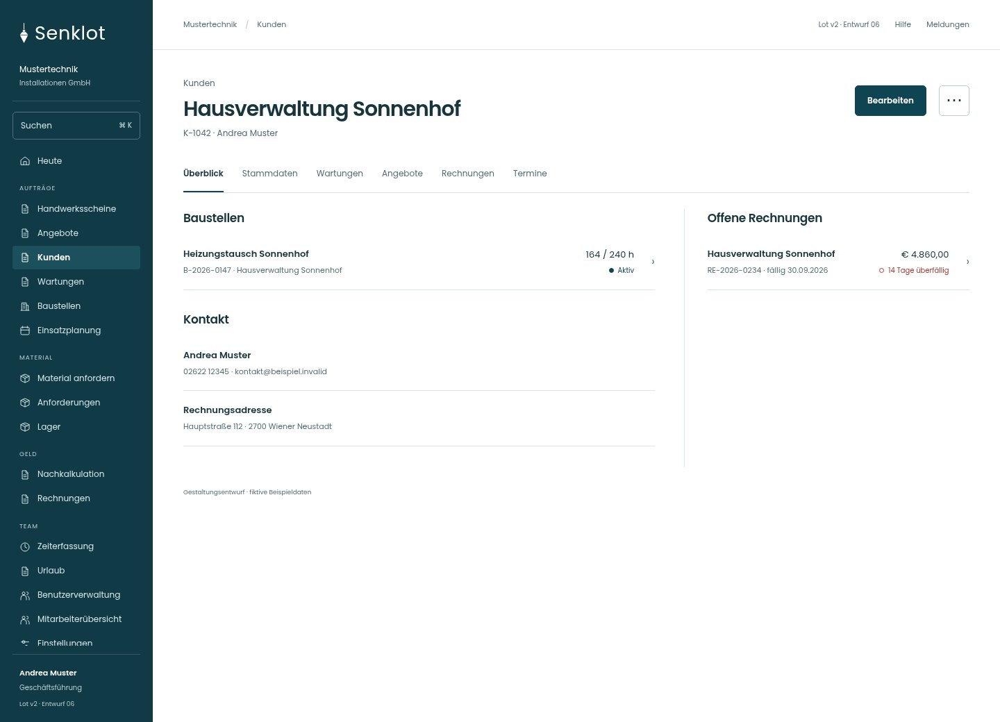
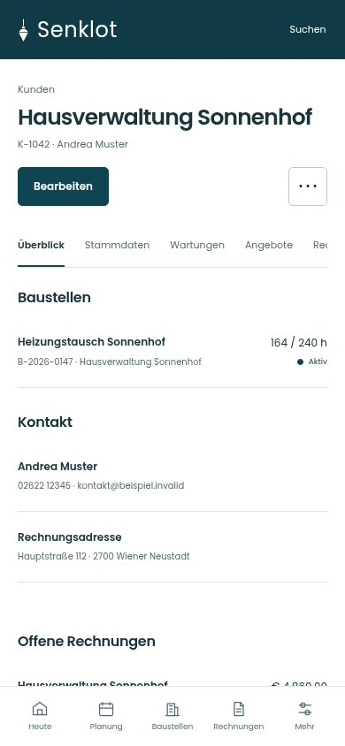
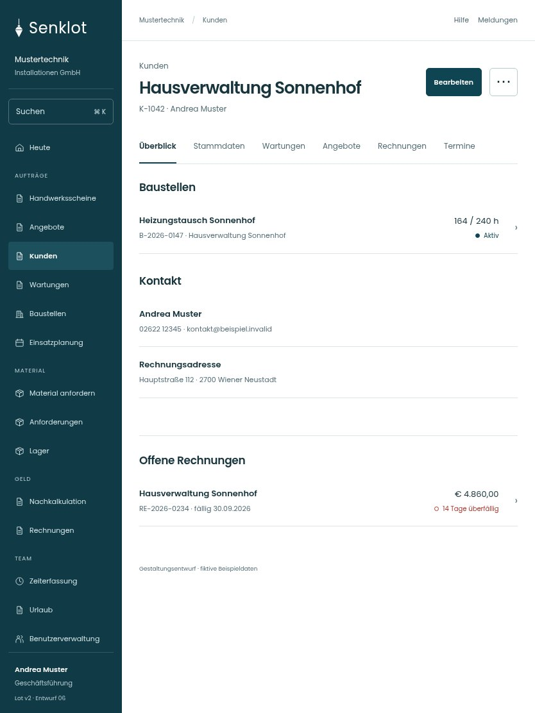

# 019 · Hausverwaltung Sonnenhof

[Zur Gesamtübersicht](../README.md) · [Vollständiges Konzept](../Konzept.md)

**Bereich:** Kunden · **Bestandsort:** `/customers/:id`

Handy · 390 px

[Ganze Seite ansehen](../bilder/019-kundenakte-handy-gesamt.jpg)

Tablet · 834 px

## Entscheidung

Die Akte verbindet vorhandene Vorgänge. Keine separate Prozessgrafik und keine duplizierten Linklisten.

**Gezeigte Rolle:** Geschäftsführung. Sichtbarkeit und Aktionen bleiben an bestehende Rollen, Zusatzrechte, Module und Datensatzstatus gebunden.

**Hauptaktion:** Bearbeiten.

**Weitere Aktionen:** Datenauskunft.

**Handy/Tablet:** Zeilen statt zusätzlicher Karten; Hauptaktion bleibt gut erreichbar.

## Muss erhalten bleiben

- Rechnungen und Angebote nur nach Recht/Modul
- UID-/VIES-Prüfstatus
- Löschen und Deaktivieren getrennt
- Datenauskunft

## Quelle

- [src/features/customers/KundenakteView.tsx](https://github.com/juliandeutsch22/Prototype-App-Installateure/blob/d4b8542821d86c7057761af16de1331d1de87e09/src/features/customers/KundenakteView.tsx)
- [src/features/customers/UidVies.tsx](https://github.com/juliandeutsch22/Prototype-App-Installateure/blob/d4b8542821d86c7057761af16de1331d1de87e09/src/features/customers/UidVies.tsx)
- [src/features/recht/Datenauskunft.tsx](https://github.com/juliandeutsch22/Prototype-App-Installateure/blob/d4b8542821d86c7057761af16de1331d1de87e09/src/features/recht/Datenauskunft.tsx)

Gestaltungsvorschau mit fiktiven Beispieldaten. Keine Änderung oder Auslieferung der App.
