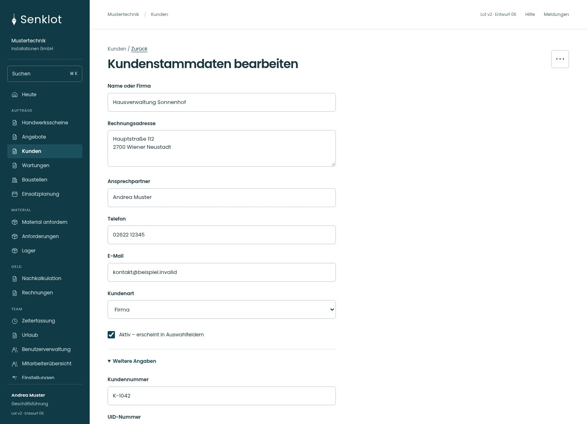
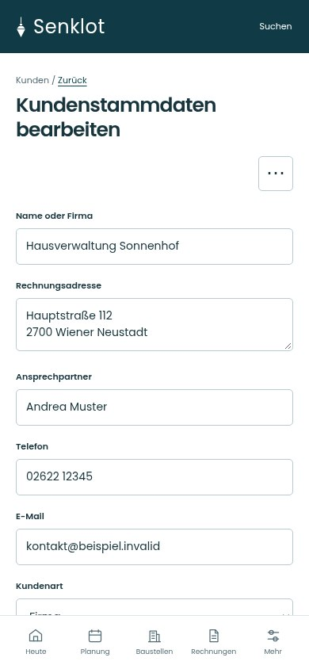
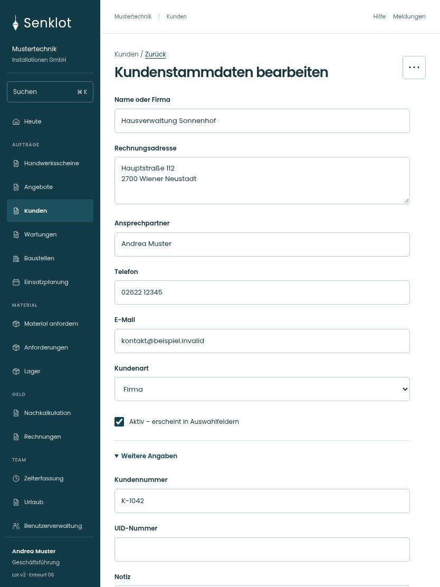

# 020 · Kundenstammdaten bearbeiten

[Zur Gesamtübersicht](../README.md) · [Vollständiges Konzept](../Konzept.md)

**Bereich:** Kunden · **Bestandsort:** `/customers/:id · Stammdaten`

Handy · 390 px

[Ganze Seite ansehen](../bilder/020-kunde-bearbeiten-handy-gesamt.jpg)

Tablet · 834 px

[Ganze Seite ansehen](../bilder/020-kunde-bearbeiten-tablet-gesamt.jpg)

[Desktop in voller Seitenlänge](../bilder/020-kunde-bearbeiten-desktop-gesamt.jpg)

## Entscheidung

Nur arbeitsrelevante Angaben; Details über die Zeile öffnen.

**Gezeigte Rolle:** Geschäftsführung. Sichtbarkeit und Aktionen bleiben an bestehende Rollen, Zusatzrechte, Module und Datensatzstatus gebunden.

**Hauptaktion:** Änderungen speichern.

**Weitere Aktionen:** UID prüfen, Kunde löschen.

**Handy/Tablet:** Zeilen statt zusätzlicher Karten; Hauptaktion bleibt gut erreichbar.

## Muss erhalten bleiben

- Ungespeichert-Warnung
- UID-Prüfung separat auslösbar
- Aktive Bezüge verhindern unzulässiges Löschen
- Verwaltung/Buchhaltung nur mit kundenPflegen; sonst lesend ohne Pflegeaktionen

## Felder

- Name oder Firma
- Rechnungsadresse
- Kundennummer · bei Bedarf
- Ansprechpartner
- Telefon
- E-Mail
- Kundenart
- UID-Nummer · bei Bedarf
- Notiz · bei Bedarf
- Aktiv – erscheint in Auswahlfeldern

## Quelle

- [src/features/customers/KundenakteView.tsx](https://github.com/juliandeutsch22/Prototype-App-Installateure/blob/d4b8542821d86c7057761af16de1331d1de87e09/src/features/customers/KundenakteView.tsx)
- [src/features/customers/UidVies.tsx](https://github.com/juliandeutsch22/Prototype-App-Installateure/blob/d4b8542821d86c7057761af16de1331d1de87e09/src/features/customers/UidVies.tsx)

Gestaltungsvorschau mit fiktiven Beispieldaten. Keine Änderung oder Auslieferung der App.
