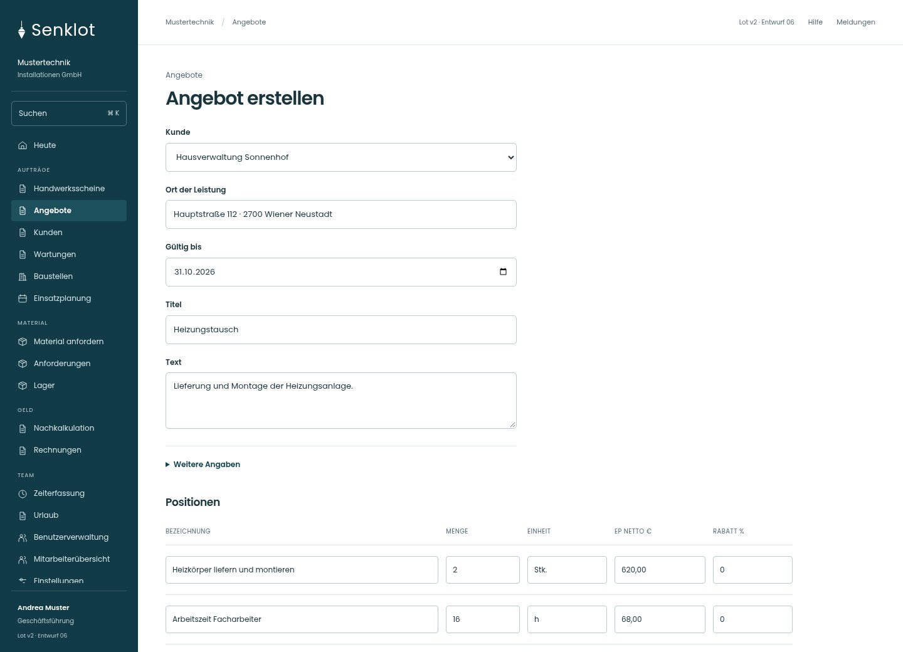
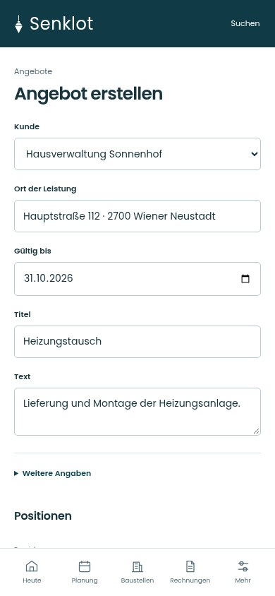
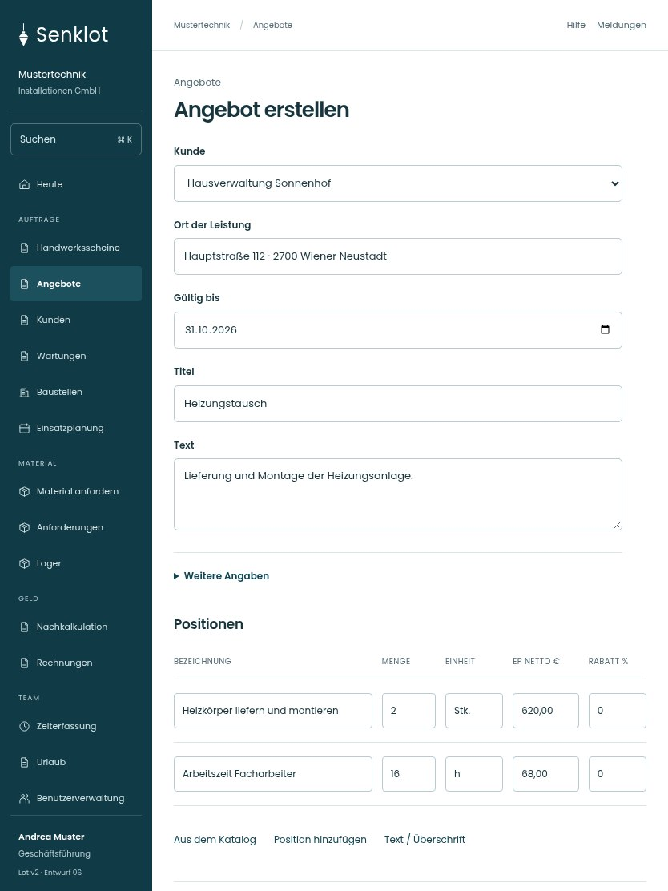

# 024 · Angebot erstellen

[Zur Gesamtübersicht](../README.md) · [Vollständiges Konzept](../Konzept.md)

**Bereich:** Angebote · **Bestandsort:** `/quotes · Entwurf`

Handy · 390 px

[Ganze Seite ansehen](../bilder/024-angebot-neu-handy-gesamt.jpg)

Tablet · 834 px

[Ganze Seite ansehen](../bilder/024-angebot-neu-tablet-gesamt.jpg)

[Desktop in voller Seitenlänge](../bilder/024-angebot-neu-desktop-gesamt.jpg)

## Entscheidung

Nur arbeitsrelevante Angaben; Details über die Zeile öffnen.

**Gezeigte Rolle:** Geschäftsführung. Sichtbarkeit und Aktionen bleiben an bestehende Rollen, Zusatzrechte, Module und Datensatzstatus gebunden.

**Hauptaktion:** Angebot speichern.

**Handy/Tablet:** Zeilen statt zusätzlicher Karten; Hauptaktion bleibt gut erreichbar.

## Muss erhalten bleiben

- Text- und Titelpositionen
- Menge/Einheit/Einzelpreis/Rabatt
- Arbeitszeit markierbar
- Katalogartikel
- Belegsumme und Steuer
- Katalog direkt an den Positionen erreichbar

## Felder

- Kunde
- Ort der Leistung
- Gültig bis
- Titel
- Text
- Anmerkungen · bei Bedarf

Positionsfelder: Bezeichnung, Menge, Einheit, Einzelpreis netto, Rabatt; außerdem Text- und Überschriftspositionen sowie Katalogübernahme nach Bestand.

## Quelle

- [src/features/quotes/QuotesView.tsx](https://github.com/juliandeutsch22/Prototype-App-Installateure/blob/d4b8542821d86c7057761af16de1331d1de87e09/src/features/quotes/QuotesView.tsx)
- [src/features/quotes/KatalogSuche.tsx](https://github.com/juliandeutsch22/Prototype-App-Installateure/blob/d4b8542821d86c7057761af16de1331d1de87e09/src/features/quotes/KatalogSuche.tsx)

Gestaltungsvorschau mit fiktiven Beispieldaten. Keine Änderung oder Auslieferung der App.
