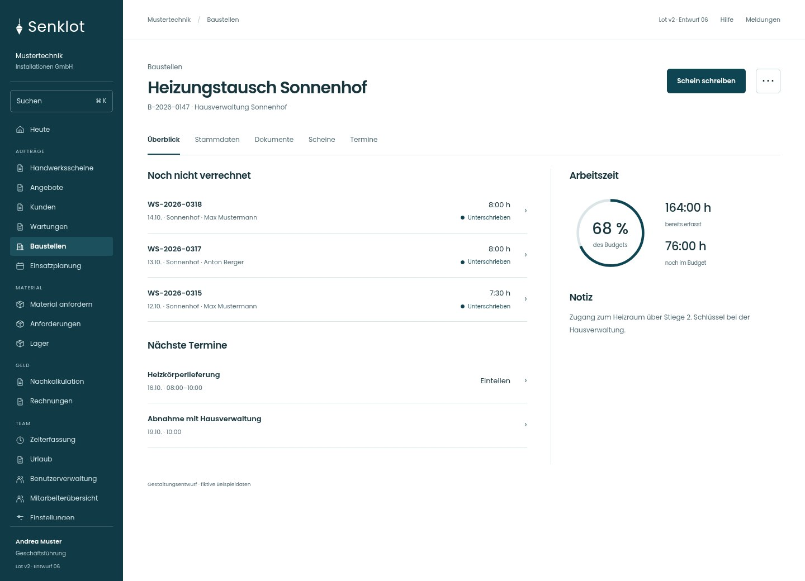
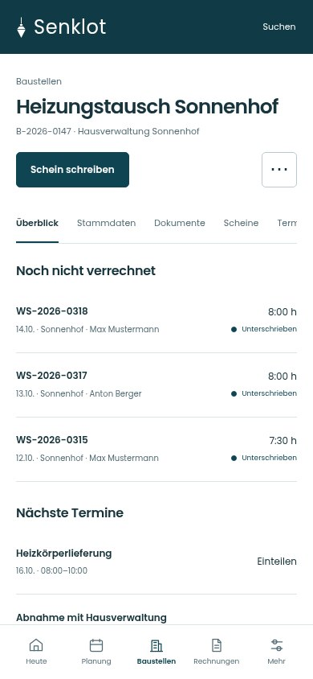
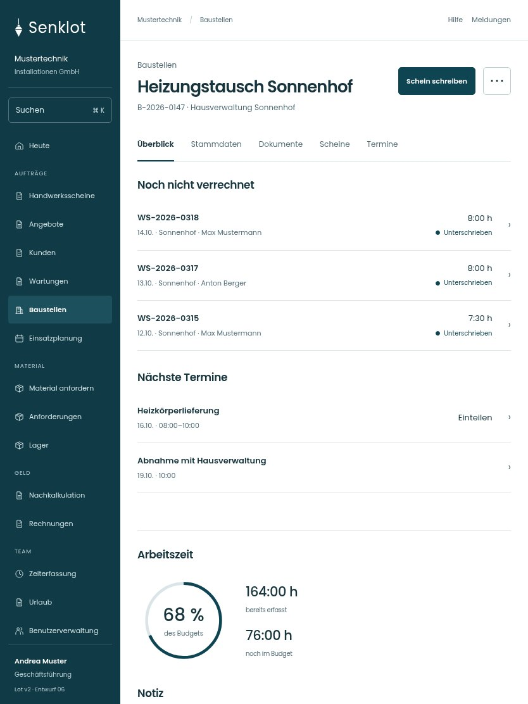

# 030 · Heizungstausch Sonnenhof

[Zur Gesamtübersicht](../README.md) · [Vollständiges Konzept](../Konzept.md)

**Bereich:** Baustellen · **Bestandsort:** `/admin-projects/:id`

Handy · 390 px

[Ganze Seite ansehen](../bilder/030-baustelle-handy-gesamt.jpg)

Tablet · 834 px

[Ganze Seite ansehen](../bilder/030-baustelle-tablet-gesamt.jpg)

## Entscheidung

Arbeitsstand links, Budget und Notiz rechts. Keine zusätzliche Prozesskette und kein zweiter Verrechnungsbanner.

**Gezeigte Rolle:** Geschäftsführung. Sichtbarkeit und Aktionen bleiben an bestehende Rollen, Zusatzrechte, Module und Datensatzstatus gebunden.

**Hauptaktion:** Schein schreiben.

**Weitere Aktionen:** Baustelle bearbeiten.

**Handy/Tablet:** Zeilen statt zusätzlicher Karten; Hauptaktion bleibt gut erreichbar.

## Muss erhalten bleiben

- Team und Projektleitung
- Angebot der Baustelle
- Abrechnung/Budget
- Warnungen zum Betriebsurlaub
- Kunde/Rechnungszugriff nach Recht

## Quelle

- [src/features/projects/BaustellenakteView.tsx](https://github.com/juliandeutsch22/Prototype-App-Installateure/blob/d4b8542821d86c7057761af16de1331d1de87e09/src/features/projects/BaustellenakteView.tsx)
- [src/features/projects/BaustellenUebersicht.tsx](https://github.com/juliandeutsch22/Prototype-App-Installateure/blob/d4b8542821d86c7057761af16de1331d1de87e09/src/features/projects/BaustellenUebersicht.tsx)

Gestaltungsvorschau mit fiktiven Beispieldaten. Keine Änderung oder Auslieferung der App.
