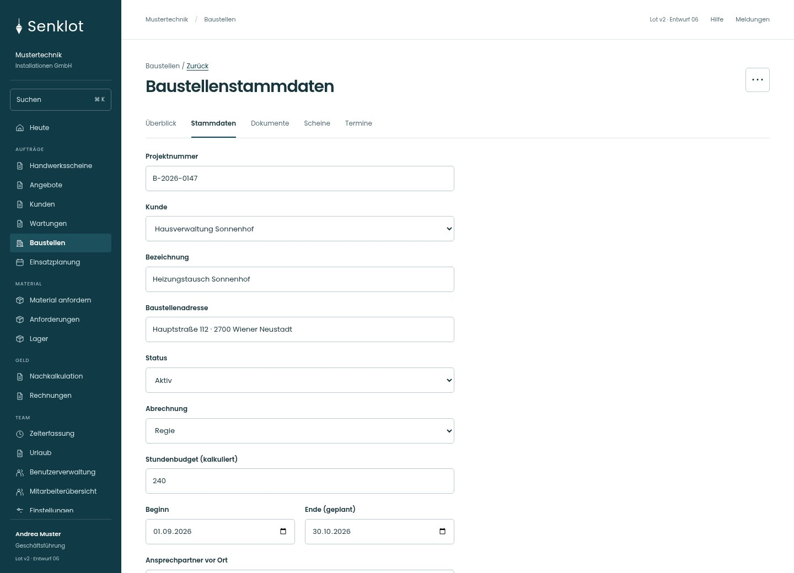
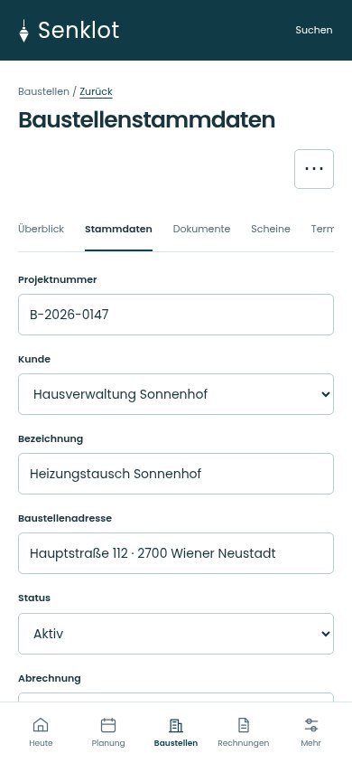
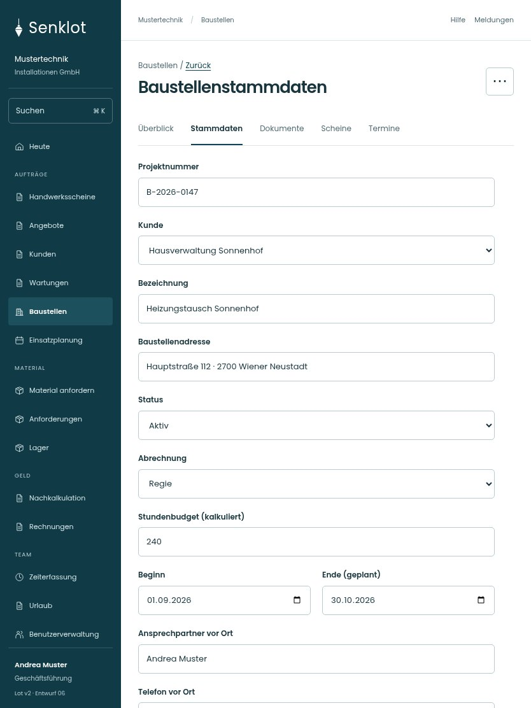

# 031 · Baustellenstammdaten

[Zur Gesamtübersicht](../README.md) · [Vollständiges Konzept](../Konzept.md)

**Bereich:** Baustellen · **Bestandsort:** `/admin-projects/:id · Stammdaten`

Handy · 390 px

[Ganze Seite ansehen](../bilder/031-baustelle-daten-handy-gesamt.jpg)

Tablet · 834 px

[Ganze Seite ansehen](../bilder/031-baustelle-daten-tablet-gesamt.jpg)

[Desktop in voller Seitenlänge](../bilder/031-baustelle-daten-desktop-gesamt.jpg)

## Entscheidung

Nur arbeitsrelevante Angaben; Details über die Zeile öffnen.

**Gezeigte Rolle:** Geschäftsführung. Sichtbarkeit und Aktionen bleiben an bestehende Rollen, Zusatzrechte, Module und Datensatzstatus gebunden.

**Hauptaktion:** Änderungen speichern.

**Weitere Aktionen:** Baustelle löschen.

**Handy/Tablet:** Zeilen statt zusätzlicher Karten; Hauptaktion bleibt gut erreichbar.

## Muss erhalten bleiben

- Warnung bei Nummernänderung
- Ungespeicherte Angaben
- Bisher zugeordnete deaktivierte Personen bleiben sichtbar

## Felder

- Projektnummer
- Kunde
- Bezeichnung
- Baustellenadresse
- Status
- Abrechnung
- Stundenbudget (kalkuliert)
- Beginn
- Ende (geplant)
- Ansprechpartner vor Ort
- Telefon vor Ort
- Beschreibung / Auftragsumfang
- Team
- Projektleitung

## Quelle

- [src/features/projects/BaustellenakteView.tsx](https://github.com/juliandeutsch22/Prototype-App-Installateure/blob/d4b8542821d86c7057761af16de1331d1de87e09/src/features/projects/BaustellenakteView.tsx)

Gestaltungsvorschau mit fiktiven Beispieldaten. Keine Änderung oder Auslieferung der App.
