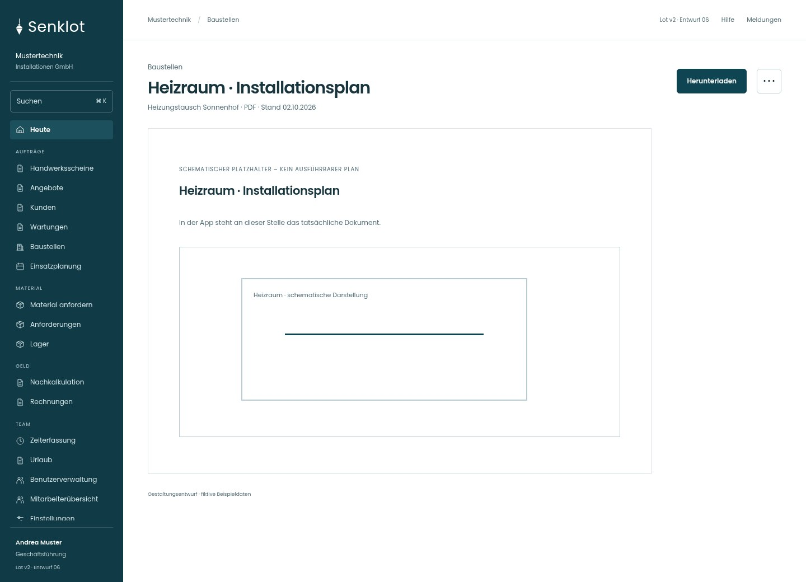
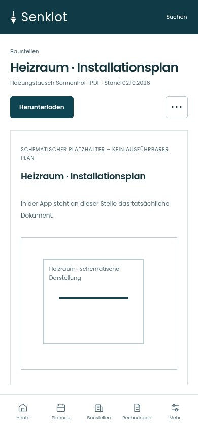
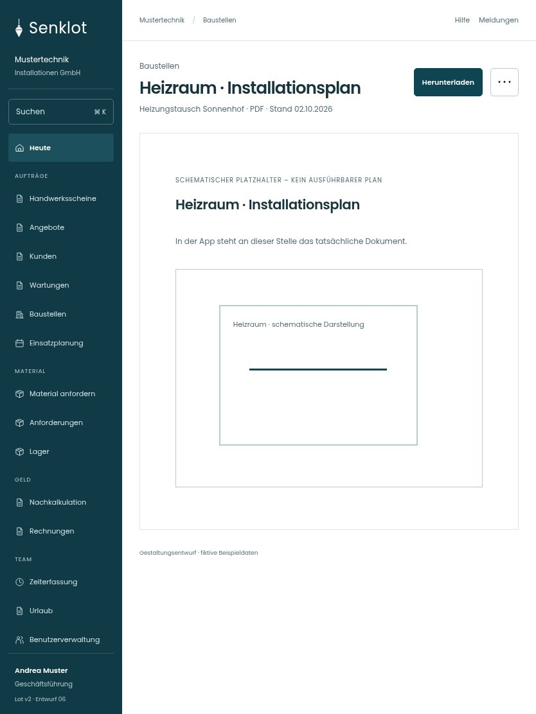

# 034 · Heizraum · Installationsplan

[Zur Gesamtübersicht](../README.md) · [Vollständiges Konzept](../Konzept.md)

**Bereich:** Baustellen · **Bestandsort:** `Dokumentvorschau / Download`

Handy · 390 px

Tablet · 834 px

## Entscheidung

Dokumentfläche nutzt die verfügbare Breite. Metadaten und Download bleiben am Rand; kein zusätzlicher Dekorrahmen.

**Gezeigte Rolle:** Geschäftsführung. Sichtbarkeit und Aktionen bleiben an bestehende Rollen, Zusatzrechte, Module und Datensatzstatus gebunden.

**Hauptaktion:** Herunterladen.

**Weitere Aktionen:** Zur Dokumentliste.

**Handy/Tablet:** Zeilen statt zusätzlicher Karten; Hauptaktion bleibt gut erreichbar.

## Muss erhalten bleiben

- Tatsächlichen Inhalt anzeigen
- Fehler/abgelaufenen Zugriff verständlich melden

## Quelle

- [src/features/projects/PlaeneListe.tsx](https://github.com/juliandeutsch22/Prototype-App-Installateure/blob/d4b8542821d86c7057761af16de1331d1de87e09/src/features/projects/PlaeneListe.tsx)

Gestaltungsvorschau mit fiktiven Beispieldaten. Keine Änderung oder Auslieferung der App.
