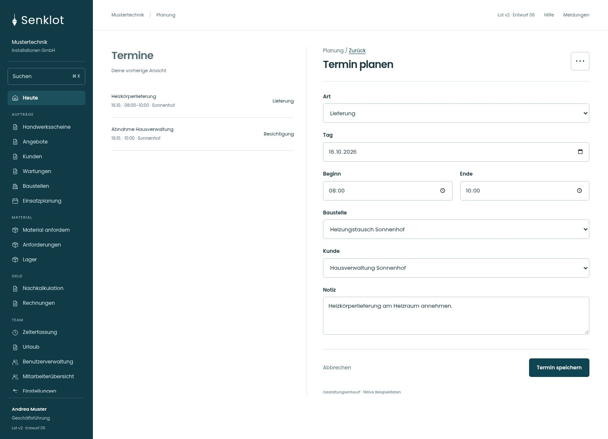
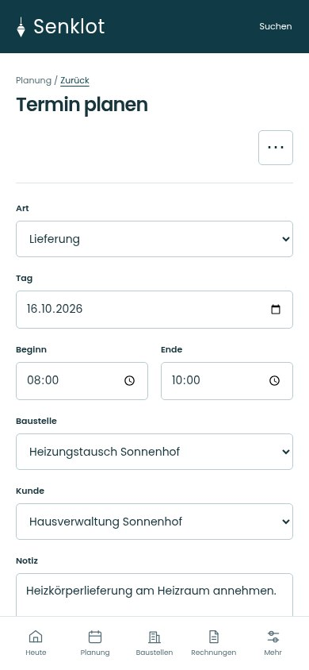
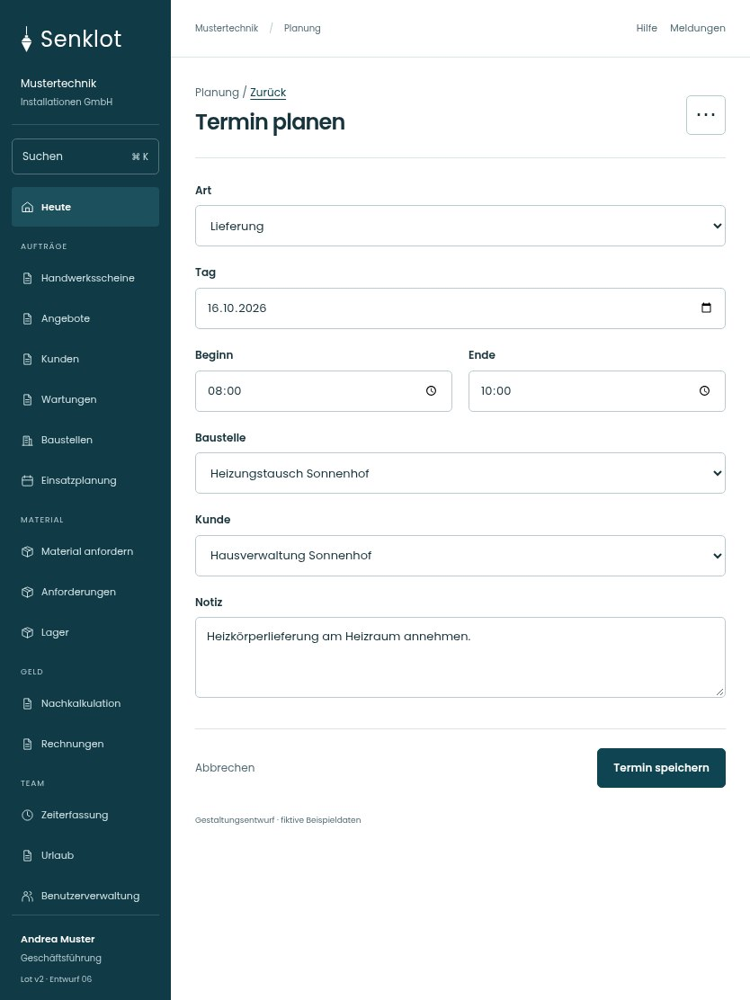

# 039 · Termin planen

[Zur Gesamtübersicht](../README.md) · [Vollständiges Konzept](../Konzept.md)

**Bereich:** Planung · **Bestandsort:** `Terminfenster`

Handy · 390 px

[Ganze Seite ansehen](../bilder/039-termin-handy-gesamt.jpg)

Tablet · 834 px

## Entscheidung

Nur arbeitsrelevante Angaben; Details über die Zeile öffnen.

**Gezeigte Rolle:** Geschäftsführung. Sichtbarkeit und Aktionen bleiben an bestehende Rollen, Zusatzrechte, Module und Datensatzstatus gebunden.

**Hauptaktion:** Termin speichern.

**Weitere Aktionen:** Termin löschen.

**Handy/Tablet:** Zeilen statt zusätzlicher Karten; Hauptaktion bleibt gut erreichbar.

## Muss erhalten bleiben

## Felder

- Art
- Tag
- Beginn
- Ende
- Baustelle
- Kunde
- Notiz

## Quelle

- [src/features/termine/TerminFenster.tsx](https://github.com/juliandeutsch22/Prototype-App-Installateure/blob/d4b8542821d86c7057761af16de1331d1de87e09/src/features/termine/TerminFenster.tsx)
- [src/features/termine/TerminFormular.tsx](https://github.com/juliandeutsch22/Prototype-App-Installateure/blob/d4b8542821d86c7057761af16de1331d1de87e09/src/features/termine/TerminFormular.tsx)

Gestaltungsvorschau mit fiktiven Beispieldaten. Keine Änderung oder Auslieferung der App.
