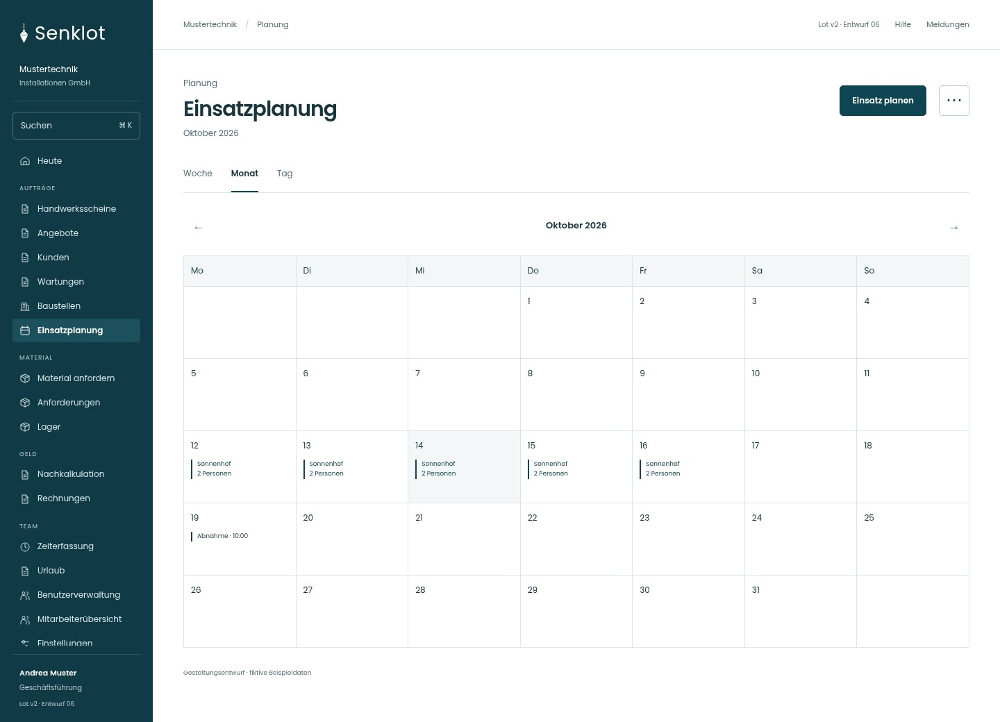
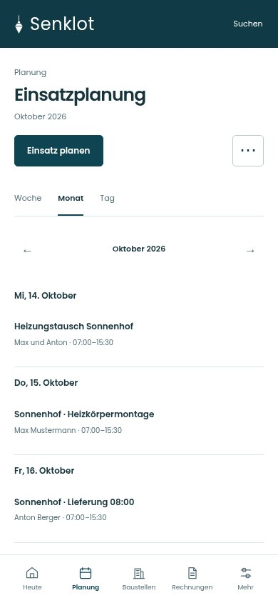
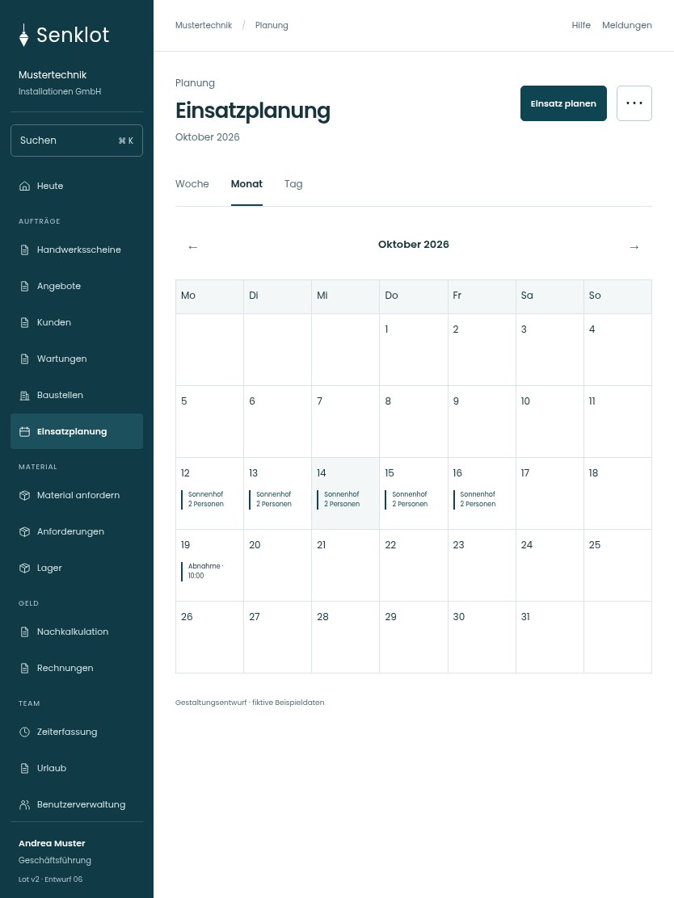

# 041 · Einsatzplanung

[Zur Gesamtübersicht](../README.md) · [Vollständiges Konzept](../Konzept.md)

**Bereich:** Planung · **Bestandsort:** `/assignments/woche?ansicht=monat`

Handy · 390 px

Tablet · 834 px

## Entscheidung

Das Raster ist selbst das Arbeitswerkzeug. Freie Kapazität steht am betroffenen Tag, keine zusätzliche Statistikreihe.

**Gezeigte Rolle:** Geschäftsführung. Sichtbarkeit und Aktionen bleiben an bestehende Rollen, Zusatzrechte, Module und Datensatzstatus gebunden.

**Hauptaktion:** Einsatz planen.

**Weitere Aktionen:** Kalender abonnieren.

**Handy/Tablet:** Zeilen statt zusätzlicher Karten; Hauptaktion bleibt gut erreichbar.

## Muss erhalten bleiben

- Personen-/Baustellenansicht
- Tag/Woche/Monat
- Abwesenheiten und Verfügbarkeit
- Einteilung bearbeiten/löschen
- Materialbedarf
- Kalender-Abo

## Quelle

- [src/features/assignments/WochenplanView.tsx](https://github.com/juliandeutsch22/Prototype-App-Installateure/blob/d4b8542821d86c7057761af16de1331d1de87e09/src/features/assignments/WochenplanView.tsx)
- [src/features/assignments/MonatsAnsicht.tsx](https://github.com/juliandeutsch22/Prototype-App-Installateure/blob/d4b8542821d86c7057761af16de1331d1de87e09/src/features/assignments/MonatsAnsicht.tsx)
- [src/features/assignments/AssignmentsView.tsx](https://github.com/juliandeutsch22/Prototype-App-Installateure/blob/d4b8542821d86c7057761af16de1331d1de87e09/src/features/assignments/AssignmentsView.tsx)

Gestaltungsvorschau mit fiktiven Beispieldaten. Keine Änderung oder Auslieferung der App.
