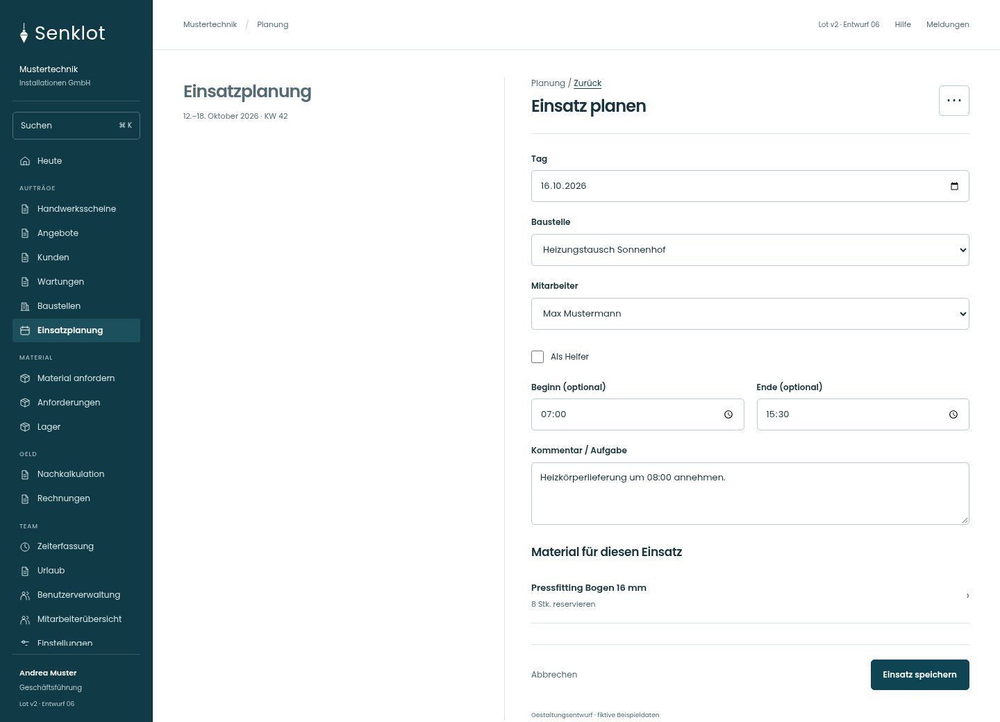
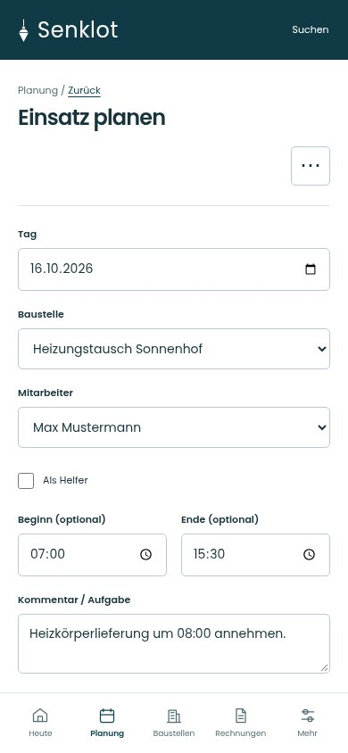
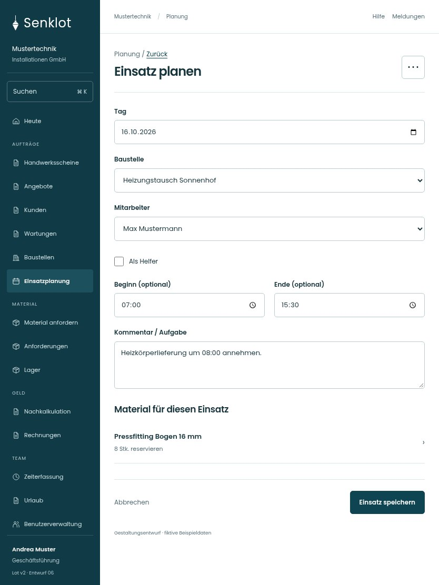

# 043 · Einsatz planen

[Zur Gesamtübersicht](../README.md) · [Vollständiges Konzept](../Konzept.md)

**Bereich:** Planung · **Bestandsort:** `/assignments · Einsatzfenster`

Handy · 390 px

[Ganze Seite ansehen](../bilder/043-planung-einsatz-handy-gesamt.jpg)

Tablet · 834 px

## Entscheidung

Nur arbeitsrelevante Angaben; Details über die Zeile öffnen.

**Gezeigte Rolle:** Geschäftsführung. Sichtbarkeit und Aktionen bleiben an bestehende Rollen, Zusatzrechte, Module und Datensatzstatus gebunden.

**Hauptaktion:** Einsatz speichern.

**Weitere Aktionen:** Material planen, Einsatz löschen.

**Handy/Tablet:** Zeilen statt zusätzlicher Karten; Hauptaktion bleibt gut erreichbar.

## Muss erhalten bleiben

- Doppelbelegung
- Lehrlinge korrekt einstufen
- Gespeicherte Einteilung bleibt bei Fehler sichtbar

## Felder

- Tag
- Baustelle
- Mitarbeiter
- Als Helfer
- Beginn (optional)
- Ende (optional)
- Kommentar / Aufgabe

## Quelle

- [src/features/assignments/EinsatzFenster.tsx](https://github.com/juliandeutsch22/Prototype-App-Installateure/blob/d4b8542821d86c7057761af16de1331d1de87e09/src/features/assignments/EinsatzFenster.tsx)
- [src/features/assignments/EinsatzFormular.tsx](https://github.com/juliandeutsch22/Prototype-App-Installateure/blob/d4b8542821d86c7057761af16de1331d1de87e09/src/features/assignments/EinsatzFormular.tsx)

Gestaltungsvorschau mit fiktiven Beispieldaten. Keine Änderung oder Auslieferung der App.
