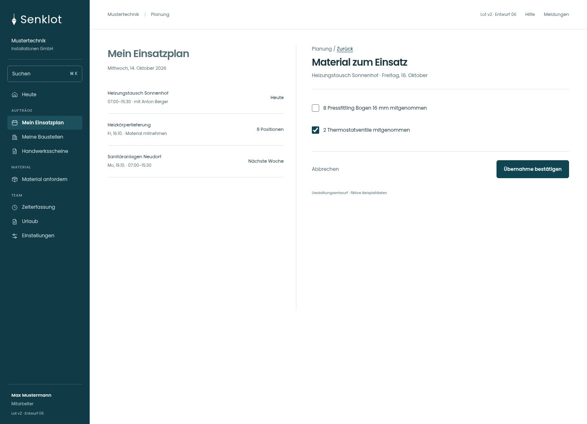
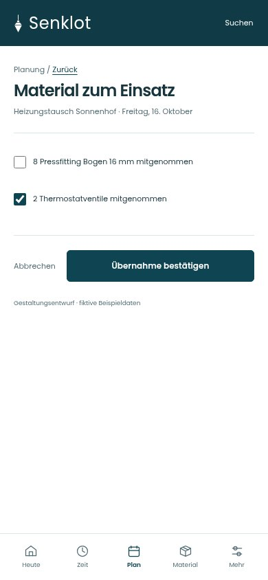
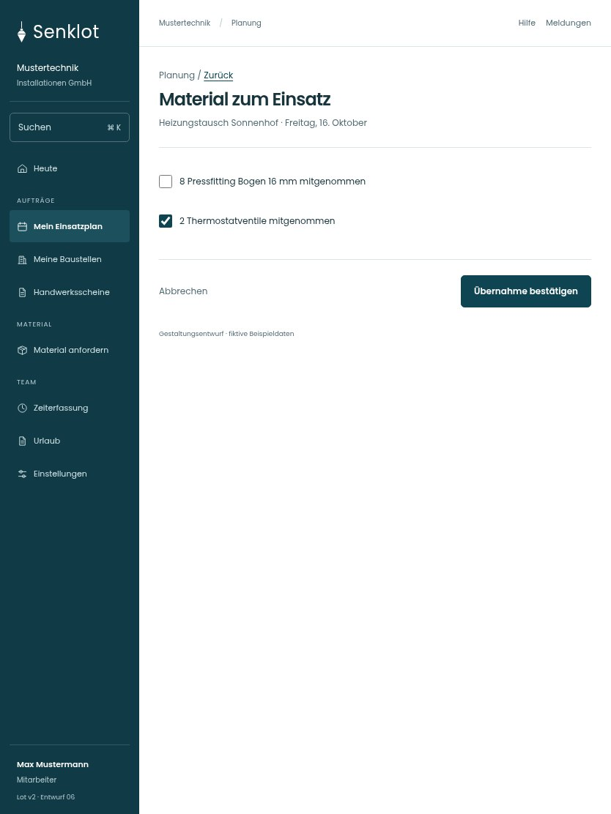

# 045 · Material zum Einsatz

[Zur Gesamtübersicht](../README.md) · [Vollständiges Konzept](../Konzept.md)

**Bereich:** Planung · **Bestandsort:** `/my-schedule · Rüstliste`

Handy · 390 px

Tablet · 834 px

## Entscheidung

Nur arbeitsrelevante Angaben; Details über die Zeile öffnen.

**Gezeigte Rolle:** Mitarbeiter. Sichtbarkeit und Aktionen bleiben an bestehende Rollen, Zusatzrechte, Module und Datensatzstatus gebunden.

**Hauptaktion:** Übernahme bestätigen.

**Handy/Tablet:** Zeilen statt zusätzlicher Karten; Hauptaktion bleibt gut erreichbar.

## Muss erhalten bleiben

- Nur eigener Einsatz
- Bestandswirkung nicht doppelt auslösen

## Felder

- 8 Pressfitting Bogen 16 mm mitgenommen
- 2 Thermostatventile mitgenommen

## Quelle

- [src/features/assignments/RuestlisteAbhaken.tsx](https://github.com/juliandeutsch22/Prototype-App-Installateure/blob/d4b8542821d86c7057761af16de1331d1de87e09/src/features/assignments/RuestlisteAbhaken.tsx)

Gestaltungsvorschau mit fiktiven Beispieldaten. Keine Änderung oder Auslieferung der App.
