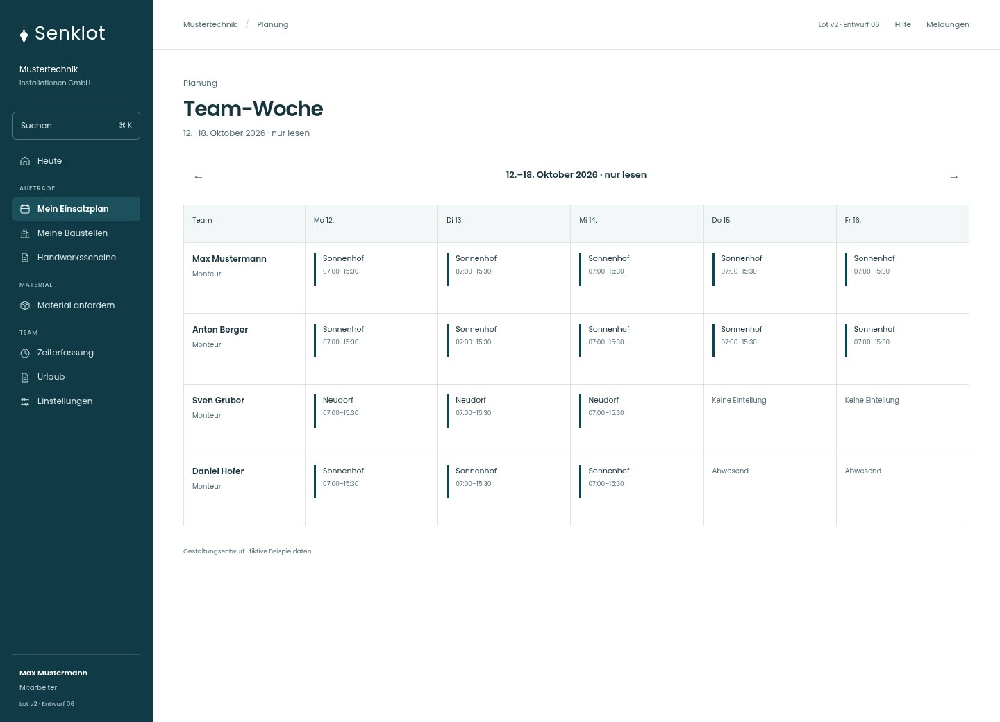
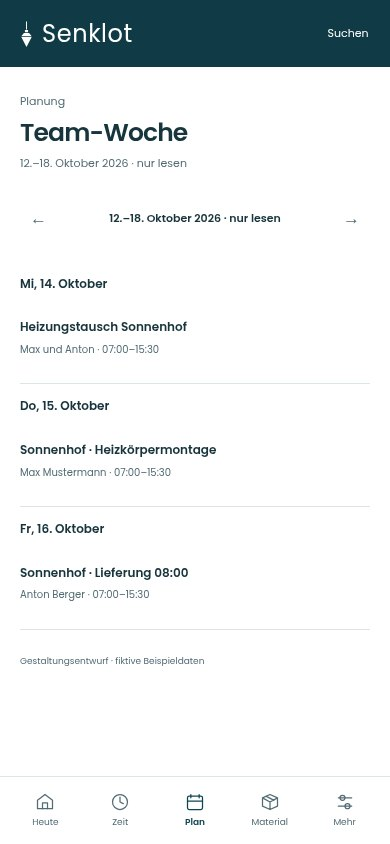
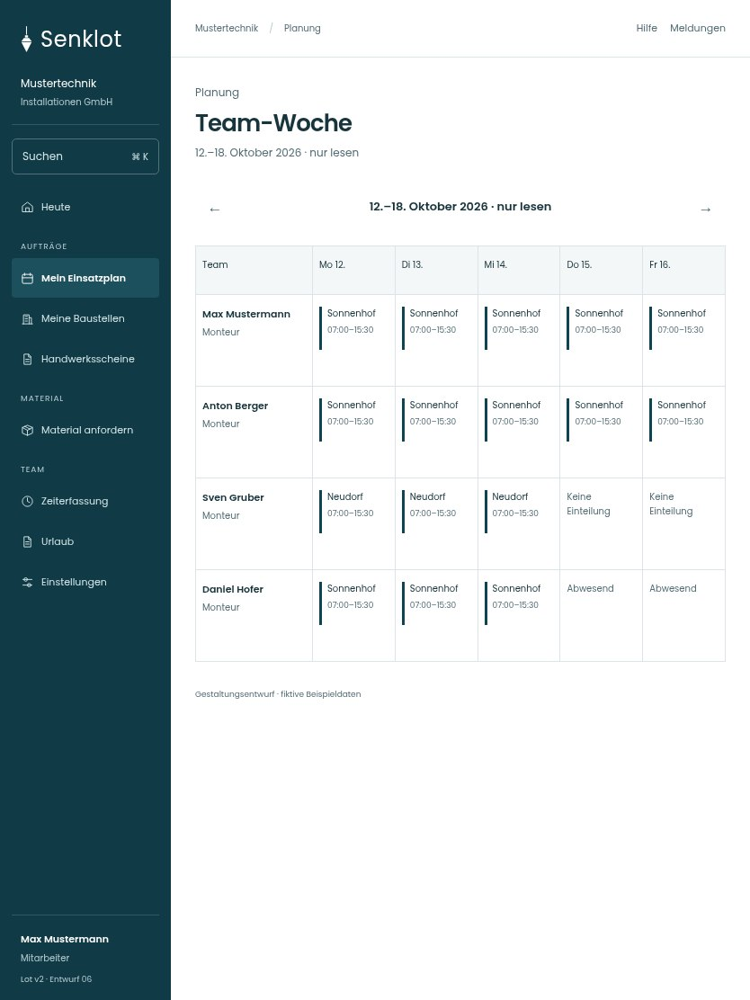

# 047 · Team-Woche

[Zur Gesamtübersicht](../README.md) · [Vollständiges Konzept](../Konzept.md)

**Bereich:** Planung · **Bestandsort:** `/my-schedule/team`

Handy · 390 px

Tablet · 834 px

## Entscheidung

Gleiches Raster wie Planung, aber ausschließlich lesend und ohne freie Kapazität oder Abwesenheitsgründe.

**Gezeigte Rolle:** Mitarbeiter. Sichtbarkeit und Aktionen bleiben an bestehende Rollen, Zusatzrechte, Module und Datensatzstatus gebunden.

**Hauptaktion:** Keine zusätzliche Hauptaktion.

**Handy/Tablet:** Zeilen statt zusätzlicher Karten; Hauptaktion bleibt gut erreichbar.

## Muss erhalten bleiben

- Nur bei wochenplanFuerAlle
- Abwesend ohne Grund
- Keine Planungsaktionen
- Datenbank-Sichtbarkeit bleibt gleich

## Quelle

- [src/features/assignments/TeamWoche.tsx](https://github.com/juliandeutsch22/Prototype-App-Installateure/blob/d4b8542821d86c7057761af16de1331d1de87e09/src/features/assignments/TeamWoche.tsx)
- [src/features/assignments/WochenplanView.tsx](https://github.com/juliandeutsch22/Prototype-App-Installateure/blob/d4b8542821d86c7057761af16de1331d1de87e09/src/features/assignments/WochenplanView.tsx)

Gestaltungsvorschau mit fiktiven Beispieldaten. Keine Änderung oder Auslieferung der App.
