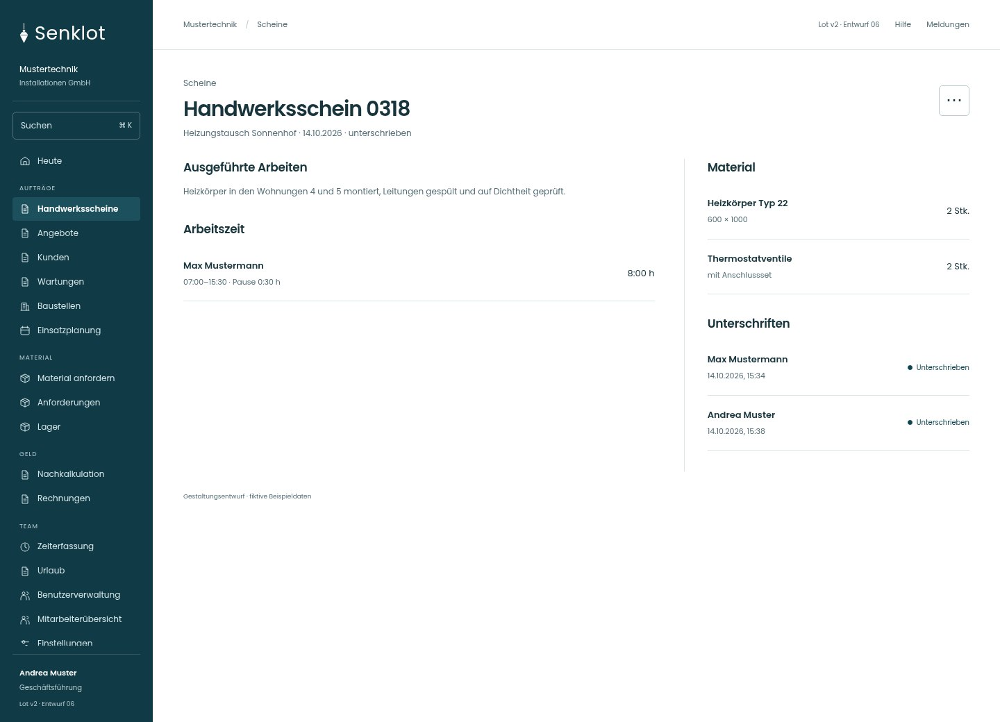
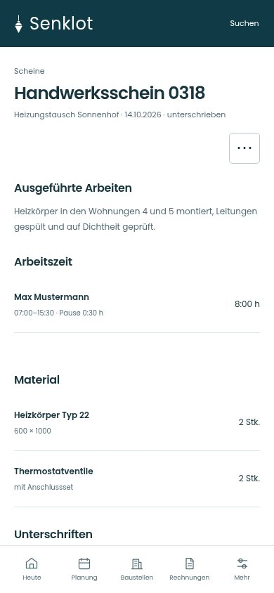
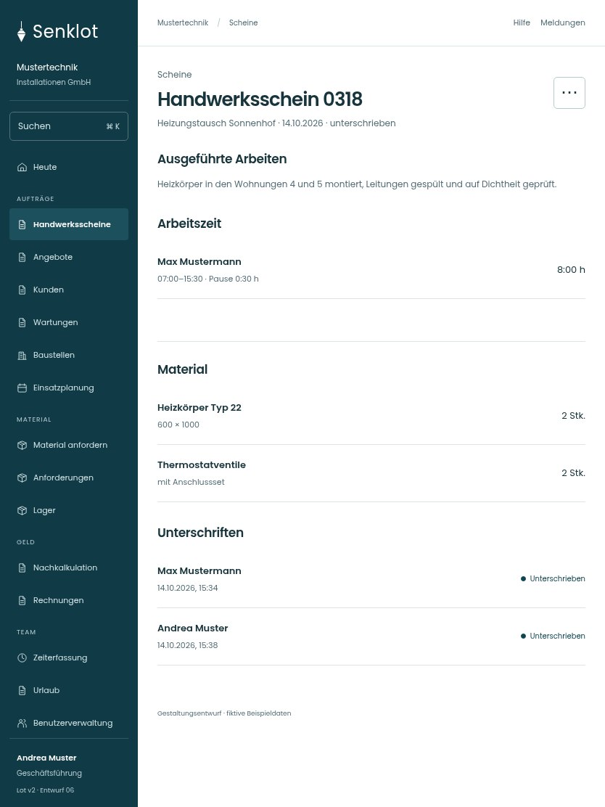

# 050 · Handwerksschein 0318

[Zur Gesamtübersicht](../README.md) · [Vollständiges Konzept](../Konzept.md)

**Bereich:** Scheine · **Bestandsort:** `/worksheets · Einzelheiten`

Handy · 390 px

[Ganze Seite ansehen](../bilder/050-schein-detail-handy-gesamt.jpg)

Tablet · 834 px

## Entscheidung

Die unterschriebene Leistung steht im Mittelpunkt. Ein zusätzlicher Prozessstreifen und doppelte Verrechnungsaktionen entfallen.

**Gezeigte Rolle:** Geschäftsführung. Sichtbarkeit und Aktionen bleiben an bestehende Rollen, Zusatzrechte, Module und Datensatzstatus gebunden.

**Hauptaktion:** Keine zusätzliche Hauptaktion.

**Weitere Aktionen:** PDF laden, Zur Baustelle.

**Handy/Tablet:** Zeilen statt zusätzlicher Karten; Hauptaktion bleibt gut erreichbar.

## Muss erhalten bleiben

- Unterschriebene Scheine unveränderbar
- PDF mit vollständigen Nachweisen
- Abrechnung nur mit Rechnungsrecht

## Quelle

- [src/features/worksheets/WorkSheetsListView.tsx](https://github.com/juliandeutsch22/Prototype-App-Installateure/blob/d4b8542821d86c7057761af16de1331d1de87e09/src/features/worksheets/WorkSheetsListView.tsx)
- [src/features/worksheets/Schrittfolge.tsx](https://github.com/juliandeutsch22/Prototype-App-Installateure/blob/d4b8542821d86c7057761af16de1331d1de87e09/src/features/worksheets/Schrittfolge.tsx)

Gestaltungsvorschau mit fiktiven Beispieldaten. Keine Änderung oder Auslieferung der App.
