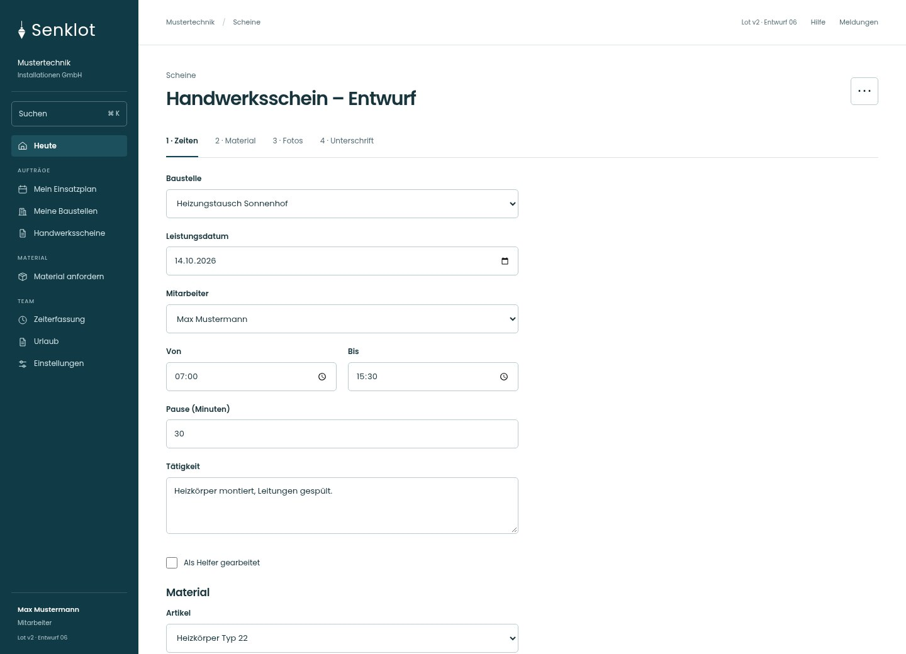
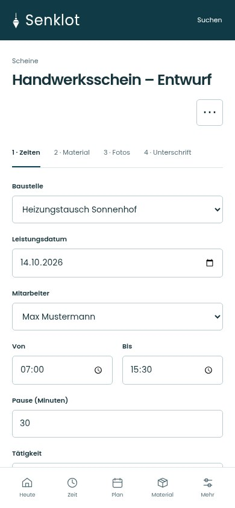
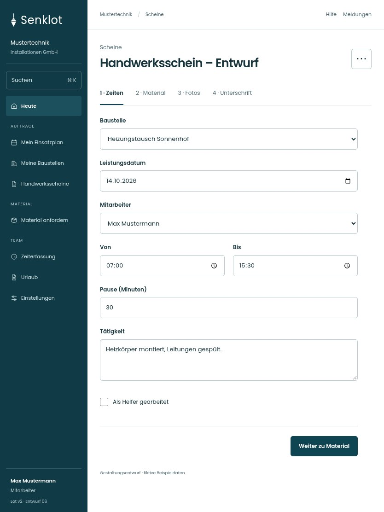

# 051 · Handwerksschein – Entwurf

[Zur Gesamtübersicht](../README.md) · [Vollständiges Konzept](../Konzept.md)

**Bereich:** Scheine · **Bestandsort:** `/worksheet · Zeiten`

Handy · 390 px

[Ganze Seite ansehen](../bilder/051-schein-zeiten-handy-gesamt.jpg)

Tablet · 834 px

[Desktop in voller Seitenlänge](../bilder/051-schein-zeiten-desktop-gesamt.jpg)

## Entscheidung

Nur arbeitsrelevante Angaben; Details über die Zeile öffnen.

**Gezeigte Rolle:** Mitarbeiter. Sichtbarkeit und Aktionen bleiben an bestehende Rollen, Zusatzrechte, Module und Datensatzstatus gebunden.

**Hauptaktion:** Weiter zu Material.

**Weitere Aktionen:** Zeile hinzufügen.

**Handy/Tablet:** Handy/Tablet: vier direkt anwählbare Schritte. Desktop: alle Angaben auf einer Seite, ohne erzwungene Weiter-Klicks; die Daten bleiben erhalten.

## Muss erhalten bleiben

- Entwurf bleibt beim Schrittwechsel erhalten
- Mehrere Leistungszeiten
- Kein doppeltes Buchen ins Zeitkonto

## Felder

- Baustelle
- Leistungsdatum
- Mitarbeiter
- Von
- Bis
- Pause (Minuten)
- Tätigkeit
- Als Helfer gearbeitet

## Quelle

- [src/features/worksheets/WorkSheetView.tsx](https://github.com/juliandeutsch22/Prototype-App-Installateure/blob/d4b8542821d86c7057761af16de1331d1de87e09/src/features/worksheets/WorkSheetView.tsx)
- [src/features/worksheets/LeistungszeitErfassen.tsx](https://github.com/juliandeutsch22/Prototype-App-Installateure/blob/d4b8542821d86c7057761af16de1331d1de87e09/src/features/worksheets/LeistungszeitErfassen.tsx)
- [src/features/worksheets/Schrittfolge.tsx](https://github.com/juliandeutsch22/Prototype-App-Installateure/blob/d4b8542821d86c7057761af16de1331d1de87e09/src/features/worksheets/Schrittfolge.tsx)

Gestaltungsvorschau mit fiktiven Beispieldaten. Keine Änderung oder Auslieferung der App.
