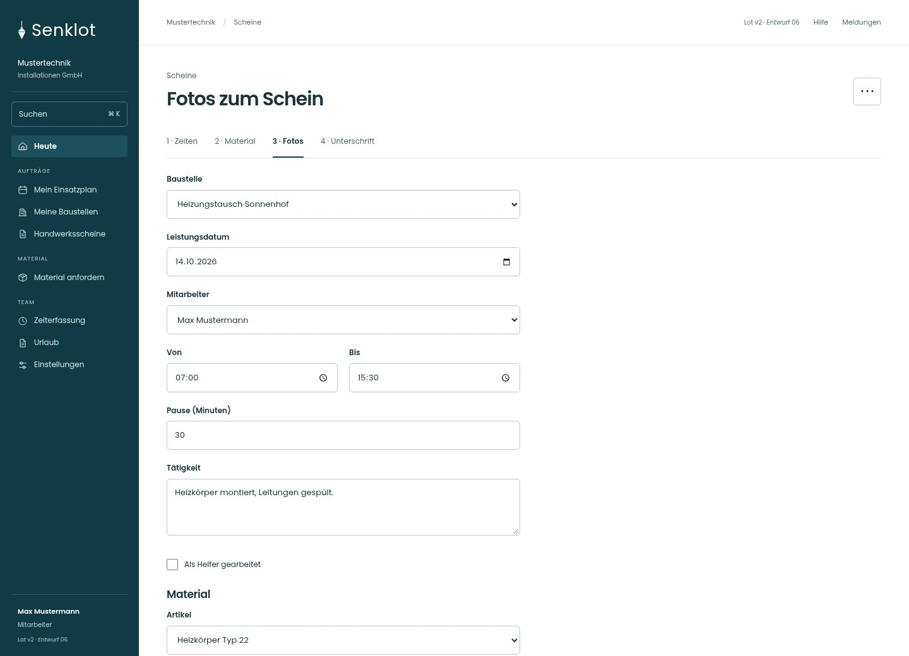
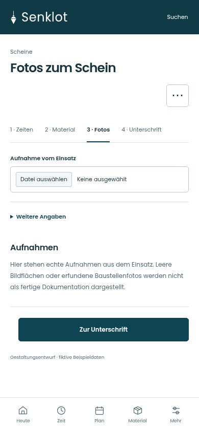
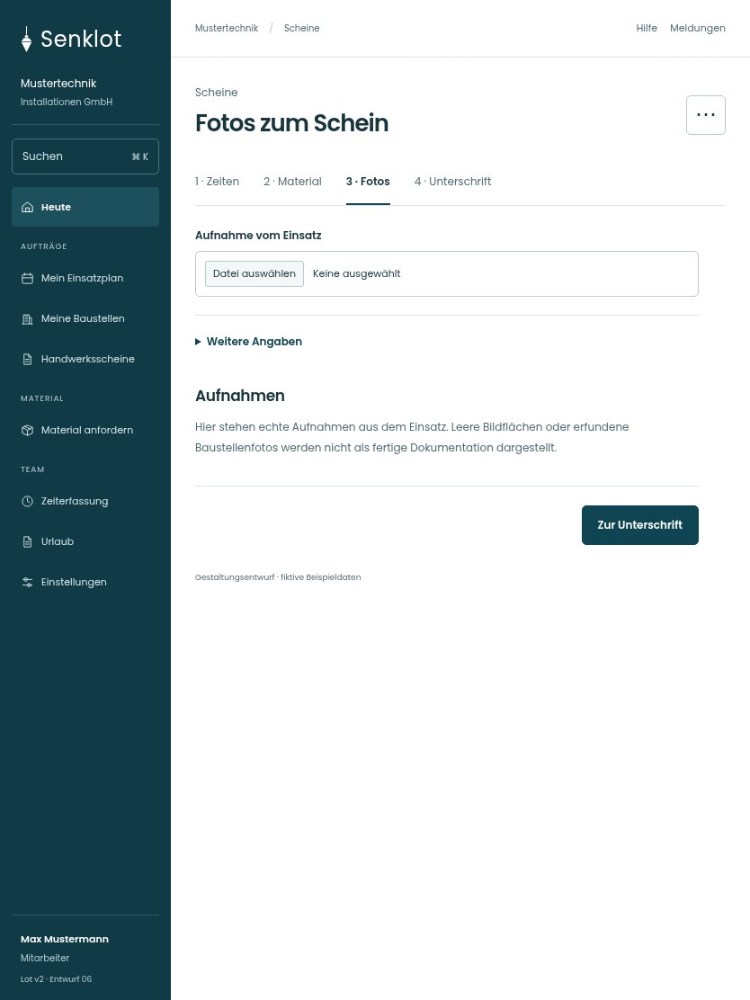

# 053 · Fotos zum Schein

[Zur Gesamtübersicht](../README.md) · [Vollständiges Konzept](../Konzept.md)

**Bereich:** Scheine · **Bestandsort:** `/worksheet · Fotos`

Handy · 390 px

Tablet · 834 px

[Desktop in voller Seitenlänge](../bilder/053-schein-fotos-desktop-gesamt.jpg)

## Entscheidung

Nur arbeitsrelevante Angaben; Details über die Zeile öffnen.

**Gezeigte Rolle:** Mitarbeiter. Sichtbarkeit und Aktionen bleiben an bestehende Rollen, Zusatzrechte, Module und Datensatzstatus gebunden.

**Hauptaktion:** Zur Unterschrift.

**Weitere Aktionen:** Foto aufnehmen.

**Handy/Tablet:** Handy/Tablet: vier direkt anwählbare Schritte. Desktop: alle Angaben auf einer Seite, ohne erzwungene Weiter-Klicks; die Daten bleiben erhalten.

## Muss erhalten bleiben

- Kamera und Dateiauswahl
- Bild entfernen
- Upload läuft/Fehler/offline
- Fotos optional nach bestehender Regel

## Felder

- Aufnahme vom Einsatz
- Notizen, Regiearbeiten, Mängel · bei Bedarf

## Quelle

- [src/features/worksheets/WorkSheetView.tsx](https://github.com/juliandeutsch22/Prototype-App-Installateure/blob/d4b8542821d86c7057761af16de1331d1de87e09/src/features/worksheets/WorkSheetView.tsx)
- [src/features/worksheets/Fotostreifen.tsx](https://github.com/juliandeutsch22/Prototype-App-Installateure/blob/d4b8542821d86c7057761af16de1331d1de87e09/src/features/worksheets/Fotostreifen.tsx)

Gestaltungsvorschau mit fiktiven Beispieldaten. Keine Änderung oder Auslieferung der App.
