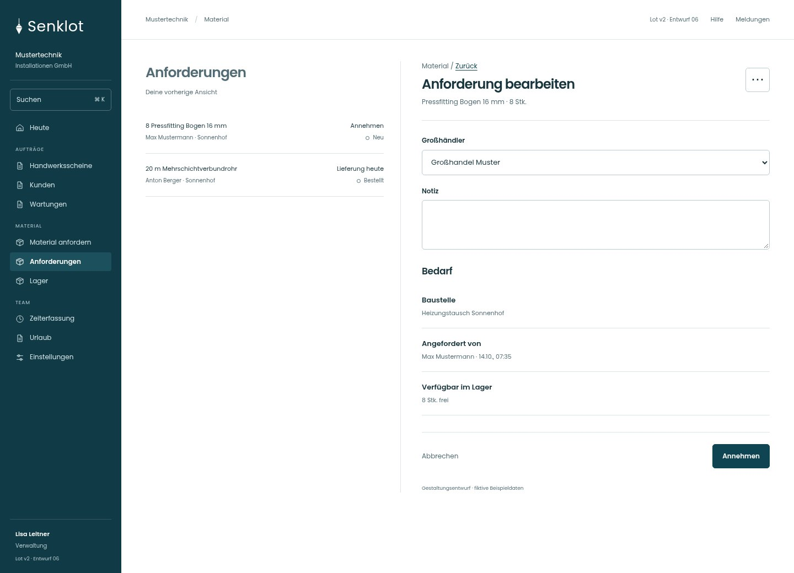
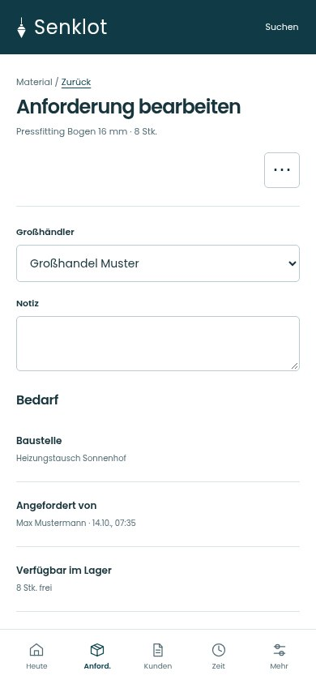
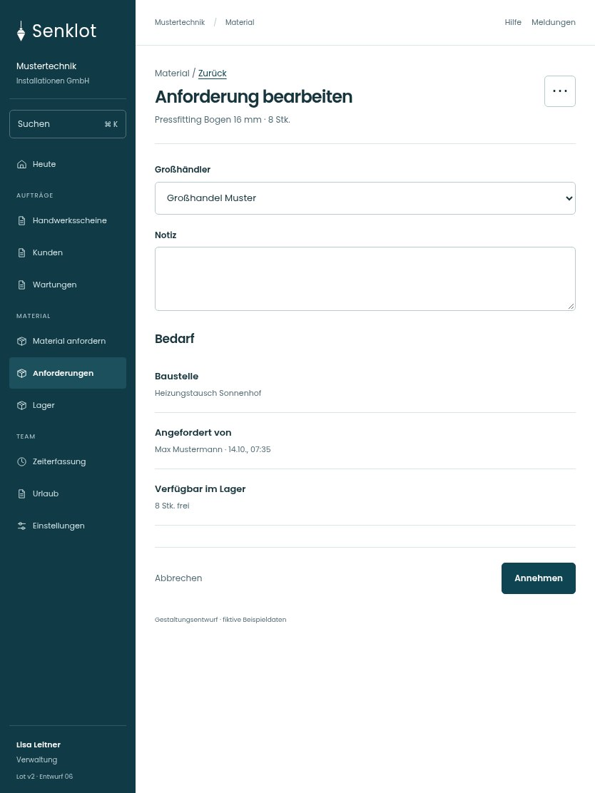

# 063 · Anforderung bearbeiten

[Zur Gesamtübersicht](../README.md) · [Vollständiges Konzept](../Konzept.md)

**Bereich:** Material · **Bestandsort:** `/anforderungen · Einzelheiten`

Handy · 390 px

[Ganze Seite ansehen](../bilder/063-anforderung-detail-handy-gesamt.jpg)

Tablet · 834 px

## Entscheidung

Nur arbeitsrelevante Angaben; Details über die Zeile öffnen.

**Gezeigte Rolle:** Verwaltung. Sichtbarkeit und Aktionen bleiben an bestehende Rollen, Zusatzrechte, Module und Datensatzstatus gebunden.

**Hauptaktion:** Annehmen.

**Weitere Aktionen:** Auf die Einkaufsliste, Als abholbereit markieren, Anforderung abschließen.

**Handy/Tablet:** Zeilen statt zusätzlicher Karten; Hauptaktion bleibt gut erreichbar.

## Muss erhalten bleiben

- Bestellen/Liefern/Abholbereit/Abschließen nur passend zum Status
- Lagerreservierung bleibt korrekt

## Felder

- Großhändler
- Notiz

## Quelle

- [src/features/orders/AdminOrdersView.tsx](https://github.com/juliandeutsch22/Prototype-App-Installateure/blob/d4b8542821d86c7057761af16de1331d1de87e09/src/features/orders/AdminOrdersView.tsx)

Gestaltungsvorschau mit fiktiven Beispieldaten. Keine Änderung oder Auslieferung der App.
