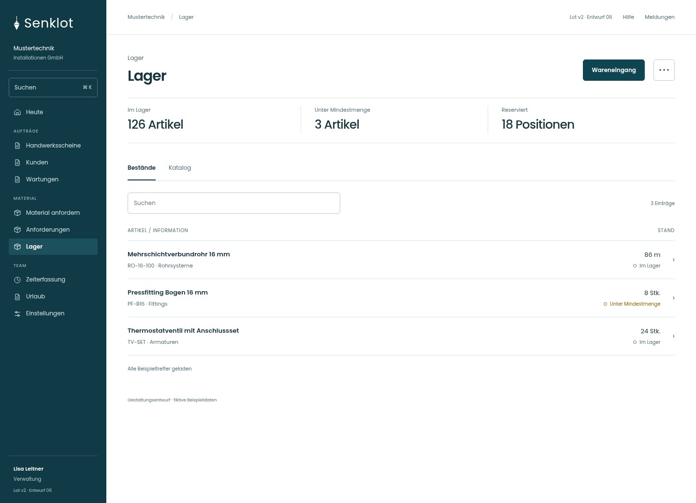
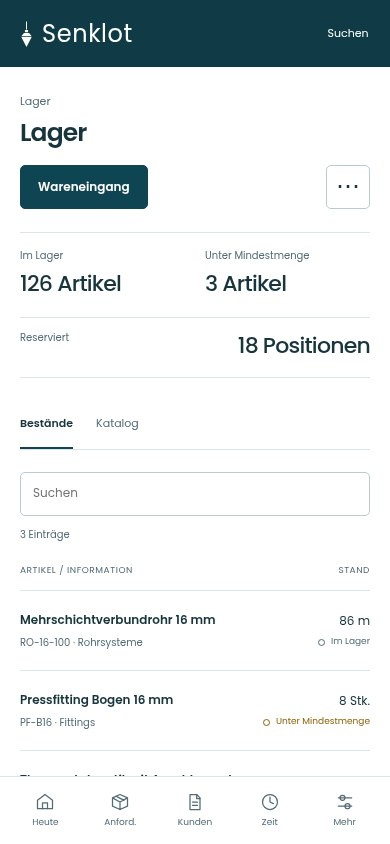
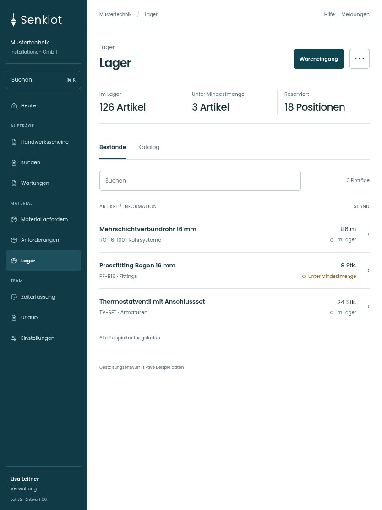

# 071 · Lager

[Zur Gesamtübersicht](../README.md) · [Vollständiges Konzept](../Konzept.md)

**Bereich:** Lager · **Bestandsort:** `/lager`

Handy · 390 px

[Ganze Seite ansehen](../bilder/071-lager-handy-gesamt.jpg)

Tablet · 834 px

## Entscheidung

Nur arbeitsrelevante Angaben; Details über die Zeile öffnen.

**Gezeigte Rolle:** Verwaltung. Sichtbarkeit und Aktionen bleiben an bestehende Rollen, Zusatzrechte, Module und Datensatzstatus gebunden.

**Hauptaktion:** Wareneingang.

**Weitere Aktionen:** Inventur, Katalog einspielen.

**Handy/Tablet:** Zeilen statt zusätzlicher Karten; Hauptaktion bleibt gut erreichbar.

## Muss erhalten bleiben

- Bestand/frei/reserviert getrennt
- Knapp-Filter
- Buchungen mit Grund/Bezug
- Einkaufspreise nur mit Recht

## Quelle

- [src/features/orders/StockView.tsx](https://github.com/juliandeutsch22/Prototype-App-Installateure/blob/d4b8542821d86c7057761af16de1331d1de87e09/src/features/orders/StockView.tsx)

Gestaltungsvorschau mit fiktiven Beispieldaten. Keine Änderung oder Auslieferung der App.
