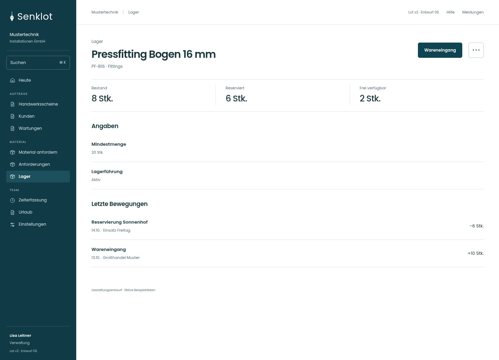
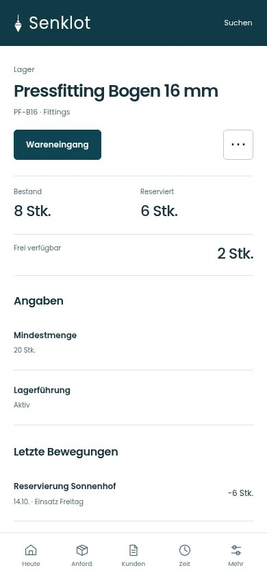
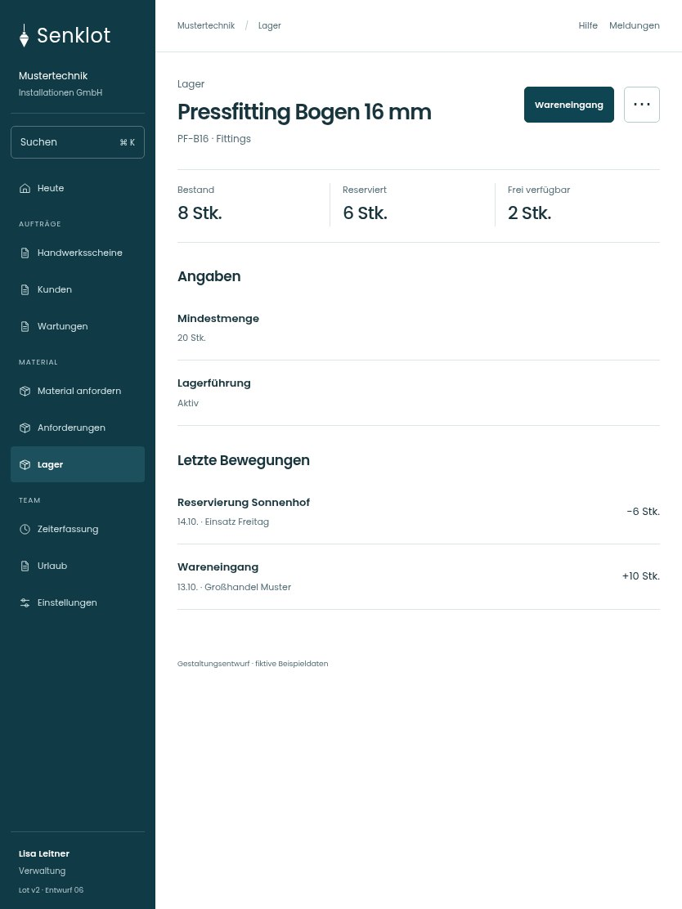

# 072 · Pressfitting Bogen 16 mm

[Zur Gesamtübersicht](../README.md) · [Vollständiges Konzept](../Konzept.md)

**Bereich:** Lager · **Bestandsort:** `/lager · Artikel`

Handy · 390 px

[Ganze Seite ansehen](../bilder/072-lager-artikel-handy-gesamt.jpg)

Tablet · 834 px

## Entscheidung

Nur arbeitsrelevante Angaben; Details über die Zeile öffnen.

**Gezeigte Rolle:** Verwaltung. Sichtbarkeit und Aktionen bleiben an bestehende Rollen, Zusatzrechte, Module und Datensatzstatus gebunden.

**Hauptaktion:** Wareneingang.

**Weitere Aktionen:** Inventur, Alle Bewegungen.

**Handy/Tablet:** Zeilen statt zusätzlicher Karten; Hauptaktion bleibt gut erreichbar.

## Muss erhalten bleiben

- Bewegungstypen nicht als identische Bestandsabgänge darstellen
- Negativer/Reservierter Bestand transparent
- Bestand 8 minus reserviert 6 = frei 2; diese Zahlen gelten für den gezeigten Artikel

## Quelle

- [src/features/orders/StockView.tsx](https://github.com/juliandeutsch22/Prototype-App-Installateure/blob/d4b8542821d86c7057761af16de1331d1de87e09/src/features/orders/StockView.tsx)
- [src/features/orders/LagerDialoge.tsx](https://github.com/juliandeutsch22/Prototype-App-Installateure/blob/d4b8542821d86c7057761af16de1331d1de87e09/src/features/orders/LagerDialoge.tsx)

Gestaltungsvorschau mit fiktiven Beispieldaten. Keine Änderung oder Auslieferung der App.
