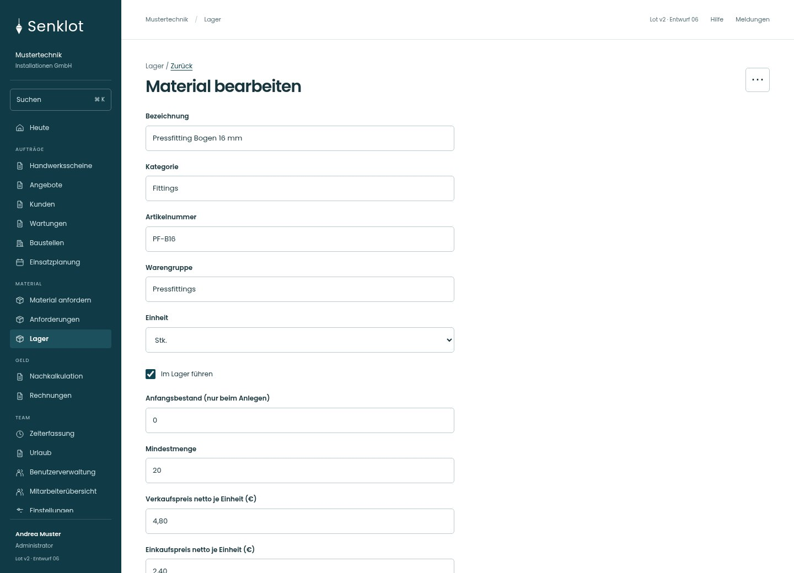
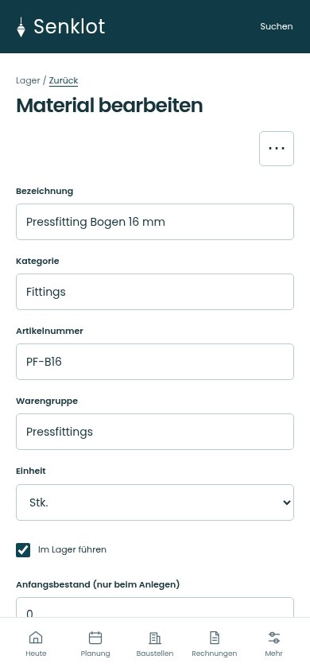
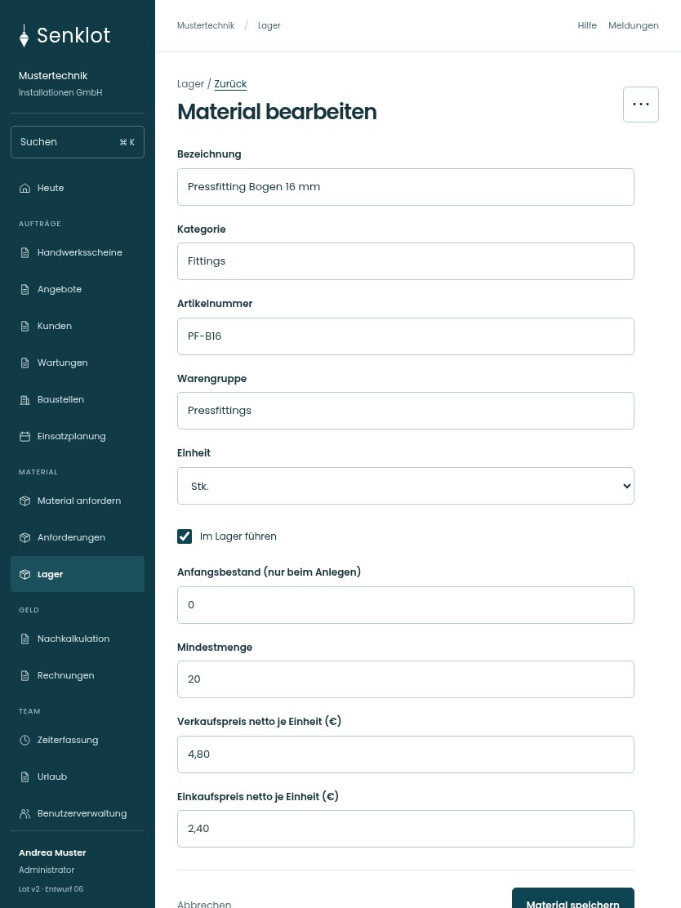

# 077 · Material bearbeiten

[Zur Gesamtübersicht](../README.md) · [Vollständiges Konzept](../Konzept.md)

**Bereich:** Lager · **Bestandsort:** `/lager · Katalogartikel`

Handy · 390 px

[Ganze Seite ansehen](../bilder/077-katalog-artikel-handy-gesamt.jpg)

Tablet · 834 px

[Ganze Seite ansehen](../bilder/077-katalog-artikel-tablet-gesamt.jpg)

[Desktop in voller Seitenlänge](../bilder/077-katalog-artikel-desktop-gesamt.jpg)

## Entscheidung

Nur arbeitsrelevante Angaben; Details über die Zeile öffnen.

**Gezeigte Rolle:** Administrator. Sichtbarkeit und Aktionen bleiben an bestehende Rollen, Zusatzrechte, Module und Datensatzstatus gebunden.

**Hauptaktion:** Material speichern.

**Weitere Aktionen:** Material löschen.

**Handy/Tablet:** Zeilen statt zusätzlicher Karten; Hauptaktion bleibt gut erreichbar.

## Muss erhalten bleiben

- Anfangsbestand nicht als freie Bestandsänderung missbrauchen
- Einkauf nur für Berechtigte

## Felder

- Bezeichnung
- Kategorie
- Artikelnummer
- Warengruppe
- Einheit
- Im Lager führen
- Anfangsbestand (nur beim Anlegen)
- Mindestmenge
- Verkaufspreis netto je Einheit (€)
- Einkaufspreis netto je Einheit (€)

## Quelle

- [src/features/orders/MaterialCatalog.tsx](https://github.com/juliandeutsch22/Prototype-App-Installateure/blob/d4b8542821d86c7057761af16de1331d1de87e09/src/features/orders/MaterialCatalog.tsx)

Gestaltungsvorschau mit fiktiven Beispieldaten. Keine Änderung oder Auslieferung der App.
