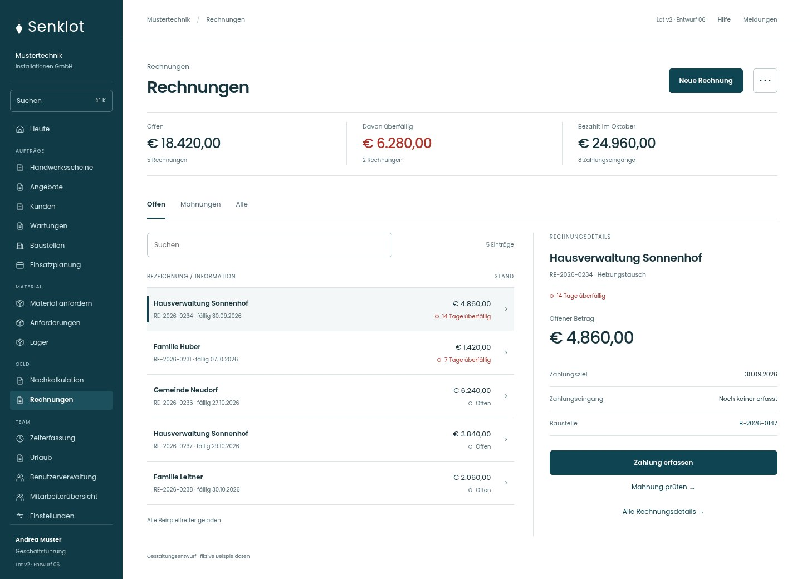
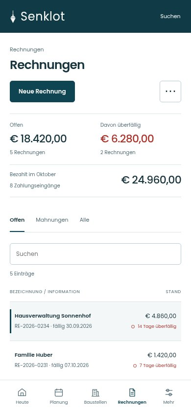
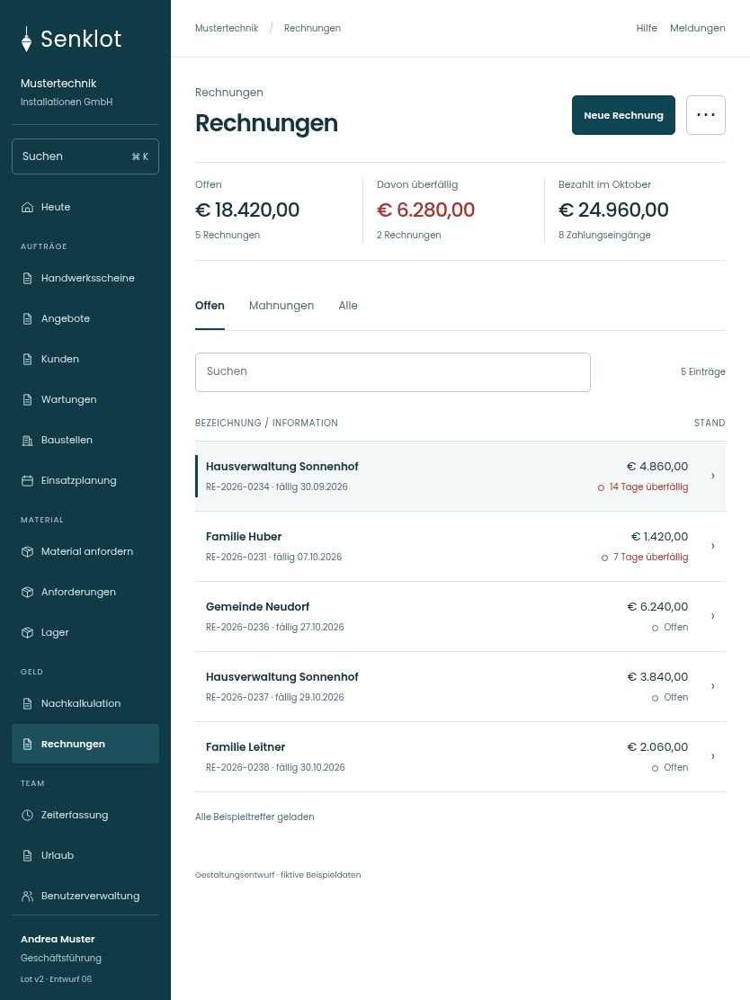

# 081 · Rechnungen

[Zur Gesamtübersicht](../README.md) · [Vollständiges Konzept](../Konzept.md)

**Bereich:** Rechnungen · **Bestandsort:** `/invoices`

Handy · 390 px

[Ganze Seite ansehen](../bilder/081-rechnungen-handy-gesamt.jpg)

Tablet · 834 px

## Entscheidung

Summenzeile reicht. Forderungsdiagramm, wiederholte Statushinweise und getrennte Linkblöcke entfallen.

**Gezeigte Rolle:** Geschäftsführung. Sichtbarkeit und Aktionen bleiben an bestehende Rollen, Zusatzrechte, Module und Datensatzstatus gebunden.

**Hauptaktion:** Neue Rechnung.

**Weitere Aktionen:** Buchhaltungs-Export.

**Handy/Tablet:** Zeilen statt zusätzlicher Karten; Hauptaktion bleibt gut erreichbar.

## Muss erhalten bleiben

- Alle bisherigen Filter/Status
- Nicht verrechnete Leistung
- Mahnlauf
- Suche über alle
- Beleg- und Stornoaktionen

## Quelle

- [src/features/invoices/InvoicesView.tsx](https://github.com/juliandeutsch22/Prototype-App-Installateure/blob/d4b8542821d86c7057761af16de1331d1de87e09/src/features/invoices/InvoicesView.tsx)
- [src/features/invoices/RechnungsListe.tsx](https://github.com/juliandeutsch22/Prototype-App-Installateure/blob/d4b8542821d86c7057761af16de1331d1de87e09/src/features/invoices/RechnungsListe.tsx)
- [src/features/invoices/RechnungDetail.tsx](https://github.com/juliandeutsch22/Prototype-App-Installateure/blob/d4b8542821d86c7057761af16de1331d1de87e09/src/features/invoices/RechnungDetail.tsx)

Gestaltungsvorschau mit fiktiven Beispieldaten. Keine Änderung oder Auslieferung der App.
