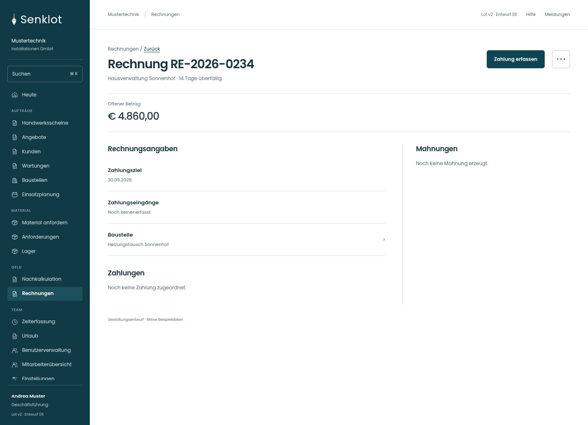
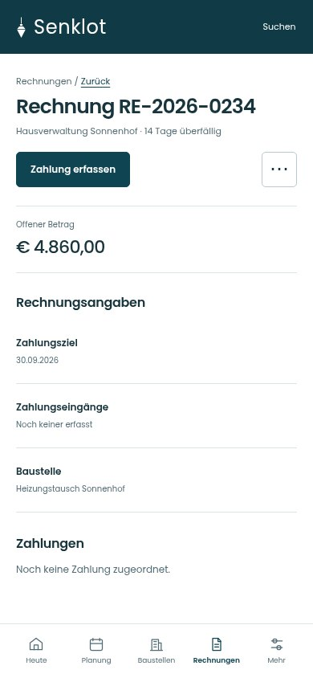
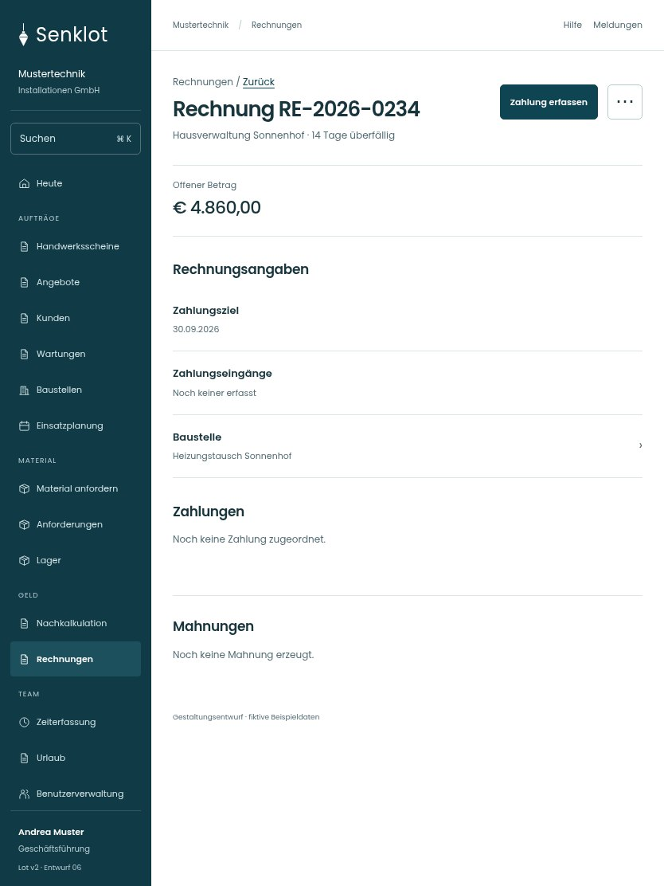

# 082 · Rechnung RE-2026-0234

[Zur Gesamtübersicht](../README.md) · [Vollständiges Konzept](../Konzept.md)

**Bereich:** Rechnungen · **Bestandsort:** `/invoices · Detail`

Handy · 390 px

[Ganze Seite ansehen](../bilder/082-rechnung-detail-handy-gesamt.jpg)

Tablet · 834 px

## Entscheidung

Nur arbeitsrelevante Angaben; Details über die Zeile öffnen.

**Gezeigte Rolle:** Geschäftsführung. Sichtbarkeit und Aktionen bleiben an bestehende Rollen, Zusatzrechte, Module und Datensatzstatus gebunden.

**Hauptaktion:** Zahlung erfassen.

**Weitere Aktionen:** PDF laden, Mahnung prüfen, Bankgarantie, Stornieren.

**Handy/Tablet:** Eigenständiges Detail ohne die allgemeinen Summen; Zurück erhält Filter, Auswahl und Scrollposition.

## Muss erhalten bleiben

- Teilzahlungen/Rückzahlungen
- Guthaben
- Rabatt/Skonto/Rücklass
- Mahnverlauf
- Stornobelege

## Quelle

- [src/features/invoices/RechnungDetail.tsx](https://github.com/juliandeutsch22/Prototype-App-Installateure/blob/d4b8542821d86c7057761af16de1331d1de87e09/src/features/invoices/RechnungDetail.tsx)
- [src/features/invoices/InvoicesView.tsx](https://github.com/juliandeutsch22/Prototype-App-Installateure/blob/d4b8542821d86c7057761af16de1331d1de87e09/src/features/invoices/InvoicesView.tsx)

Gestaltungsvorschau mit fiktiven Beispieldaten. Keine Änderung oder Auslieferung der App.
