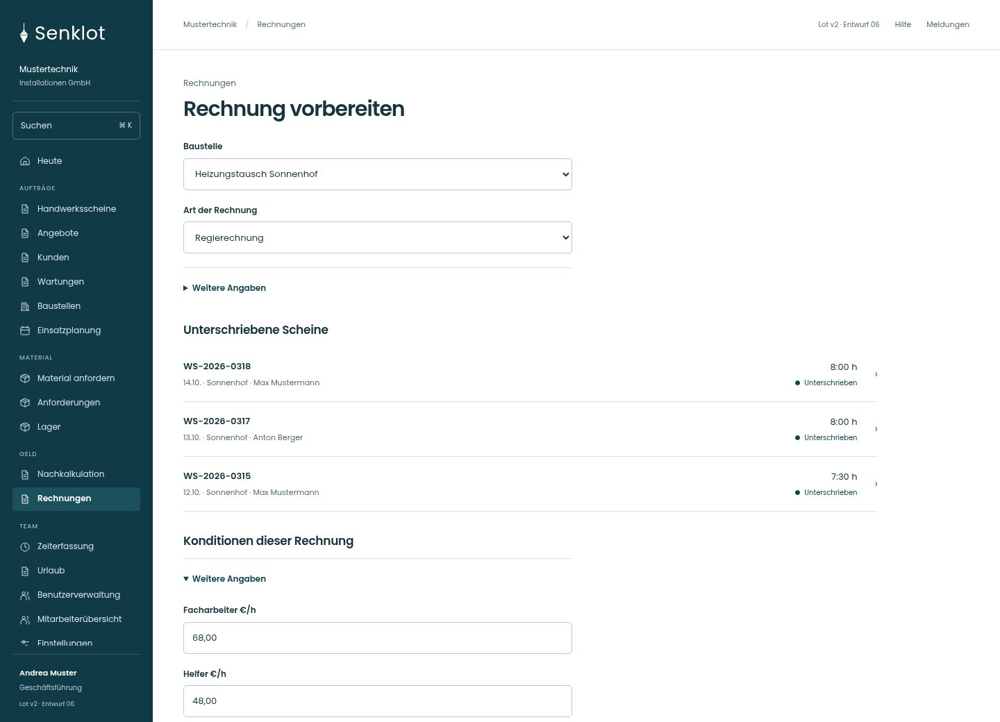
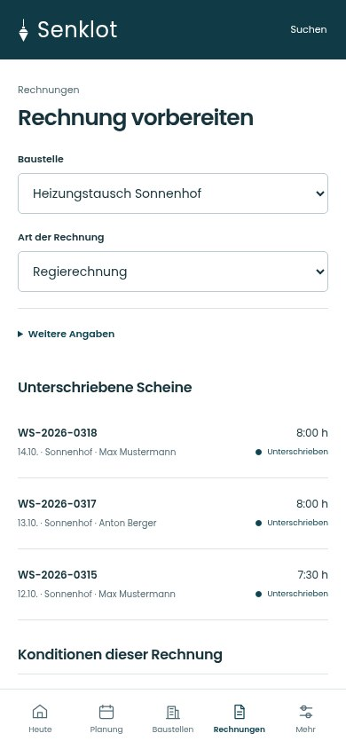
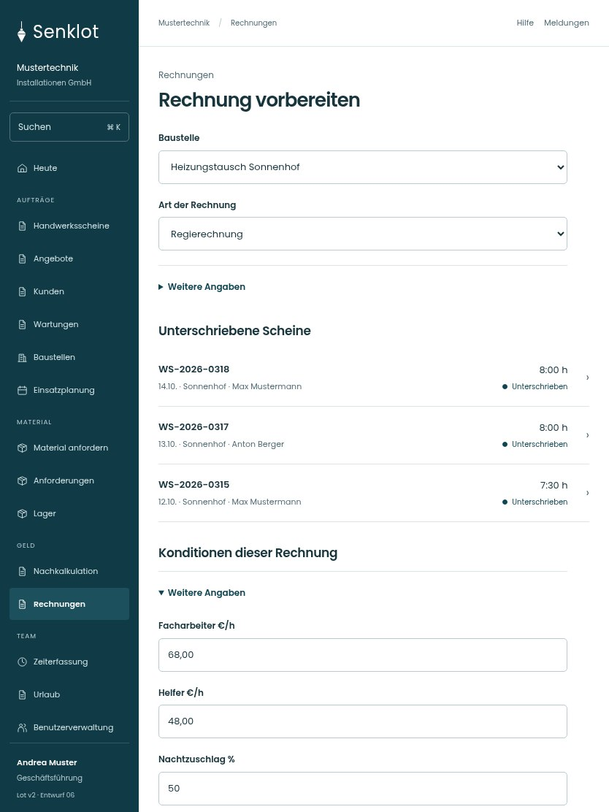

# 084 · Rechnung vorbereiten

[Zur Gesamtübersicht](../README.md) · [Vollständiges Konzept](../Konzept.md)

**Bereich:** Rechnungen · **Bestandsort:** `/invoices · Neue Rechnung`

Handy · 390 px

[Ganze Seite ansehen](../bilder/084-rechnung-neu-handy-gesamt.jpg)

Tablet · 834 px

[Ganze Seite ansehen](../bilder/084-rechnung-neu-tablet-gesamt.jpg)

[Desktop in voller Seitenlänge](../bilder/084-rechnung-neu-desktop-gesamt.jpg)

## Entscheidung

Nur arbeitsrelevante Angaben; Details über die Zeile öffnen.

**Gezeigte Rolle:** Geschäftsführung. Sichtbarkeit und Aktionen bleiben an bestehende Rollen, Zusatzrechte, Module und Datensatzstatus gebunden.

**Hauptaktion:** Vorschau erstellen.

**Handy/Tablet:** Zeilen statt zusätzlicher Karten; Hauptaktion bleibt gut erreichbar.

## Muss erhalten bleiben

- Regie/Pauschale/Anzahlung/Teil/Schluss
- Scheinabgleich
- Konditionen aus Bestand
- Keine Nummernvergabe vor Erstellung

## Felder

- Baustelle
- Art der Rechnung
- Anteil vom angenommenen Angebot (%) · bei Bedarf
- Facharbeiter €/h · bei Bedarf
- Helfer €/h · bei Bedarf
- Nachtzuschlag % · bei Bedarf
- Notdienstzuschlag % · bei Bedarf
- Zahlungsziel (Tage) · bei Bedarf
- Skonto % · bei Bedarf
- Skontofrist (Tage) · bei Bedarf

## Quelle

- [src/features/invoices/InvoicesView.tsx](https://github.com/juliandeutsch22/Prototype-App-Installateure/blob/d4b8542821d86c7057761af16de1331d1de87e09/src/features/invoices/InvoicesView.tsx)

Gestaltungsvorschau mit fiktiven Beispieldaten. Keine Änderung oder Auslieferung der App.
