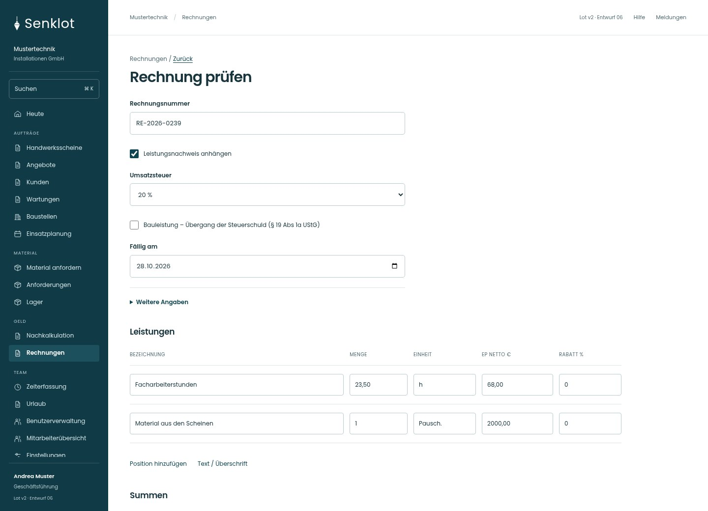
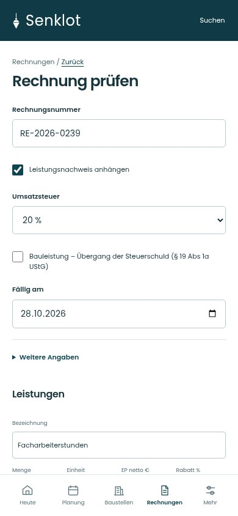
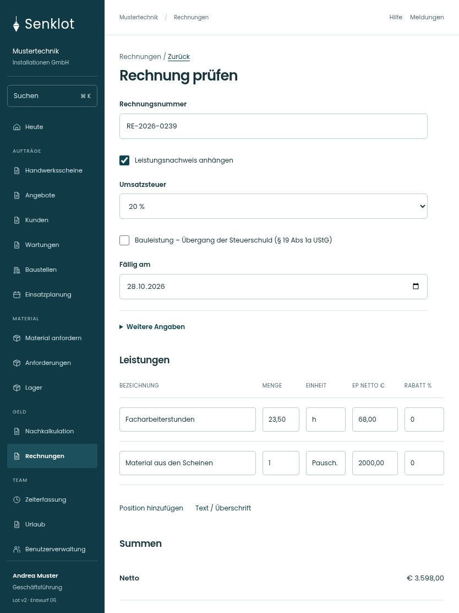

# 085 · Rechnung prüfen

[Zur Gesamtübersicht](../README.md) · [Vollständiges Konzept](../Konzept.md)

**Bereich:** Rechnungen · **Bestandsort:** `/invoices · Vorschau`

Handy · 390 px

[Ganze Seite ansehen](../bilder/085-rechnung-vorschau-handy-gesamt.jpg)

Tablet · 834 px

[Ganze Seite ansehen](../bilder/085-rechnung-vorschau-tablet-gesamt.jpg)

[Desktop in voller Seitenlänge](../bilder/085-rechnung-vorschau-desktop-gesamt.jpg)

## Entscheidung

Nur arbeitsrelevante Angaben; Details über die Zeile öffnen.

**Gezeigte Rolle:** Geschäftsführung. Sichtbarkeit und Aktionen bleiben an bestehende Rollen, Zusatzrechte, Module und Datensatzstatus gebunden.

**Hauptaktion:** Rechnung verbindlich erstellen.

**Handy/Tablet:** Zeilen statt zusätzlicher Karten; Hauptaktion bleibt gut erreichbar.

## Muss erhalten bleiben

- Nummernprüfung und Empfänger-/Firmensperren
- Material-/Leistungspositionen bearbeitbar nach Bestandsregeln
- Reverse Charge nur bei gültigen Voraussetzungen
- Skonto/Rabatt/Rücklass
- Serverwerte maßgeblich

## Felder

- Rechnungsnummer
- Leistungsnachweis anhängen
- Umsatzsteuer
- Bauleistung – Übergang der Steuerschuld (§ 19 Abs 1a UStG)
- UID-Nummer des Kunden · bei Bedarf
- Grund der Steuerbefreiung · bei Bedarf
- Bestellnummer des Kunden · bei Bedarf
- Rabatt – Bezeichnung · bei Bedarf
- Rabattart · bei Bedarf
- Rabattwert · bei Bedarf
- Rücklass (%) · bei Bedarf
- Fällig am

Positionsfelder: Bezeichnung, Menge, Einheit, Einzelpreis netto, Rabatt; außerdem Text- und Überschriftspositionen sowie Katalogübernahme nach Bestand.

## Quelle

- [src/features/invoices/InvoicesView.tsx](https://github.com/juliandeutsch22/Prototype-App-Installateure/blob/d4b8542821d86c7057761af16de1331d1de87e09/src/features/invoices/InvoicesView.tsx)

Gestaltungsvorschau mit fiktiven Beispieldaten. Keine Änderung oder Auslieferung der App.
