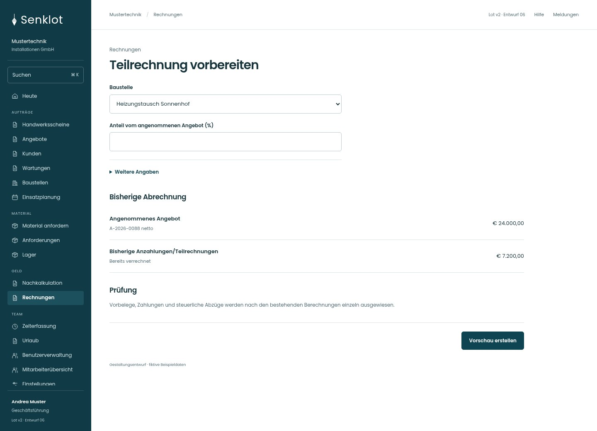
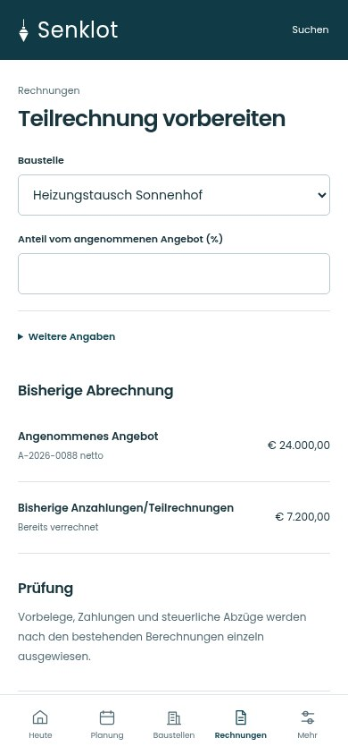
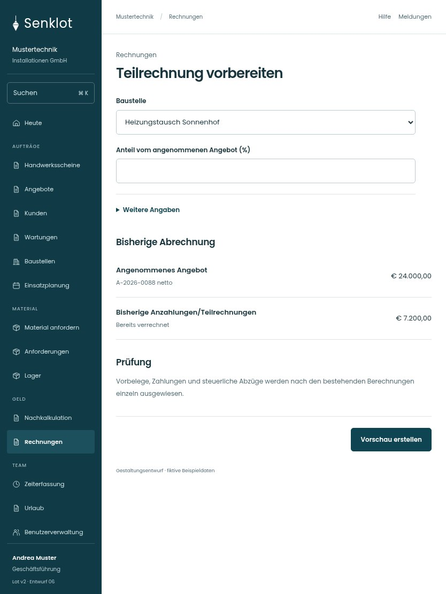

# 087 · Teilrechnung vorbereiten

[Zur Gesamtübersicht](../README.md) · [Vollständiges Konzept](../Konzept.md)

**Bereich:** Rechnungen · **Bestandsort:** `/invoices · Teilrechnung`

Handy · 390 px

[Ganze Seite ansehen](../bilder/087-rechnung-teil-handy-gesamt.jpg)

Tablet · 834 px

## Entscheidung

Nur arbeitsrelevante Angaben; Details über die Zeile öffnen.

**Gezeigte Rolle:** Geschäftsführung. Sichtbarkeit und Aktionen bleiben an bestehende Rollen, Zusatzrechte, Module und Datensatzstatus gebunden.

**Hauptaktion:** Vorschau erstellen.

**Handy/Tablet:** Zeilen statt zusätzlicher Karten; Hauptaktion bleibt gut erreichbar.

## Muss erhalten bleiben

- Betriebsfreigabe für Teil-/Schlussrechnungen
- Keine doppelte Verrechnung
- Vorbelege und Anzahlungsabzüge
- Kein neuer Berechnungsweg

## Felder

- Baustelle
- Anteil vom angenommenen Angebot (%)
- Bestellnummer des Kunden · bei Bedarf

## Quelle

- [src/features/invoices/InvoicesView.tsx](https://github.com/juliandeutsch22/Prototype-App-Installateure/blob/d4b8542821d86c7057761af16de1331d1de87e09/src/features/invoices/InvoicesView.tsx)
- [src/features/invoices/anzahlung.ts](https://github.com/juliandeutsch22/Prototype-App-Installateure/blob/d4b8542821d86c7057761af16de1331d1de87e09/src/features/invoices/anzahlung.ts)
- [src/features/invoices/vorrechnungen.ts](https://github.com/juliandeutsch22/Prototype-App-Installateure/blob/d4b8542821d86c7057761af16de1331d1de87e09/src/features/invoices/vorrechnungen.ts)

Gestaltungsvorschau mit fiktiven Beispieldaten. Keine Änderung oder Auslieferung der App.
