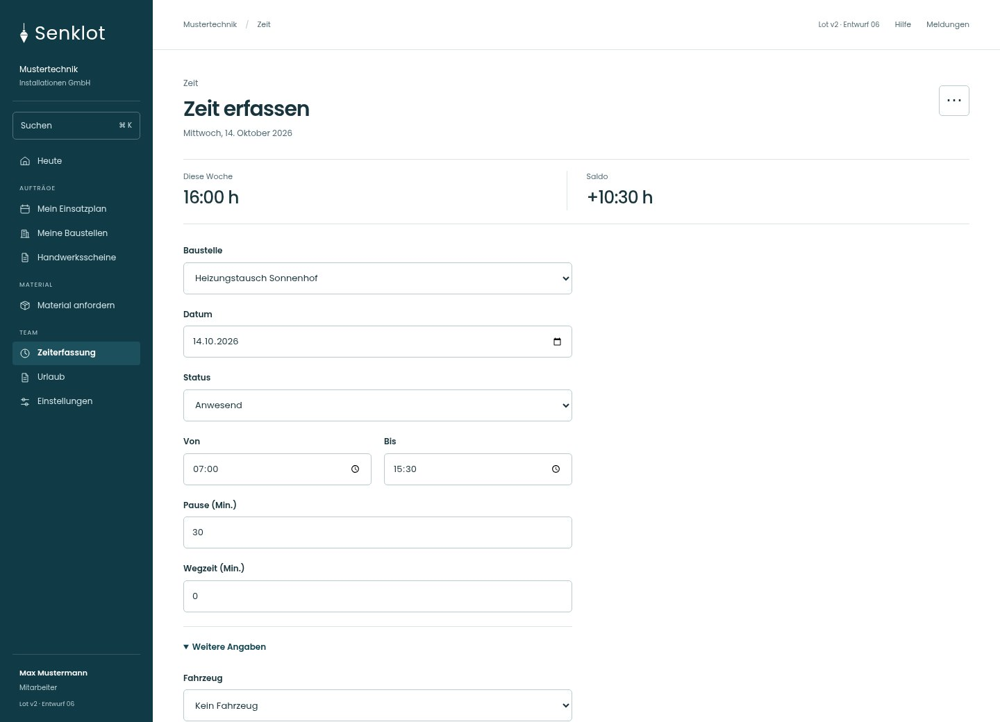
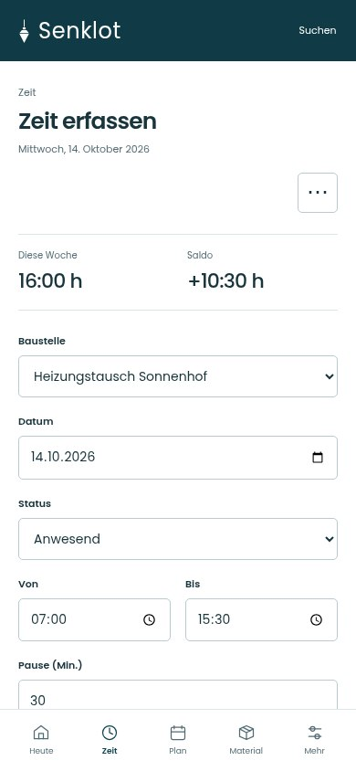
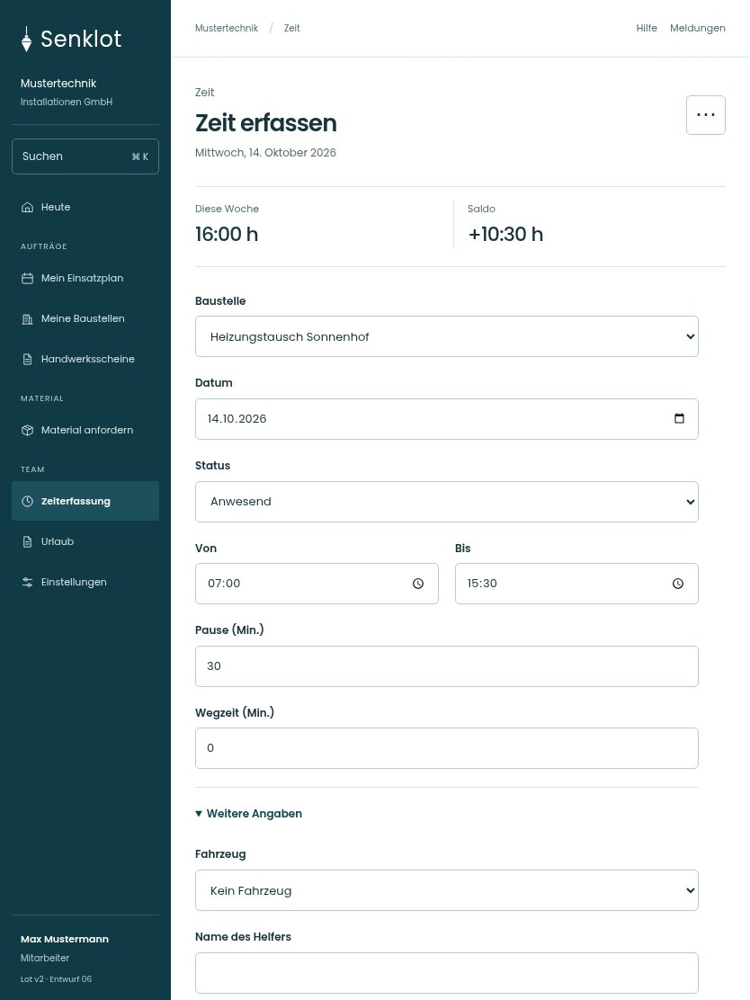

# 098 · Zeit erfassen

[Zur Gesamtübersicht](../README.md) · [Vollständiges Konzept](../Konzept.md)

**Bereich:** Zeit · **Bestandsort:** `/time`

Handy · 390 px

[Ganze Seite ansehen](../bilder/098-zeit-handy-gesamt.jpg)

Tablet · 834 px

[Ganze Seite ansehen](../bilder/098-zeit-tablet-gesamt.jpg)

[Desktop in voller Seitenlänge](../bilder/098-zeit-desktop-gesamt.jpg)

## Entscheidung

Eingabe zuerst; Dauer wird unmittelbar berechnet. Weitere Angaben nur bei Bedarf, keine zweite Statistikspalte am Handy.

**Gezeigte Rolle:** Mitarbeiter. Sichtbarkeit und Aktionen bleiben an bestehende Rollen, Zusatzrechte, Module und Datensatzstatus gebunden.

**Hauptaktion:** Zeit buchen.

**Weitere Aktionen:** Meine Einträge, Auf Baustellen aufteilen.

**Handy/Tablet:** Zeilen statt zusätzlicher Karten; Hauptaktion bleibt gut erreichbar.

## Muss erhalten bleiben

- Alle Rollen eigene Zeit
- Monteur immer volle Erfassung
- Büro keine unnötigen Baustellen-/Zuschlagsfelder
- Leitung kann erweitern
- Jugendliche/Unterricht/Nachtzeitregeln
- Abwesenheiten stunden-/tageweise

## Felder

- Baustelle
- Datum
- Status
- Von
- Bis
- Pause (Min.)
- Wegzeit (Min.)
- Fahrzeug · bei Bedarf
- Name des Helfers · bei Bedarf
- Einsatz als Helfer · bei Bedarf
- Notdienst / Störungseinsatz · bei Bedarf
- Nicht als Nachtarbeit zählen · bei Bedarf
- Grund · bei Bedarf
- Kommentar · bei Bedarf

## Quelle

- [src/features/time/TimeView.tsx](https://github.com/juliandeutsch22/Prototype-App-Installateure/blob/d4b8542821d86c7057761af16de1331d1de87e09/src/features/time/TimeView.tsx)
- [src/features/time/TimeForm.tsx](https://github.com/juliandeutsch22/Prototype-App-Installateure/blob/d4b8542821d86c7057761af16de1331d1de87e09/src/features/time/TimeForm.tsx)

Gestaltungsvorschau mit fiktiven Beispieldaten. Keine Änderung oder Auslieferung der App.
