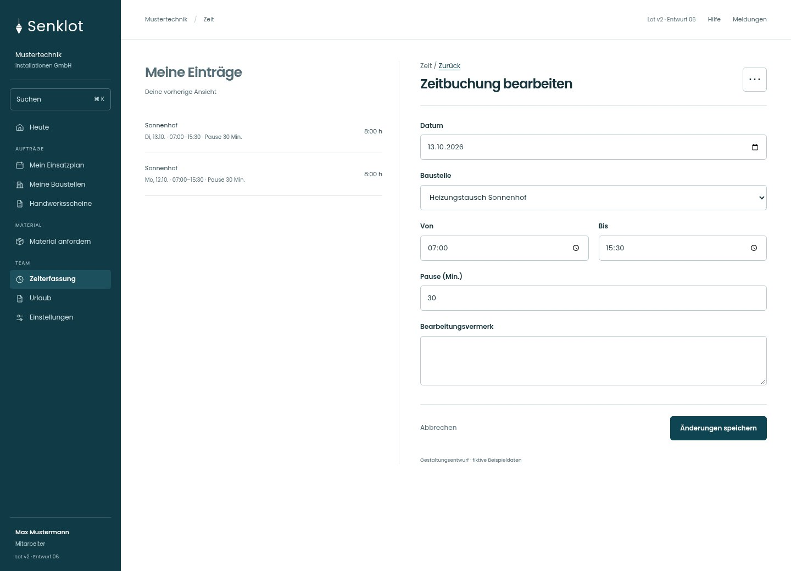
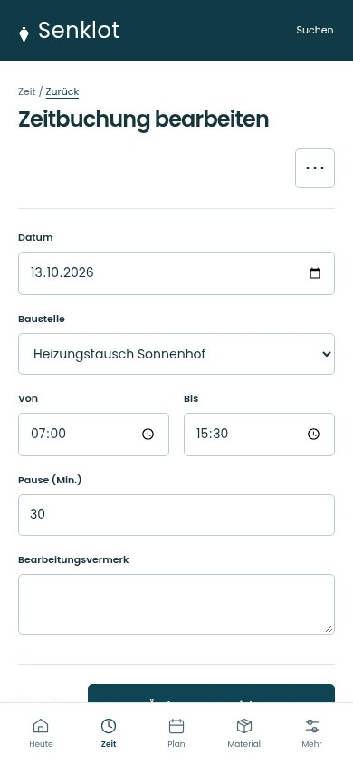
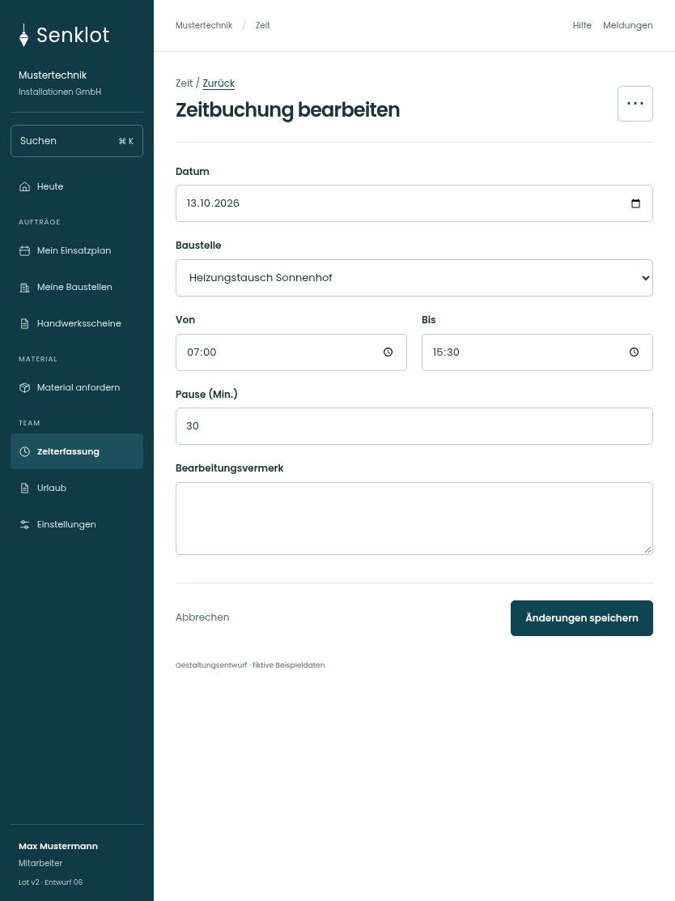

# 102 · Zeitbuchung bearbeiten

[Zur Gesamtübersicht](../README.md) · [Vollständiges Konzept](../Konzept.md)

**Bereich:** Zeit · **Bestandsort:** `/time · Bearbeiten`

Handy · 390 px

[Ganze Seite ansehen](../bilder/102-zeit-bearbeiten-handy-gesamt.jpg)

Tablet · 834 px

## Entscheidung

Nur arbeitsrelevante Angaben; Details über die Zeile öffnen.

**Gezeigte Rolle:** Mitarbeiter. Sichtbarkeit und Aktionen bleiben an bestehende Rollen, Zusatzrechte, Module und Datensatzstatus gebunden.

**Hauptaktion:** Änderungen speichern.

**Weitere Aktionen:** Eintrag löschen.

**Handy/Tablet:** Zeilen statt zusätzlicher Karten; Hauptaktion bleibt gut erreichbar.

## Muss erhalten bleiben

- Bearbeitungsvermerk nach Bestand
- Fremdbuchung nur mit Korrekturrecht
- Löschen bestätigt

## Felder

- Datum
- Baustelle
- Von
- Bis
- Pause (Min.)
- Bearbeitungsvermerk

## Quelle

- [src/features/time/TimeView.tsx](https://github.com/juliandeutsch22/Prototype-App-Installateure/blob/d4b8542821d86c7057761af16de1331d1de87e09/src/features/time/TimeView.tsx)
- [src/features/time/TimeForm.tsx](https://github.com/juliandeutsch22/Prototype-App-Installateure/blob/d4b8542821d86c7057761af16de1331d1de87e09/src/features/time/TimeForm.tsx)

Gestaltungsvorschau mit fiktiven Beispieldaten. Keine Änderung oder Auslieferung der App.
