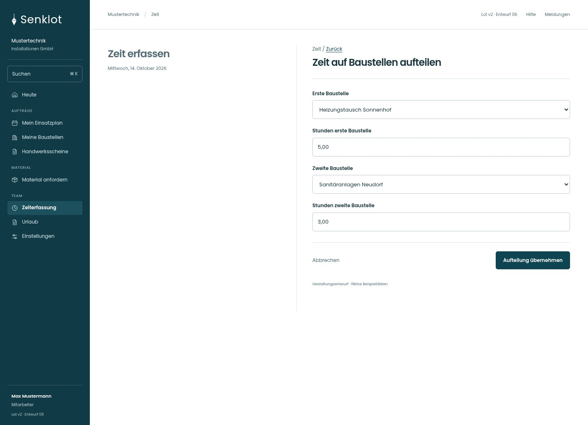
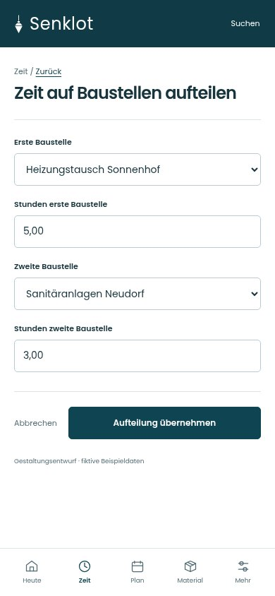
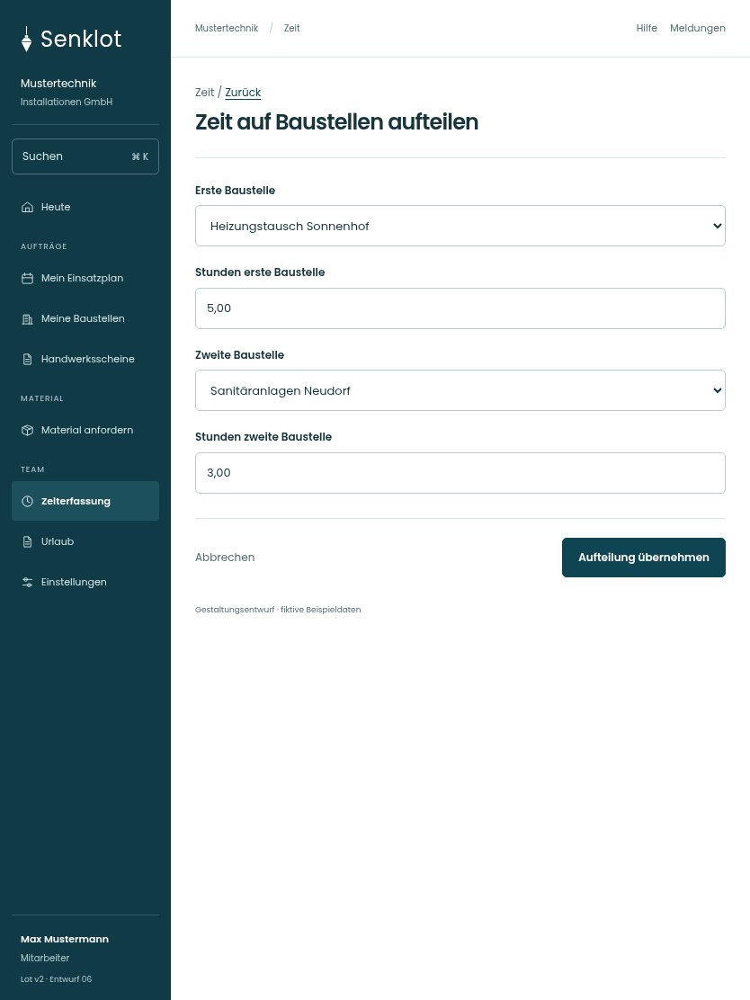

# 103 · Zeit auf Baustellen aufteilen

[Zur Gesamtübersicht](../README.md) · [Vollständiges Konzept](../Konzept.md)

**Bereich:** Zeit · **Bestandsort:** `/time · Aufteilen`

Handy · 390 px

Tablet · 834 px

## Entscheidung

Nur arbeitsrelevante Angaben; Details über die Zeile öffnen.

**Gezeigte Rolle:** Mitarbeiter. Sichtbarkeit und Aktionen bleiben an bestehende Rollen, Zusatzrechte, Module und Datensatzstatus gebunden.

**Hauptaktion:** Aufteilung übernehmen.

**Handy/Tablet:** Zeilen statt zusätzlicher Karten; Hauptaktion bleibt gut erreichbar.

## Muss erhalten bleiben

- Summe muss ursprünglicher Zeit entsprechen
- Keine doppelten Stunden

## Felder

- Erste Baustelle
- Stunden erste Baustelle
- Zweite Baustelle
- Stunden zweite Baustelle

## Quelle

- [src/features/time/AufteilenDialog.tsx](https://github.com/juliandeutsch22/Prototype-App-Installateure/blob/d4b8542821d86c7057761af16de1331d1de87e09/src/features/time/AufteilenDialog.tsx)

Gestaltungsvorschau mit fiktiven Beispieldaten. Keine Änderung oder Auslieferung der App.
