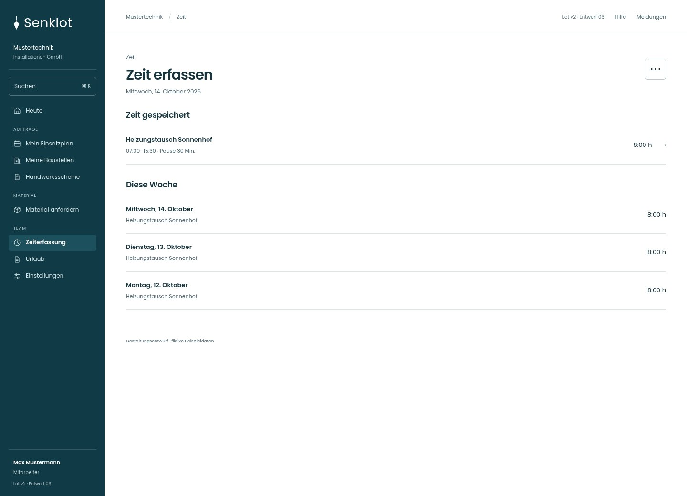
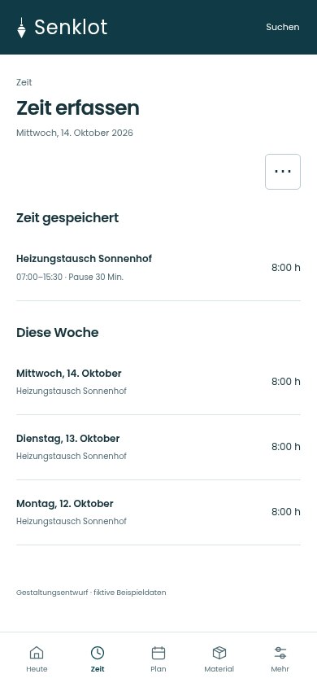
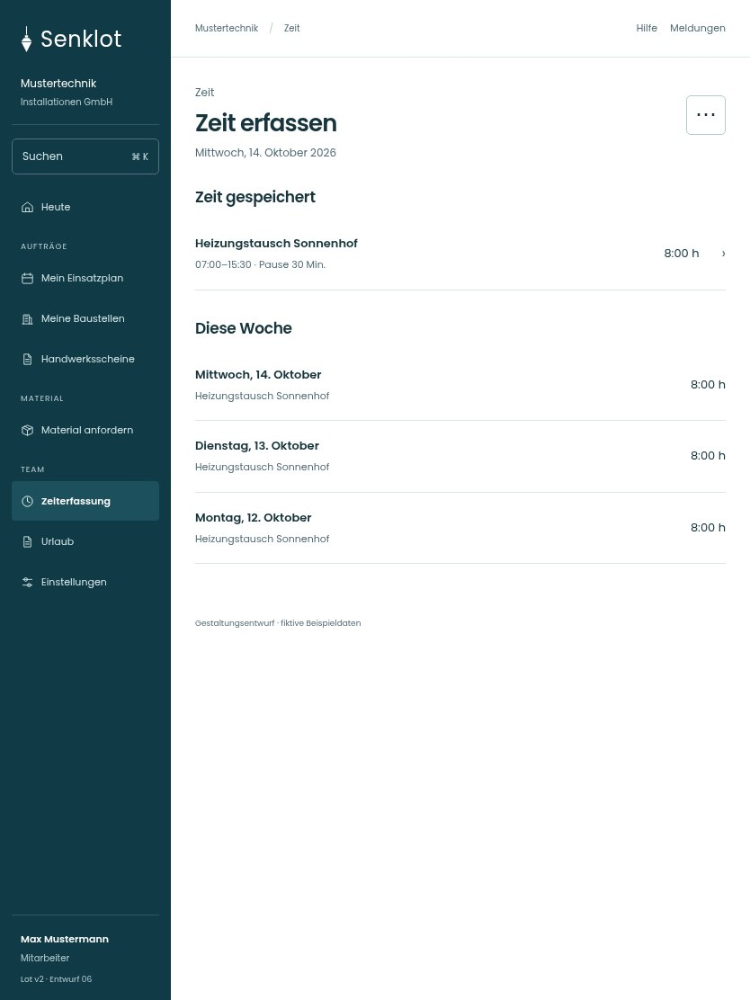

# 104 · Zeit erfassen

[Zur Gesamtübersicht](../README.md) · [Vollständiges Konzept](../Konzept.md)

**Bereich:** Zeit · **Bestandsort:** `/time · gespeichert`

Handy · 390 px

Tablet · 834 px

## Entscheidung

Eine kurze Bestätigung am Eintrag reicht; kein dauerhaftes Erfolgsbanner.

**Gezeigte Rolle:** Mitarbeiter. Sichtbarkeit und Aktionen bleiben an bestehende Rollen, Zusatzrechte, Module und Datensatzstatus gebunden.

**Hauptaktion:** Keine zusätzliche Hauptaktion.

**Weitere Aktionen:** Weitere Zeit erfassen.

**Handy/Tablet:** Zeilen statt zusätzlicher Karten; Hauptaktion bleibt gut erreichbar.

## Muss erhalten bleiben

- Nur tatsächlichen Servererfolg als gespeichert anzeigen
- Offline separat als wartet kennzeichnen

## Quelle

- [src/features/time/TimeView.tsx](https://github.com/juliandeutsch22/Prototype-App-Installateure/blob/d4b8542821d86c7057761af16de1331d1de87e09/src/features/time/TimeView.tsx)

Gestaltungsvorschau mit fiktiven Beispieldaten. Keine Änderung oder Auslieferung der App.
