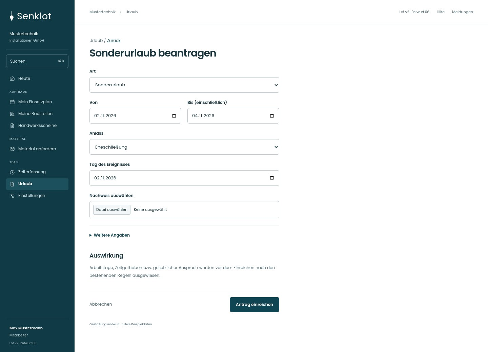
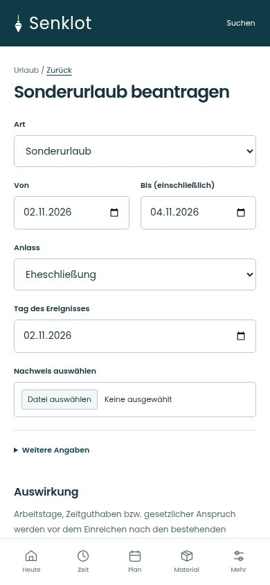
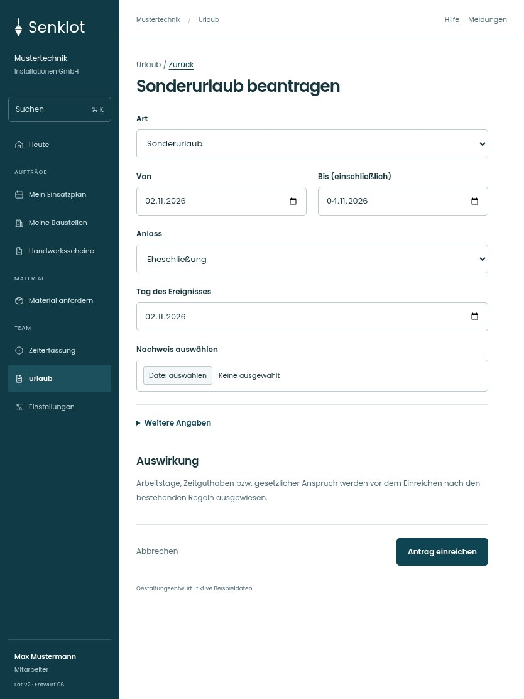

# 108 · Sonderurlaub beantragen

[Zur Gesamtübersicht](../README.md) · [Vollständiges Konzept](../Konzept.md)

**Bereich:** Urlaub · **Bestandsort:** `/vacations · Sonderurlaub`

Handy · 390 px

[Ganze Seite ansehen](../bilder/108-sonderurlaub-handy-gesamt.jpg)

Tablet · 834 px

## Entscheidung

Nur arbeitsrelevante Angaben; Details über die Zeile öffnen.

**Gezeigte Rolle:** Mitarbeiter. Sichtbarkeit und Aktionen bleiben an bestehende Rollen, Zusatzrechte, Module und Datensatzstatus gebunden.

**Hauptaktion:** Antrag einreichen.

**Handy/Tablet:** Zeilen statt zusätzlicher Karten; Hauptaktion bleibt gut erreichbar.

## Muss erhalten bleiben

- Überschneidungen prüfen
- Teilzeit/halbe Tage
- Resturlaub im richtigen Urlaubsjahr
- Unbezahlter Urlaub nur Spitze entscheidet
- Sonderurlaub bestätigen statt Ermessensurlaub

## Felder

- Art
- Von
- Bis (einschließlich)
- Anlass
- Tag des Ereignisses
- Nachweis auswählen
- Anmerkung · bei Bedarf

## Quelle

- [src/features/vacations/VacationsView.tsx](https://github.com/juliandeutsch22/Prototype-App-Installateure/blob/d4b8542821d86c7057761af16de1331d1de87e09/src/features/vacations/VacationsView.tsx)
- [src/features/vacations/FreistellungFormular.tsx](https://github.com/juliandeutsch22/Prototype-App-Installateure/blob/d4b8542821d86c7057761af16de1331d1de87e09/src/features/vacations/FreistellungFormular.tsx)

Gestaltungsvorschau mit fiktiven Beispieldaten. Keine Änderung oder Auslieferung der App.
