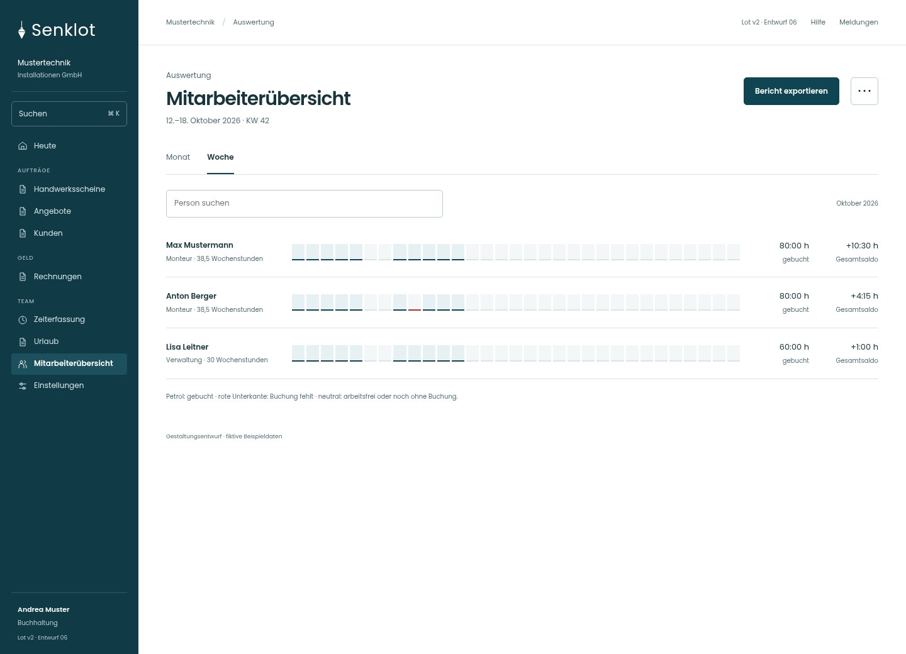
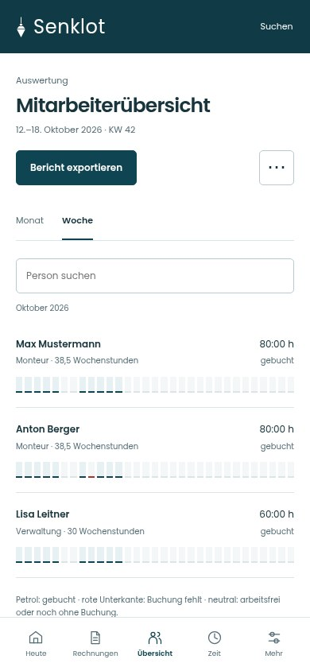
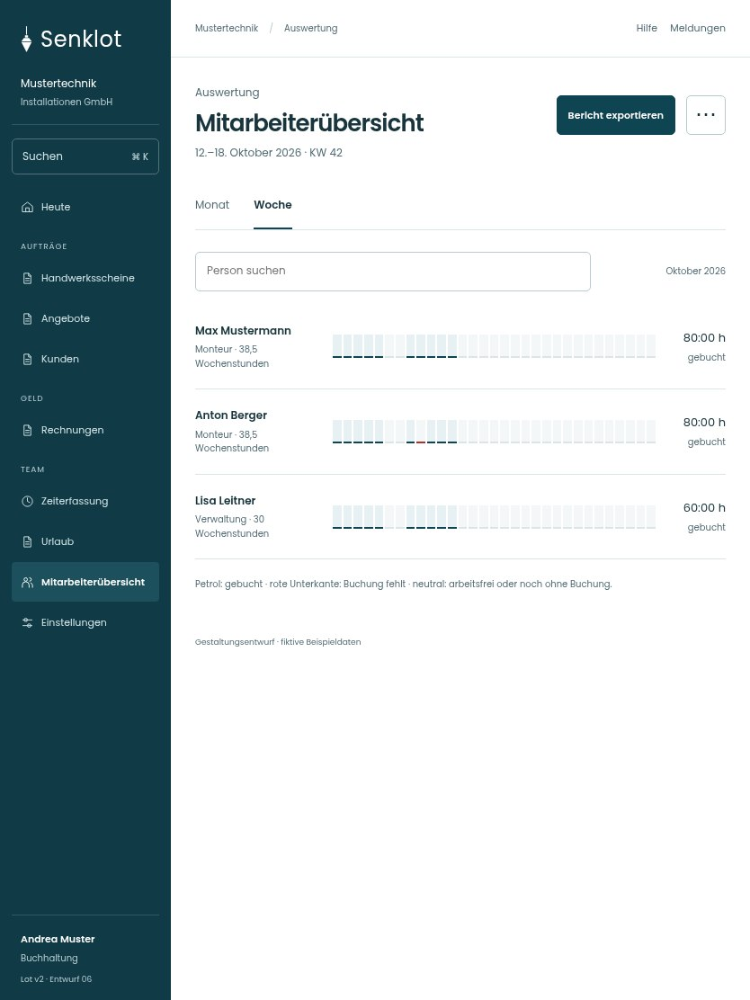

# 120 · Mitarbeiterübersicht

[Zur Gesamtübersicht](../README.md) · [Vollständiges Konzept](../Konzept.md)

**Bereich:** Auswertung · **Bestandsort:** `/accounting?ansicht=woche`

Handy · 390 px

[Ganze Seite ansehen](../bilder/120-mitarbeiter-woche-handy-gesamt.jpg)

Tablet · 834 px

## Entscheidung

Ein lesbarer Streifen je Person; Detail über die Zeile. Keine doppelte Tabelle neben denselben Kennzahlen.

**Gezeigte Rolle:** Buchhaltung. Sichtbarkeit und Aktionen bleiben an bestehende Rollen, Zusatzrechte, Module und Datensatzstatus gebunden.

**Hauptaktion:** Bericht exportieren.

**Weitere Aktionen:** Stunden je Baustelle.

**Handy/Tablet:** Zeilen statt zusätzlicher Karten; Hauptaktion bleibt gut erreichbar.

## Muss erhalten bleiben

- Ist/Soll/Saldo getrennt
- Fehlende Tage/Arbeitszeitgrenzen
- Zeitkonto nur für berechtigte Personen
- Kein Zeitkonto für Administration
- Support ohne sensible Tagesdetails

## Quelle

- [src/features/accounting/AccountingView.tsx](https://github.com/juliandeutsch22/Prototype-App-Installateure/blob/d4b8542821d86c7057761af16de1331d1de87e09/src/features/accounting/AccountingView.tsx)
- [src/features/accounting/UebersichtListe.tsx](https://github.com/juliandeutsch22/Prototype-App-Installateure/blob/d4b8542821d86c7057761af16de1331d1de87e09/src/features/accounting/UebersichtListe.tsx)
- [src/features/accounting/Streifen.tsx](https://github.com/juliandeutsch22/Prototype-App-Installateure/blob/d4b8542821d86c7057761af16de1331d1de87e09/src/features/accounting/Streifen.tsx)

Gestaltungsvorschau mit fiktiven Beispieldaten. Keine Änderung oder Auslieferung der App.
