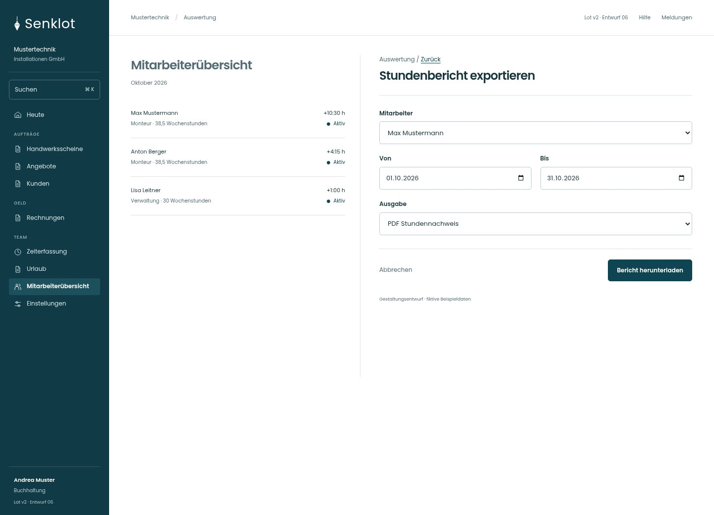
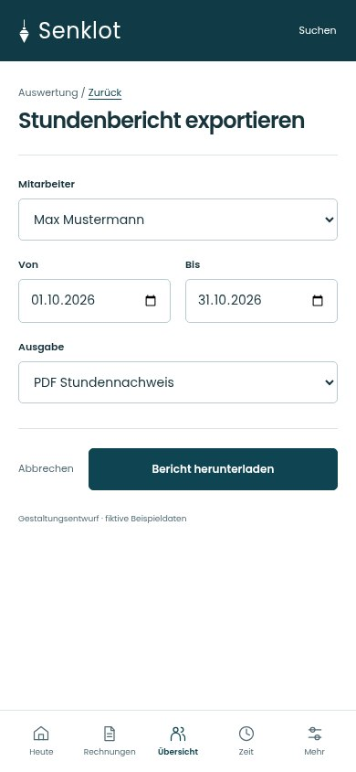
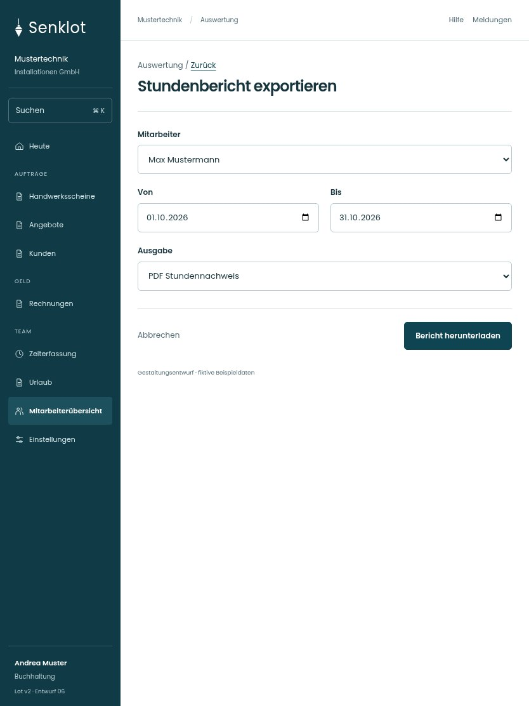

# 122 · Stundenbericht exportieren

[Zur Gesamtübersicht](../README.md) · [Vollständiges Konzept](../Konzept.md)

**Bereich:** Auswertung · **Bestandsort:** `/accounting · Export`

Handy · 390 px

Tablet · 834 px

## Entscheidung

Nur arbeitsrelevante Angaben; Details über die Zeile öffnen.

**Gezeigte Rolle:** Buchhaltung. Sichtbarkeit und Aktionen bleiben an bestehende Rollen, Zusatzrechte, Module und Datensatzstatus gebunden.

**Hauptaktion:** Bericht herunterladen.

**Handy/Tablet:** Zeilen statt zusätzlicher Karten; Hauptaktion bleibt gut erreichbar.

## Muss erhalten bleiben

- Bestehende PDF-/CSV-Berechnungen
- Zeitraum und Person
- Personen ohne Zeitkonto korrekt behandeln

## Felder

- Mitarbeiter
- Von
- Bis
- Ausgabe

## Quelle

- [src/features/accounting/ExportDialog.tsx](https://github.com/juliandeutsch22/Prototype-App-Installateure/blob/d4b8542821d86c7057761af16de1331d1de87e09/src/features/accounting/ExportDialog.tsx)

Gestaltungsvorschau mit fiktiven Beispieldaten. Keine Änderung oder Auslieferung der App.
